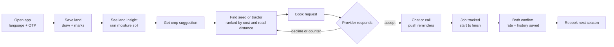

# FarmHelper — Product Requirements Document (PRD)

| Field         | Value                                                                  |
| ------------- | ---------------------------------------------------------------------- |
| Product       | FarmHelper (FarmMatch)                                                 |
| Document type | PRD — the _why, for whom, what, and in which order_                   |
| Version       | 0.1 (draft for team review)                                            |
| Date          | 2026-11-14                                                             |
| Owner         | Md Sadik Uz Zaman                                                      |
| Companion doc | `docs/doc.md` — the SRS (v0.2): exact requirements, data, architecture |
| Audience      | Project team, supervisors, pilot partners                              |

> **How the PRD and SRS fit together.** This PRD says _what product we are building, for whom, and in what order_. The SRS says _exactly how it must behave_ (requirement IDs `FR-*`, `NFR-*`, data model, algorithms, tests). When they disagree, fix both — then log it in the SRS change log. Feature numbers below (#1–#10) are your original request list; each maps to SRS requirement IDs (Appendix A).

---

## 1. Summary

**Vision.** Help every smallholder farmer in Bangladesh get the right service at a fair price, understand their own land, and sell their harvest — from one simple, Bangla-friendly mobile app.

**Today.** A working prototype finds and ranks nearby tractor, sprayer and seed providers using real road distance (OpenStreetMap + pgRouting). It has no accounts, no booking, no provider side.

**Next.** Grow it into a four-part platform:

| Pillar                         | What it is                                                              | Your requests |
| ------------------------------ | ----------------------------------------------------------------------- | ------------- |
| **A. Service marketplace**     | Providers publish services; farmers find, book, talk to, and track them | #1 #2 #3 #4 #5 |
| **B. Land intelligence**       | Farmers save their land, see NASA/soil data, get crop suggestions       | #6 #7 #8      |
| **C. Produce marketplace**     | Farmers sell to buyers (the reverse of pillar A) — experimental         | #9            |
| **D. Business & operations**   | Fees, transactions, transport, roles that keep the platform running     | #10           |

**The coherent story we want to be able to demo:**

> _A farmer saves her land → sees what the weather and soil are doing → gets a crop suggestion → finds the best tractor/seed provider → books → chats/calls → the provider does the job → both confirm → ratings and history are saved._

Everything in this PRD is judged by whether it strengthens that story.

---

## 2. Problem and opportunity

> **Evidence status: hypotheses.** Nothing below is validated yet. Phase 0 includes interviews to confirm or kill each statement (Section 12).

| Who      | Problem (hypothesis)                                                                                                              | Cost of the problem                                      |
| -------- | --------------------------------------------------------------------------------------------------------------------------------- | -------------------------------------------------------- |
| Farmer   | Finds services by word of mouth; no comparable prices; real travel distance is unclear; doesn't know what the land needs         | Lost time, overpaying, late sowing, wrong crop choice    |
| Farmer   | Sells produce through few intermediaries with weak price information                                                              | Lower farm-gate price                                    |
| Provider | Idle machines/days; customers found only through personal networks; bookings and money tracked on paper or memory                 | Lower utilisation and income, disputes                   |
| Buyer    | Sourcing is fragmented; quality, quantity and location are hard to compare                                                        | Higher sourcing effort                                   |
| Society  | Many small roles (drivers, loaders, local agents) are informal and invisible                                                      | Opportunity for new, trackable work                      |

**Why now / why us.** Mobile phones and mobile money are widespread; open data (OpenStreetMap, NASA, SoilGrids) removes the need to build our own data sources; we already have a working matching + routing engine that is hard to copy quickly.

---

## 3. Goals and non-goals

### 3.1 Goals

| ID | Goal                                                         | How we will know (initial targets — baseline in pilot)                      |
| -- | ------------------------------------------------------------ | --------------------------------------------------------------------------- |
| G1 | Farmers find a good provider fast                            | First match in ≤ 3 taps; match response < 2 s                               |
| G2 | Providers can run their business in the app                  | New provider onboarded in ≤ 10 min; ≥ 80% publish ≥ 1 offer                 |
| G3 | Bookings actually get completed in the app                   | ≥ 60% of accepted bookings reach `completed` with confirmation               |
| G4 | Farmers understand and reuse their land information          | Saved land attached to a request in ≤ 2 taps; insight screen understood in test |
| G5 | Crop suggestions are trusted and useful                      | ≥ 70% of tested farmers rate the suggestion "useful"; expert review passed  |
| G6 | The platform can sustain itself (hypothesis)                 | Commission/ledger reconciles 100% with recorded transactions in pilot        |
| G7 | Works on poor networks and low-end phones                    | Cold start < 5 s; fallbacks never leave a blank screen                       |

### 3.2 Non-goals (for now)

- Holding customers' money or running our own payment system.
- Crop-disease image diagnosis, fertiliser prescriptions, yield guarantees.
- Government subsidy workflows; multi-country; iOS store release.
- Algorithmic/AI crop prediction in v1 (rules first).

### 3.3 Product principles

1. **Map first, one action per screen.** The primary action is always obvious.
2. **Bangla and low-literacy first.** Icons, numbers with units, voice later; local units (decimal, bigha).
3. **Works on bad networks.** Cache, timeouts, fallbacks; never a blank screen.
4. **Transparent, not black-box.** Show where data came from (road/Haversine, NASA date, resolution) and _why_ a result was suggested.
5. **Advisory, not authoritative.** Crop and data insights carry confidence and caveats.
6. **Privacy by default.** Location and contact are shared only when needed, only with consent.
7. **Manual before automatic.** Ship the low-tech version (e.g., "set my current location") before the high-tech one (live tracking).
8. **Measure what matters** — privacy-safe analytics from day one.

---

## 4. Users and stakeholders

> Personas are **illustrative** — replace with interview findings.

| Role                    | Illustrative persona                                      | Main need                                         | Key features                  |
| ----------------------- | --------------------------------------------------------- | ------------------------------------------------- | ----------------------------- |
| **Farmer**              | Rahim, 42, Rangpur, 3 acres, mid-range Android, patchy 4G | Reliable service, fair price, know the land       | #2 #3 #6 #7 #8 #9             |
| **Provider (owner)**    | Karim, owns 2 tractors, hires 2 drivers                   | Steady jobs, fewer calls, clear records           | #1 #2 #3 #4 #5 #10            |
| **Operator / driver**   | Jamal, drives for Karim                                   | Know the next job; simple, fair tracking          | #4 #5                         |
| **Buyer**               | Salma, local trader / aratdar                             | Find produce by crop, quantity, location          | #9 #10                        |
| **Transporter**         | Owner of a pickup/truck                                   | Fill return trips, get paid reliably              | #10                           |
| **Field agent / ops**   | Nusrat, upazila-level agent                               | Onboard providers/farmers, verify, resolve issues | #4 #10                        |
| **Admin**               | Project team                                              | Trust and safety, analytics, finance              | #10                           |

---

## 5. Feature catalogue (your 10 requests)

| #  | Request                                              | Pillar | SRS IDs                      | Priority            | Target release |
| -- | ---------------------------------------------------- | ------ | ---------------------------- | ------------------- | -------------- |
| 1  | Provider profile management                          | A      | FR-14 (+ FR-04, FR-10)       | Must                | R0.3           |
| 2  | Customer–provider relationship management            | A      | FR-15                        | Should              | R0.4           |
| 3  | Communication system / booking                       | A      | FR-16, FR-09                 | Must                | R0.3           |
| 4  | Onboarding and working track (job tracking)          | A      | FR-17                        | Must / Should       | R0.3 / R0.4    |
| 5  | Tractor vs provider physical location (needs discussion) | A  | FR-18                        | Could               | R1.1           |
| 6  | NASA land / soil data implementation + visualisation | B      | FR-20                        | Should              | R0.5           |
| 7  | Saved land names and marks (reuse)                   | B      | FR-19                        | Should (foundation) | R0.2           |
| 8  | Crop suggestions from land data, weather, market     | B      | FR-21                        | Should (market: Could) | R0.5        |
| 9  | Farmer marketplace — reverse model (experimental)    | C      | FR-13                        | Could               | R2.0           |
| 10 | Business model: fees, transactions, transport, roles | D      | FR-22                        | Should (ledger) / Could (payments, transport) | R1.0 / R2.0 |

---

## 6. Feature specifications

Each spec: **problem → who → user stories → MVP slice → later → metric → dependencies → open questions.**

### #1 Provider profile management

- **Problem:** Providers are currently just rows seeded by script; they can't describe or manage their business.
- **Who:** Provider owner, field agent (assisted).
- **User stories**
  - As a provider, I can create a profile with my name, phone, photo, and one or more hub locations so farmers can trust and find me.
  - As a provider, I can list each service with price, unit, minimum charge, and set it available / busy / off-season.
  - As a provider, I can register my machines (equipment) and assign drivers.
  - As a farmer, I can open a provider profile and see services, price, rating, jobs done, and verification level.
- **MVP slice:** profile, one hub via GPS capture, per-service offers and availability toggle, public profile view.
- **Later:** equipment register, working hours/season calendar, verification badges, price history, staff accounts.
- **Metric:** profile completion rate; time to first published offer.
- **Depends on:** auth and roles (FR-08).
- **Open:** how providers are verified (D-04).

### #2 Customer–provider relationship management

- **Problem:** Every booking starts from zero; no memory of who served whom well.
- **Who:** Farmer, provider.
- **User stories**
  - As a farmer, I can favourite a provider and rebook them in one tap for the same land and service.
  - As a provider, I can see my customers, their history, and add private notes.
  - As both parties, I can rate the other after a job; serious problems can be reported and resolved.
- **MVP slice:** favourites, booking history, farmer→provider rating, rebook.
- **Later:** provider customer list with notes/tags, provider→farmer reliability (private), negotiated repeat prices, disputes, seasonal re-engagement reminders.
- **Metric:** repeat-booking share; average rating coverage (% of completed jobs rated).
- **Depends on:** booking + job completion (#3, #4).
- **Open:** two-way vs one-way ratings, visibility (D-32).

### #3 Communication system and booking

- **Problem:** Farmers and providers coordinate by phone only; nothing is recorded.
- **Who:** Farmer, provider, operator.
- **User stories**
  - As a farmer, I can request a booking from a match result and see its status and history.
  - As a provider, I can accept, decline, or counter with a new time/price.
  - As either party, I get a push notification (SMS fallback for key events) and can chat with quick replies or call with one tap.
- **MVP slice:** request → accept/decline/counter → cancel; booking timeline; push notifications; one-tap call after acceptance; simple thread with quick replies.
- **Later:** voice notes, location pin, read receipts, reminders, notification preferences, moderation.
- **Metric:** request-to-response time; acceptance rate; % of bookings with at least one in-app message.
- **Depends on:** auth, provider profile.
- **Open:** booking model and when phone numbers are revealed (D-02, D-21).

### #4 Onboarding and working track

- **Problem:** New users don't know what to do first; there is no record that the work actually happened.
- **Interpretation (please confirm — D-22):** "working track" = **job tracking**: tracking an accepted booking through scheduled → en route → working → completed, with actual quantity and farmer confirmation.
- **User stories**
  - As a new farmer, I can set language, sign in with OTP, and optionally save my first land in ≤ 4 screens.
  - As a new provider, I am guided step by step (wizard, resumable) until I have a published offer.
  - As a field agent, I can onboard a provider on their behalf with their OTP consent.
  - As a provider, I update job status and record actual acres/hours; the farmer confirms.
- **MVP slice:** farmer and provider onboarding; job record with start/finish and quantity; farmer confirmation.
- **Later:** assisted onboarding, photos, job timeline/ETA, completion summary feeding ratings, price tracking and the ledger.
- **Metric:** onboarding completion; % of accepted bookings with a confirmed job outcome.

### #5 Tractor location vs provider location (needs discussion)

- **Problem:** A provider's registered base (hub) may be far from where a machine currently is. Ranking by hub distance can mislead the farmer.
- **Hypothesis H-1:** using the machine's _current_ position improves distance accuracy and ETA and reduces mismatches.
- **Options**

| Option                              | Effort | Accuracy | Privacy / battery | Verdict                         |
| ----------------------------------- | ------ | -------- | ----------------- | ------------------------------- |
| A. Hub only (today)                 | None   | Low      | Best              | Baseline                        |
| B. Provider sets "currently at" manually (village/pin) | Low | Medium | Best | **Recommended first step**   |
| C. Operator phone shares location while on duty | High | High | Needs consent; battery | Later, after B proves value |
| D. Dedicated GPS device             | Very high | High | Cost, hardware    | Not now                         |

- **MVP slice:** equipment register + manual current location with a freshness timer (stale → fall back to hub).
- **Later:** operator "on duty" tracking with adaptive interval, farmer sees approximate position for active jobs only.
- **Metric (experiment):** fraction of matches where effective origin ≠ hub; distance-error reduction vs hub; farmer-reported "provider was where the app said".
- **Kill / continue criterion:** if B changes < 10% of top matches in pilot, don't build C.
- **Open:** D-23, D-24.

### #6 NASA land and soil data — implementation and visualisation

- **Problem:** Farmers can't see what rain, temperature and soil moisture have been doing on or near their land.
- **Important clarification.** NASA provides weather, soil **wetness/moisture** and vegetation indices. It does **not** provide detailed soil composition (texture, pH, organic carbon) — that comes from other open sources (e.g., ISRIC SoilGrids) or local soil surveys. The product therefore shows **NASA (dynamic) + soil-property (static)** data, labelled by source.
- **Honest limitation:** NASA grids are coarse (roughly 9 km to tens of km depending on product). Show it as **area context, not plot measurement**, always with source, date and resolution.
- **User stories**
  - As a farmer, I open a saved land and see rainfall (7/30 days), temperature, soil moisture, and vegetation as simple "dry / adequate / wet" indicators and charts.
  - As a farmer, I see the soil profile estimate with a clear "estimate" label.
- **MVP slice:** per-land summary + 30/90-day charts from server-cached data (NASA POWER), static soil estimate.
- **Later:** regional map layers, comparison with last year, alerts, farmer-entered soil test overrides.
- **Metric:** % of lands with fresh data (< 3 days); comprehension in usability test.
- **Depends on:** saved lands (#7); server-side ingestion.
- **Open:** which NASA products to ingest (D-25); forecast source (D-26).

### #7 Saved land names and marks

- **Problem:** Farmers re-enter location and area every time.
- **User stories**
  - As a farmer, I can draw or pin my land, name it ("North plot"), and see its area in decimal, bigha, or acre.
  - As a farmer, I can add marks — water source, gate, corner, problem spot — with notes.
  - As a farmer, I can pick a saved land when requesting a service; location and area auto-fill.
- **MVP slice:** create/edit/archive lands (polygon or point + area), unit conversion, marks, "use this land" in requests.
- **Later:** crop history, photos, offline edit + sync, GeoJSON/KML import.
- **Metric:** share of requests using a saved land; lands per farmer.
- **Open:** bigha conversion varies by region (D-20).

### #8 Crop suggestion

- **Problem:** Farmers choose crops by habit or hearsay.
- **Approach (v1):** a **transparent rules/score engine** over a crop-suitability table (season, soil, water need, rotation, duration) curated from agricultural authorities and **reviewed by an agriculture expert**. No black-box ML in v1.
- **User stories**
  - As a farmer, for a saved land I see ranked crops with reasons ("fits Rabi season, loam soil, adequate moisture"), a confidence level, and the sowing window.
  - As a farmer, I can jump from a suggested crop to nearby seed providers.
  - (Optional) I see a recent market-price signal, clearly labelled and off by default.
- **MVP slice:** 5–8 locally relevant crops, season + soil + moisture + rotation; confidence from data completeness; advisory disclaimer.
- **Later:** market signal (e.g., public wholesale prices), farmer feedback loop, rule versioning dashboard.
- **Metric:** usefulness rating; % of suggestions leading to a seed search.
- **Risk:** wrong advice harms farmers → expert review, disclaimers, no yield promises.
- **Open:** who is the agronomy reviewer (D-30).

### #9 Farmer marketplace (reverse model — experimental)

- **Problem:** Farmers have little reach to buyers.
- **Idea:** mirror pillar A — farmers publish produce listings; buyers browse, offer, and arrange pickup/transport.
- **MVP slice (if/when started):** listing (crop, quantity, asking price, date, pickup land), buyer browse by distance, offer → accept/counter/decline, listing lifecycle.
- **Later:** buyer demand posts, price benchmark, transport quotes, ratings.
- **Why experimental:** two-sided cold start; heavy trust/fraud needs; overlaps with entrenched trading relationships.
- **Success signal to continue:** in a 4-week mini-pilot, ≥ N listings and ≥ M offers (set N, M with the supervisor). Otherwise stop.
- **Depends on:** auth, chat, ledger, saved lands. **Do not start before pillar A is stable.**

### #10 Business model, transactions, transport, roles

- **Intent:** the platform manages the experience of every role and earns from facilitating transactions — creating work in transport, operations, and local agent roles.
- **Phased approach (important: we do not touch money until legal review)**

| Phase | Capability                                                                                         | Money handling by platform |
| ----- | -------------------------------------------------------------------------------------------------- | -------------------------- |
| A     | **Ledger-lite:** record agreed price, both-party "paid" confirmation (cash/mobile money), platform fee accrued | None (records only)        |
| B     | Payment through a **licensed payment provider** / mobile-money API; fee split; release on confirmed completion | Via licensed provider      |
| C     | **Logistics:** transport requests and quotes for produce/inputs, delivery tracking                  | Via B                      |

- **Roles created/supported:** operator/driver, transporter, loader/packer (future), field agent, support agent.
- **MVP slice:** fee rules, transaction record per booking, payment recording, immutable audit log, provider agreement acceptance.
- **Metric:** ledger reconciliation = 100%; commission collected vs due.
- **Open:** D-03, D-27, D-28, D-29.

---

## 7. Journeys

**Provider journey:** OTP sign-in → onboarding wizard (business, hub, services, prices) → publish → receive request notification → accept/counter → update job status → record actual quantity → get confirmation and rating → see customers and history.

**Buyer journey (experimental):** sign in → browse produce near me → send offer → farmer accepts → arrange pickup (optionally transport quote) → both confirm.

---

## 8. Roadmap and release plan

Dates are intentionally absent: the original 16-week plan can't hold ten new features. Effort is sized (S/M/L/XL) in the SRS (Section 9.2) and the schedule should be re-baselined by the team.

| Release | Theme                                   | Contents                                                                                      | Exit criteria                                       |
| ------- | --------------------------------------- | --------------------------------------------------------------------------------------------- | --------------------------------------------------- |
| R0.1    | Prototype (done)                        | Map, matching, road routing, simulator                                                         | Demo works                                          |
| R0.2    | Farmer core + lands                     | Real Home, GPS, validation, phone OTP, **saved lands + marks (#7)**, offline cache             | Farmer saves a land and runs a match with it        |
| R0.3    | Provider side + booking                 | **Provider profile (#1), onboarding (#4), booking + communication (#3)**                       | Provider publishes; farmer books; accept/decline works |
| R0.4    | Trust and records                       | **Job tracking (#4), relationships/ratings (#2)**, notifications, Bangla/English               | Booking reaches confirmed completion + rating       |
| R0.5    | Land intelligence                       | **NASA/soil data (#6), crop suggestion v1 (#8)**                                               | Insight + suggestion for a saved land; expert review done |
| R1.0    | Pilot                                   | Admin console, analytics, **ledger-lite (#10 phase A)**, hardening, staging, tests             | Pilot-ready; no P0 bugs                             |
| R1.1    | Fleet-aware matching                    | **Equipment + manual current location (#5)**; phone tracking only if kill criterion passes     | Hypothesis H-1 evaluated                            |
| R2.0    | Marketplace and business                | **Produce marketplace (#9), payments + transport (#10 B/C)**                                   | Subject to pilot results and legal review           |

### Recommended cut for the final-year evaluation

| Tier                              | Items                                                                                                      |
| --------------------------------- | ---------------------------------------------------------------------------------------------------------- |
| **Core — build and demo fully**   | #7 saved land · #1 provider profile · #3 booking (request-and-accept, push, call, simple thread) · #4 onboarding + basic job completion · #6 NASA summary for a saved land · #8 rule-based suggestions (5–8 crops) |
| **Prototype-level**               | #2 favourites + ratings · #5 manual current location only · #10 ledger-lite                                |
| **Design-only (documented, not built)** | #9 marketplace · #10 payments/logistics · live phone tracking                                        |

Why: the core tier tells one end-to-end story, keeps external dependencies small (no payments, no two-sided buyer market), and each item can be demonstrated on a physical Android device. **This is a recommendation — confirm as decision D-33.**

---

## 9. Success metrics

**North Star:** _confirmed completed bookings per month_ (later: gross transaction value).

| Stage       | Metric                                                                | Initial target (baseline in pilot) |
| ----------- | --------------------------------------------------------------------- | ---------------------------------- |
| Acquisition | Farmers and providers onboarded in the pilot area                     | Set with supervisor (D-10)         |
| Activation  | Farmer: first match ≤ 3 taps · Provider: first offer published        | 90% / 80%                          |
| Engagement  | Matches per farmer per month; bookings per provider per month         | Baseline                           |
| Retention   | Repeat booking within a season                                        | ≥ 30% of farmers                   |
| Quality     | Acceptance rate; completion rate; average rating; dispute rate        | ≥ 60% completion; dispute < 5%     |
| Land        | Lands saved per farmer; requests using a saved land                   | Baseline                           |
| Insight     | Fresh-data coverage; suggestion usefulness                            | ≥ 90% fresh; ≥ 70% useful          |
| Business    | Ledger reconciliation; fee accrued vs recorded                        | 100%                               |
| Guardrails  | Crash-free sessions; match p95 latency; battery cost of tracking; complaint rate | ≥ 99%; < 2 s; ≤ 5%/h; trend ↓ |

All analytics are privacy-safe: no raw farmer coordinates in exports.

---

## 10. Business model (hypotheses to test)

### 10.1 Value exchange

| From → To           | Value                                                          |
| ------------------- | -------------------------------------------------------------- |
| Platform → Farmer   | Faster discovery, fair prices, land insight, market access     |
| Platform → Provider | Customers, scheduling, records, reputation                     |
| Platform → Buyer    | Discoverable supply, price and location transparency           |
| Provider/Buyer/Farmer → Platform | Transaction fees, subscriptions, data (aggregated)  |

### 10.2 Revenue streams

| # | Stream                                          | Who pays      | Phase | Main risk                                      |
| - | ----------------------------------------------- | ------------- | ----- | ---------------------------------------------- |
| 1 | Commission on completed service bookings (**X %** — to be set) | Provider (or split) | A→B | Users move off-platform after first match      |
| 2 | Provider subscription / promoted listing        | Provider      | B     | Low willingness to pay at small scale          |
| 3 | Marketplace fee on produce trades               | Buyer/farmer  | C     | Cold start; trading relationships entrenched   |
| 4 | Transport margin or fee                         | Farmer/buyer  | C     | Operations complexity                          |
| 5 | Aggregated insights for NGOs, input companies, agencies | Institutions | Later | Privacy and data-governance obligations   |

### 10.3 Jobs and roles supported (potential, to be tracked in pilot)

| Role                      | How the platform creates or formalises work                        |
| ------------------------- | ------------------------------------------------------------------ |
| Operators / drivers       | Steady job assignment via provider accounts                         |
| Transporters              | Transport requests for produce and inputs                           |
| Loaders / packers         | Attached to transport or produce-handling requests (future)         |
| Field agents              | Assisted onboarding, verification visits, farmer training           |
| Support agents            | Dispute handling, customer support                                   |
| Crop/agronomy reviewers   | Maintain suitability rules                                           |

### 10.4 Unit economics (fill after pilot)

| Item                              | Value |
| --------------------------------- | ----- |
| Average booking value (Tk)        | TBD   |
| Commission rate                   | TBD   |
| Cost per OTP SMS / notification   | TBD   |
| Field agent cost per onboarded provider | TBD |
| Breakeven bookings per month      | TBD   |

### 10.5 Legal and regulatory (get advice before phase B)

- Collecting and holding customers' money may require licensing; **use a licensed payment provider / mobile-money API rather than holding funds.**
- Personal data (location, phone, documents) needs consent, retention rules, and deletion on request, aligned with applicable Bangladeshi rules.
- Provider agreement and terms of use must be accepted and recorded before the pilot.

---

## 11. Pilot and go-to-market

| Item              | Plan                                                                                                        |
| ----------------- | ----------------------------------------------------------------------------------------------------------- |
| Area              | Rangpur demo area, 1–2 upazilas (matches the road graph)                                                    |
| Strategy          | **Supply first:** recruit and assist real providers (field agent), then bring farmers through providers and local agriculture contacts |
| Data              | Replace synthetic providers with real ones before any farmer-facing pilot (decision D-01); label demo data clearly |
| Size and duration | Set with supervisor (D-10) — suggested starting point: ~10–20 providers, ~50–100 farmers, 4–6 weeks        |
| What we learn     | Completion rate, response time, price transparency, comprehension of land insights, usefulness of crop suggestions |
| Feedback loops    | Weekly check-ins with providers; in-app rating; short think-aloud sessions                                  |

---

## 12. Discovery plan (before building more)

| Activity                                | Target                        | Output                                          |
| --------------------------------------- | ----------------------------- | ----------------------------------------------- |
| Farmer interviews                       | ≥ 15                          | Confirm problems, units used, phone habits      |
| Provider interviews                     | ≥ 8                           | Booking habits, pricing, machine locations      |
| Buyer / trader interviews (for #9)      | ≥ 5                           | Go/no-go for marketplace                        |
| Agronomy expert session                 | 1–2                           | Crop rules source and reviewer                  |
| Legal/payment consult (for #10)         | 1                             | Allowed structure for phase B                   |
| Usability test of the current prototype | 5 farmers                     | Baseline for ≤ 3-tap goal                       |

---

## 13. Risks, assumptions, dependencies

| Top risks                                                           | Mitigation (details in SRS Section 10)                                  |
| ------------------------------------------------------------------- | ----------------------------------------------------------------------- |
| Scope explosion (ten large features, small team)                    | Tiering in Section 8; feature flags; stage gates                        |
| Two-sided cold start                                                | Supply first; assisted onboarding; one upazila                          |
| Low digital literacy and adoption                                   | Bangla, icons, quick replies, voice later, field agents                 |
| Wrong or over-trusted crop/land advice                              | Expert-reviewed rules, confidence + caveats, coarse-resolution labels    |
| Live-location privacy and battery                                   | Manual first; consent; TTL; adaptive interval                           |
| Payment / regulatory exposure                                       | Ledger-only until legal review; licensed provider                       |
| Users bypass the platform                                           | Real value-add (trust, history, payments); contact after acceptance     |
| External API limits/outages                                         | Server-side ingestion and caching; graceful degradation                 |

**Assumptions:** farmers have GPS Android phones; providers can be assisted to onboard; NASA/SoilGrids data is usable with attribution; OSM coverage is acceptable in the pilot area.

**Dependencies:** SMS/OTP provider, Firebase Cloud Messaging, Google Play developer account (for pilot distribution), an agronomy reviewer, legal advice for payments, supervisor approval of scope.

---

## 14. Decisions needed now

Full list in SRS Section 12. The ones that unblock the next two releases:

| ID   | Decision                                                      | Recommended default                          |
| ---- | ------------------------------------------------------------- | -------------------------------------------- |
| D-33 | Final-year scope cut (Section 8)                              | Core tier as proposed                        |
| D-19 | Anonymous browsing vs login gate                              | Browse anonymously; login to book/save/chat  |
| D-02 | Booking model                                                 | Request-and-accept                           |
| D-21 | When phone numbers are shown                                  | After acceptance                             |
| D-22 | Meaning of "working track"                                    | Job tracking                                 |
| D-23 | Equipment location approach                                   | Manual current location first                |
| D-25 | NASA products to ingest first                                 | POWER (weather + soil wetness) + SoilGrids   |
| D-30 | Who reviews crop rules                                        | Agriculture expert / supervisor              |
| D-01 | Synthetic vs real provider data for demo                      | Mixed: real pilot providers + labelled demo  |

---

## Appendix A — Mapping to SRS

| #  | PRD feature                      | SRS requirements                              |
| -- | -------------------------------- | --------------------------------------------- |
| 1  | Provider profile management      | FR-14, FR-04.5, FR-10                         |
| 2  | Relationship management          | FR-15                                         |
| 3  | Communication / booking          | FR-16, FR-09                                  |
| 4  | Onboarding and working track     | FR-17, FR-08                                  |
| 5  | Tractor vs provider location     | FR-18, SRS 6.9                                |
| 6  | NASA land / soil data            | FR-20, SRS 8.11                               |
| 7  | Saved land and marks             | FR-19                                         |
| 8  | Crop suggestion                  | FR-21, SRS 6.11                               |
| 9  | Farmer marketplace               | FR-13                                         |
| 10 | Business model and operations    | FR-22, FR-11                                  |

## Appendix B — Glossary

| Term           | Meaning                                                                            |
| -------------- | ---------------------------------------------------------------------------------- |
| Hub            | A provider's fixed base location                                                   |
| Equipment      | A movable machine (e.g., one tractor) belonging to a provider                      |
| Job            | The execution record of an accepted booking                                        |
| Land / Mark    | A farmer's saved plot / a pin or note on it                                        |
| Decimal (শতাংশ) | Local area unit; 100 decimal = 1 acre                                              |
| Bigha          | Local area unit that varies by region — conversion must be configurable            |
| Ledger-lite    | Recording transactions and fees without the platform holding the money             |
| PSP / MFS      | Payment service provider / mobile financial service (e.g., bKash, Nagad)           |
| Rabi / Kharif  | Bangladesh cropping seasons (winter / monsoon-related), used by the crop rules     |
