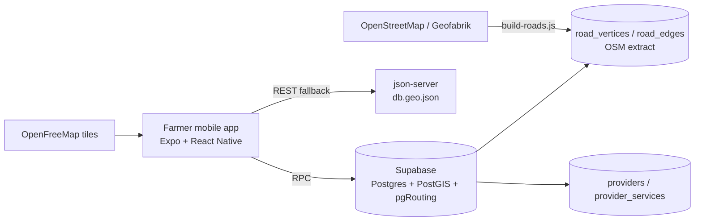
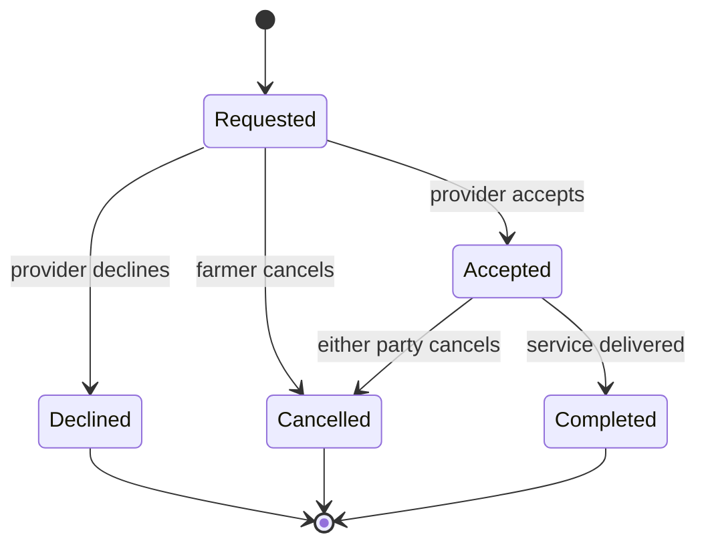
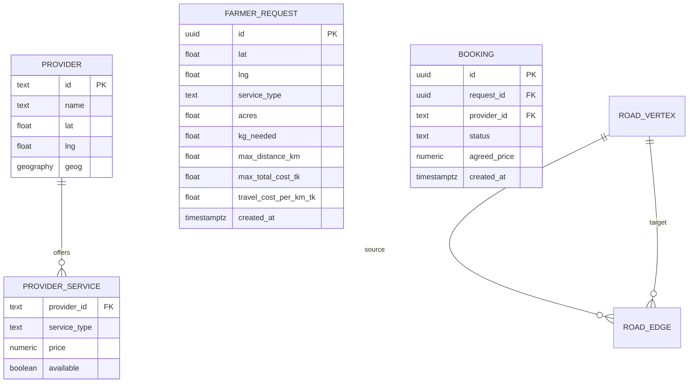
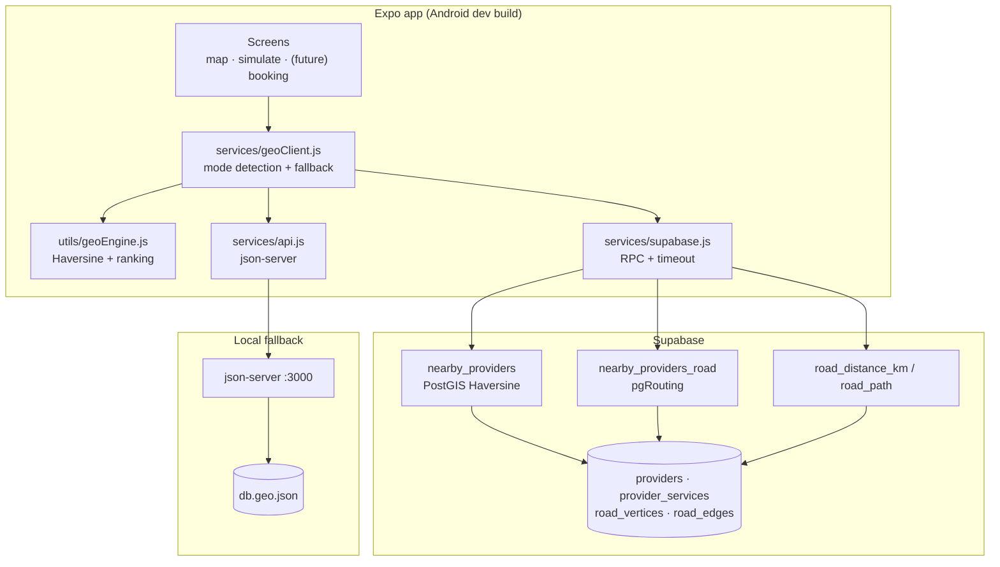
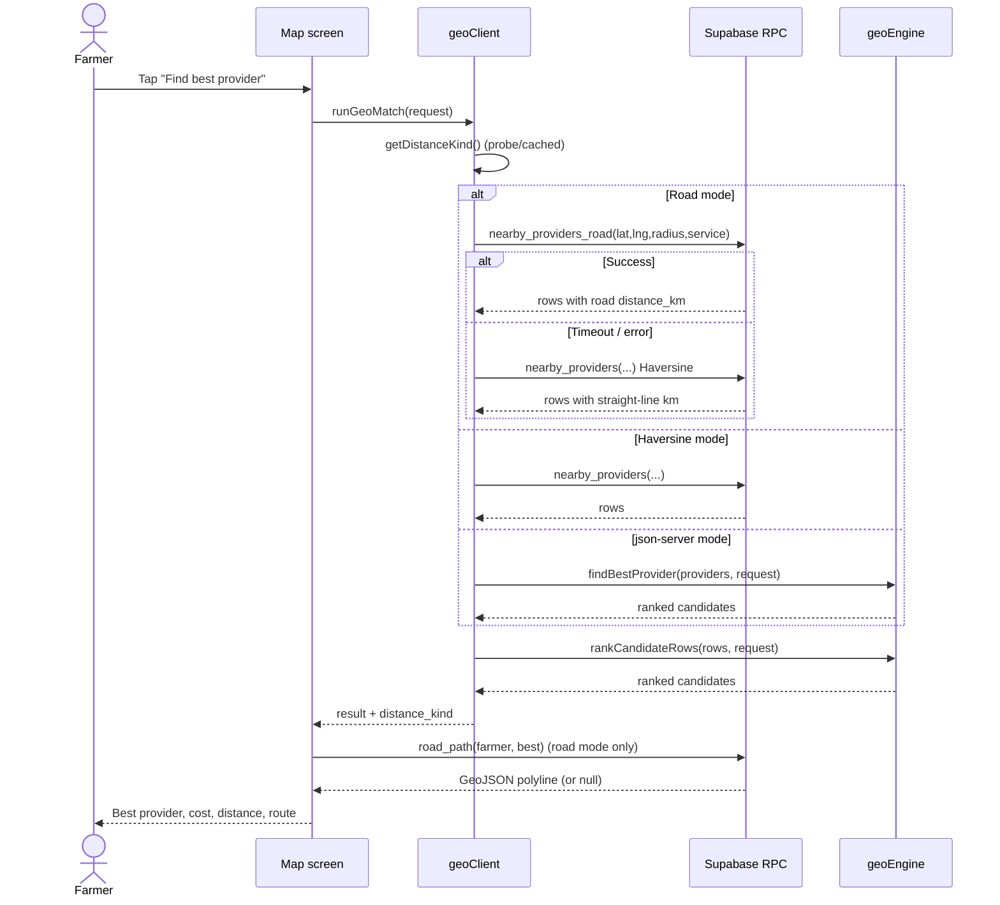
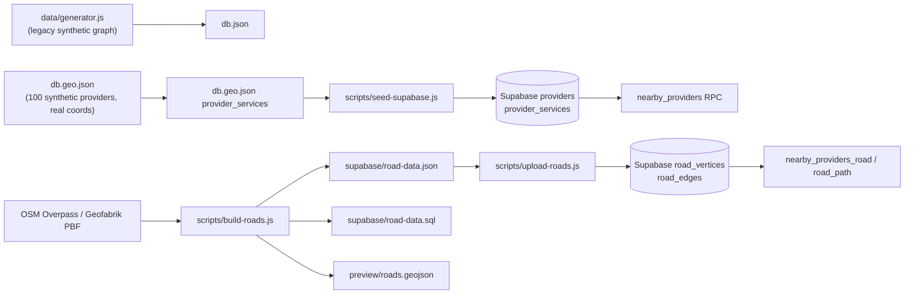

# FarmHelper — Software Requirements Specification (SRS) & Working Plan

| Field         | Value                                                   |
| ------------- | ------------------------------------------------------- |
| Project       | FarmHelper (FarmMatch)                                  |
| Document type | Living SRS + delivery plan                              |
| Version       | 0.1 (draft for team review)                             |
| Date          | 2026-11-12                                              |
| Status        | Draft — open for brainstorming                          |
| Owner         | Md Sadik Uz Zaman                                       |
| Audience      | Final-year project team, supervisors, fellow developers |
| Repository    | `FarmerHelper/` (Expo React Native + Supabase)          |

> **How to use this document**
> This file is intentionally a working draft. Sections marked **Current**, **Planned**, or **TBD** describe the implementation today, the intended product, and decisions that still need to be made. Requirement IDs (`FR-*`, `NFR-*`) are stable references for issues, PRs, and discussion. Change anything you disagree with — then update the change log at the end.
>
> **Looking for a fast handoff instead?** Read `docs/context.md` first. It is the operational map of the repo, current session state, known gaps, and next actions; this SRS holds the full requirements and design detail.

---

## 1. Introduction

### 1.1 Purpose

FarmHelper is a mobile-first platform that helps smallholder farmers in Bangladesh find and book nearby agricultural service providers — tractor owners, sprayer operators, and seed suppliers — based on distance, price, availability, and a farmer's budget.

This document specifies:

1. What the system must do (functional requirements).
2. How well it must do it (non-functional requirements).
3. How the current prototype is built and how data flows through it.
4. A phased working plan for turning the prototype into a complete, demonstrable product.
5. Known gaps, risks, and open decisions for the team to resolve.

### 1.2 Problem statement

A farmer who needs a tractor, sprayer, or seed usually relies on word of mouth. This creates three problems:

- **Search cost:** the farmer does not know who is nearby, available, or affordable.
- **Price uncertainty:** there is no transparent, comparable price signal.
- **Distance uncertainty:** straight-line distance is misleading in rural areas where roads, rivers, and one-way tracks change the real travel cost.

FarmHelper addresses this by combining a provider directory, a ranking engine, and real road-network distance (OpenStreetMap + pgRouting) in a simple map-first mobile experience.

### 1.3 Goals and success metrics

| Goal                                           | Metric (target — adjust after baseline)                                  |
| ---------------------------------------------- | ------------------------------------------------------------------------ |
| Find a relevant provider quickly               | Match response < 2 s on a 4G phone for the Rangpur dataset               |
| Recommend the best value, not just the nearest | Top result respects budget and availability 100% of the time             |
| Use realistic travel distance                  | Road-distance mode available for the demo area; falls back gracefully    |
| Be usable by non-technical farmers             | A first-time user can request a match in ≤ 3 taps after opening the map  |
| Be demonstrable for the final-year evaluation  | All acceptance scenarios in Appendix D pass on a physical Android device |

### 1.4 Scope

**In scope (target product):**

- Farmer-facing mobile app (Android first, iOS/web secondary).
- Service types: `tractor`, `sprayer`, `seed`.
- Provider discovery by location radius, service availability, price, and budget.
- Ranking by a weighted cost/distance score.
- Map with provider markers, farmer location, and route polyline.
- Real road distance and route geometry using OSM + pgRouting (Supabase).
- Fallback to straight-line (Haversine) distance when the road graph or network is unavailable.
- Data pipeline scripts: synthetic dataset generation, Supabase seeding, OSM road-graph build/upload, CLI preview.
- Simulation screen for scenario testing and evaluation.
- (Planned) provider onboarding, booking request lifecycle, authentication, admin/analytics, notifications.

**Out of scope for the current prototype:**

- Real payments and financial settlement.
- Government/registry integration.
- Physical logistics and fleet management.
- Full offline map tiles.
- Large-scale multi-district rollout.
- Native iOS release and app-store deployment.

### 1.5 Intended audience

| Reader                            | Read these sections             |
| --------------------------------- | ------------------------------- |
| Fellow developers                 | 2, 3, 4, 6, 8, 9                |
| Supervisor / evaluator            | 1, 2, 3, 7, 9, 10               |
| Product/brainstorming discussions | 1, 2, 3, 9, 12                  |
| Future maintainer                 | Everything, especially 5, 8, 13 |

### 1.6 Definitions and acronyms

| Term                   | Meaning                                                                                   |
| ---------------------- | ----------------------------------------------------------------------------------------- |
| **Farmer request**     | The input: location, service type, acres or kg, max distance, max total cost, travel rate |
| **Provider**           | An individual or business offering one or more agricultural services                      |
| **Service offer**      | A `(provider, service_type)` pair with price and availability                             |
| **Candidate**          | A provider that passes all eligibility filters                                            |
| **Match**              | The ranked candidate list plus the best provider                                          |
| **Haversine**          | Great-circle distance between two lat/lng points                                          |
| **pgRouting**          | PostgreSQL extension providing graph routing (`pgr_dijkstra`)                             |
| **PostGIS**            | PostgreSQL spatial extension (`geography`, `ST_DWithin`, `ST_DistanceSphere`)             |
| **Road graph**         | Vertices and edges built from OSM highway ways, used for Dijkstra                         |
| **RPC**                | Supabase/PostgREST callable SQL function                                                  |
| **json-server**        | Local REST mock server used as a development fallback                                     |
| **Degradation ladder** | Ordered fallback path: road → Haversine → local JSON matching                             |
| **MoSCoW**             | Must / Should / Could / Won't priority scheme                                             |

### 1.7 References

- Expo SDK 54 documentation: <https://docs.expo.dev/versions/v54.0.0/>
- Expo Router: <https://docs.expo.dev/router/introduction/>
- MapLibre React Native: <https://maplibre.org/maplibre-react-native/>
- Supabase: <https://supabase.com/docs>
- PostGIS: <https://postgis.net/documentation/>
- pgRouting: <https://docs.pgrouting.org/>
- OpenStreetMap licence (ODbL): <https://www.openstreetmap.org/copyright>
- OpenFreeMap styles: <https://openfreemap.org/>
- Repository draw.io/diagrams: **TBD**

---

## 2. Overall Description

### 2.1 Product perspective

FarmHelper is a new, self-contained system. It replaces manual phone calls and word-of-mouth discovery with a searchable provider directory and a ranking engine. It is not a booking marketplace yet; it is a **decision-support and discovery tool** that is being extended toward booking.



### 2.2 User classes and personas

| User class                 | Description                                                      | Current support                   |
| -------------------------- | ---------------------------------------------------------------- | --------------------------------- |
| **Farmer**                 | Requests a service, compares providers, later books              | Partial (map + match)             |
| **Provider**               | Publishes services, prices, availability, later accepts bookings | Not yet                           |
| **Administrator**          | Verifies providers, manages data, views analytics                | Not yet                           |
| **Researcher / developer** | Runs scenarios, benchmarks the engine, validates data            | Partial (simulator + CLI scripts) |

**Primary persona:** a smallholder farmer in Rangpur with a mid-range Android phone and intermittent 4G. They know the service they need and have a rough budget, but not who is nearby or what a fair price is.

### 2.3 Operating environment

| Aspect                 | Current choice                                                                         |
| ---------------------- | -------------------------------------------------------------------------------------- |
| Mobile framework       | Expo SDK ~54, React Native 0.81, React 19                                              |
| Routing                | Expo Router ~6 (file-based)                                                            |
| Map renderer           | `@maplibre/maplibre-react-native` 11.5 (requires a development build; **not** Expo Go) |
| Primary OS             | Android (package `com.sadikuzzamantarek.FarmerHelper`)                                 |
| Secondary              | iOS, web (Expo web output: static)                                                     |
| Backend                | Supabase (Postgres + PostGIS + pgRouting)                                              |
| Local fallback backend | `json-server` on a LAN IP, serving `db.geo.json`                                       |
| Map style              | OpenFreeMap Liberty (no API key)                                                       |
| Language/tooling       | TypeScript for app shell, JavaScript for services/engines, Node scripts                |

### 2.4 Design and implementation constraints

| ID   | Constraint                                                                                                      |
| ---- | --------------------------------------------------------------------------------------------------------------- |
| C-01 | MapLibre requires a native development build; features cannot be validated in Expo Go.                          |
| C-02 | Supabase anon key and service-role key must never be committed; only `.env.example` is tracked.                 |
| C-03 | The service-role key may be used only by Node scripts, never bundled into the app.                              |
| C-04 | The road graph currently covers only the Rangpur demo bounding box (~18 km span).                               |
| C-05 | Supabase free tier / network latency and PostgREST statement timeouts constrain RPC size.                       |
| C-06 | OSM data is ODbL-licensed; attribution is required in the app and documentation.                                |
| C-07 | Provider data is currently synthetic (`Provider_0`…`Provider_99`) and must not be presented as real businesses. |
| C-08 | The app must remain usable when Supabase is unreachable (degradation ladder).                                   |

### 2.5 Assumptions and dependencies

| ID   | Assumption / dependency                                                                                 |
| ---- | ------------------------------------------------------------------------------------------------------- |
| A-01 | Farmers have a GPS-capable Android phone and intermittent mobile data.                                  |
| A-02 | Coordinates can be represented as WGS84 lat/lng.                                                        |
| A-03 | A meaningful ranking can be built from cost + distance; other factors (rating, reliability) come later. |
| A-04 | The Rangpur demo area is sufficient for evaluation and demonstration.                                   |
| A-05 | Supabase remains the backend of record for the prototype.                                               |
| A-06 | OSM road data is accurate enough for rural routing in the demo area; isolated farms may be unreachable. |
| A-07 | Prices are in Bangladeshi Taka (Tk) and are per acre (tractor/sprayer) or per kg (seed).                |

### 2.6 Current implementation snapshot

**Status: working prototype.** The matching and road-routing concepts are implemented and exercised; the product surface (onboarding, booking, provider accounts) is not.

| Area                                  | Current state                                                                                                            | Evidence / files                                      |
| ------------------------------------- | ------------------------------------------------------------------------------------------------------------------------ | ----------------------------------------------------- |
| App shell                             | Expo Router with tabs; Home and Explore are still template screens                                                       | `app/(tabs)/index.tsx`, `app/(tabs)/explore.tsx`      |
| Map screen                            | MapLibre map, provider markers, center crosshair, booking options card, best/candidate results, road polyline            | `app/(tabs)/map.tsx`                                  |
| Simulator                             | Form-based scenario runner with timing output                                                                            | `app/(tabs)/simulate.jsx`                             |
| Tab configuration                     | Home, Explore, Simulate explicitly configured; `map` route exists but is not explicitly styled/ordered in the tab layout | `app/(tabs)/_layout.tsx`                              |
| Matching (server road)                | `nearby_providers_road` RPC via pgr_dijkstra                                                                             | `services/supabase.js`, `supabase/routing-schema.sql` |
| Matching (server Haversine)           | `nearby_providers` RPC via `ST_DistanceSphere`                                                                           | `supabase/schema.sql`                                 |
| Matching (local fallback)             | Haversine + score in JS                                                                                                  | `utils/geoEngine.js`                                  |
| Legacy engine                         | Synthetic-grid Dijkstra retained for reference                                                                           | `utils/farmMatchEngine.js`                            |
| Dataset                               | 100 synthetic providers on a 10×10 Rangpur grid; 210 service offers                                                      | `db.geo.json`, `data/generator.js`                    |
| Road graph                            | 33,220 vertices / 34,159 edges from OSM, loaded to Supabase                                                              | `supabase/road-data.json`, `scripts/build-roads.js`   |
| Seeding                               | Service-role seeding of providers and services                                                                           | `scripts/seed-supabase.js`                            |
| Preview                               | Browser preview and static map preview                                                                                   | `preview/index.html`                                  |
| Auth / booking / provider app / admin | Not implemented                                                                                                          | —                                                     |
| Automated tests / CI                  | Not implemented                                                                                                          | —                                                     |

**Known technical debt (do not mistake for requirements):**

- `services/api.js` hardcodes a LAN IP (`http://192.168.1.112:3000`) instead of using environment configuration.
- In Supabase mode, `loadGeoContext()` maps providers with `services: {}`, so the client-side `findBestProvider` fallback cannot rank them if both RPCs fail.
- `rankCandidateRows()` does not re-apply the `max_distance_km` filter after road distance is computed; road distance can exceed the straight-line prefilter radius.
- No request persistence, no auth, no input sanitisation beyond numeric coercion.
- No error boundaries, structured logging, or telemetry.
- No versioned DB migrations; SQL files are applied manually.

---

## 3. Functional Requirements

### 3.1 Feature map

| ID    | Feature                                    | Priority        | Status                  |
| ----- | ------------------------------------------ | --------------- | ----------------------- |
| FR-01 | Farmer request and service selection       | Must            | Partial                 |
| FR-02 | Provider discovery and matching            | Must            | Implemented (prototype) |
| FR-03 | Map and route visualization                | Must            | Implemented (prototype) |
| FR-04 | Provider and service data management       | Must            | Partial (seed only)     |
| FR-05 | Simulation and evaluation                  | Should          | Implemented (prototype) |
| FR-06 | Road-network data pipeline                 | Should          | Implemented (prototype) |
| FR-07 | Degraded/offline operation                 | Must            | Implemented (partial)   |
| FR-08 | Authentication and profiles                | Should          | Not started             |
| FR-09 | Booking and request lifecycle              | Must (target)   | Not started             |
| FR-10 | Provider workspace                         | Should (target) | Not started             |
| FR-11 | Admin and analytics                        | Could           | Not started             |
| FR-12 | Notifications, localization, accessibility | Should          | Not started             |
| FR-13 | Farmer Marketplace                         | Should          | Not Started             |

Priorities use MoSCoW and describe the **target product**, not the prototype.

---

### 3.2 FR-01 — Farmer request and service selection

**Description:** The farmer specifies what they need and the constraints under which a provider is acceptable.

| ID      | Requirement                                                                                                                                            | Priority | Acceptance criteria                                                                                                               |
| ------- | ------------------------------------------------------------------------------------------------------------------------------------------------------ | -------- | --------------------------------------------------------------------------------------------------------------------------------- |
| FR-01.1 | The farmer can choose a service type: tractor, sprayer, or seed.                                                                                       | Must     | Selecting a type updates the form: acres for tractor/sprayer, kg for seed.                                                        |
| FR-01.2 | The farmer's location defaults to the map center and can be changed by panning the map. It should use phone GPS and panning over the map as a fallback | Must     | The request uses the current center coordinates; a visible crosshair shows the chosen point. Later it should have GPS integration |
| FR-01.3 | The farmer can enter acres (tractor/sprayer) or kg needed (seed).                                                                                      | Must     | Non-numeric/empty input is rejected or coerced safely; value ≥ 0.                                                                 |
| FR-01.4 | The farmer can set a maximum travel distance in km.                                                                                                    | Must     | Value > 0; used as both a filter and a score normaliser.                                                                          |
| FR-01.5 | The farmer can set a maximum total cost in Tk.                                                                                                         | Must     | Value > 0; candidates above budget are excluded.                                                                                  |
| FR-01.6 | The farmer can set a travel cost rate in Tk/km.                                                                                                        | Must     | Default 10; used in the total cost formula. This control should be given to provider later updates.                               |
| FR-01.7 | The form validates input and explains invalid values.                                                                                                  | Should   | Inline messages; no request is sent with invalid values.                                                                          |
| FR-01.8 | The last-used request can be restored between sessions.                                                                                                | Could    | Local persistence; not required for first demo.                                                                                   |
| FR-01.9 | The farmer can reuse their current GPS location.                                                                                                       | Should   | Requests location permission and handles denial gracefully.                                                                       |

**Current:** `map.tsx` and `simulate.jsx` implement FR-01.1–FR-01.6 with text inputs. FR-01.7–FR-01.9 are not implemented.

---

### 3.3 FR-02 — Provider discovery and matching

**Description:** Given a request, find all eligible providers, rank them, and return the best option plus the full ranked list.

| ID       | Requirement                                                                                                            | Priority | Acceptance criteria                                                                                        |
| -------- | ---------------------------------------------------------------------------------------------------------------------- | -------- | ---------------------------------------------------------------------------------------------------------- |
| FR-02.1  | Only providers that offer the requested service are considered.                                                        | Must     | A provider without the service never appears.                                                              |
| FR-02.2  | Only offers marked available are considered.                                                                           | Must     | `available = false` is excluded.                                                                           |
| FR-02.3  | Candidates must be within the requested maximum distance.                                                              | Must     | Distance filter applied using the active distance source.                                                  |
| FR-02.4  | Candidates must be within the requested maximum total cost.                                                            | Must     | `serviceCost + travelCost ≤ max_total_cost_tk`.                                                            |
| FR-02.5  | Candidates are ranked by a weighted normalised score (lower is better).                                                | Must     | `score = 0.7 × cost/maxCost + 0.3 × distance/maxDistance`.                                                 |
| FR-02.6  | The best provider and the full ranked list are returned.                                                               | Must     | Result contains `best_provider`, `best_distance_km`, `best_total_cost_tk`, `ranked_candidates`, `success`. |
| FR-02.7  | The result reports which distance source was used. For development only production should have business logics hidden. | Should   | `distance_kind` ∈ `road`, `haversine`, `json-server`.                                                      |
| FR-02.8  | The solver is deterministic for identical inputs.                                                                      | Must     | Same request + same dataset → same ranking.                                                                |
| FR-02.9  | Rejected candidates can be explained (out of radius, over budget, unavailable).                                        | Could    | Useful for debugging and farmer trust.                                                                     |
| FR-02.10 | Ranking weights are configurable.                                                                                      | Could    | Defaults 0.7/0.3; admin or experiment override.                                                            |
| FR-02.11 | Additional ranking factors (rating, reliability, response time) are supported.                                         | Could    | Extend score without breaking result contract.                                                             |

**Current:** FR-02.1–FR-02.7 are implemented across `utils/geoEngine.js`, Supabase RPCs, and `services/geoClient.js`. FR-02.8 is effectively true. FR-02.9–FR-02.11 are not implemented.

**Open rule:** confirm whether `max_distance_km` must be re-checked after road distance (recommended: yes). See D-07.

---

### 3.4 FR-03 — Map and route visualization

**Description:** A map-first interface showing the farmer's chosen location, available providers, and the route to the selected provider.

| ID       | Requirement                                                                                                                                     | Priority | Acceptance criteria                                              |
| -------- | ----------------------------------------------------------------------------------------------------------------------------------------------- | -------- | ---------------------------------------------------------------- |
| FR-03.1  | Show an interactive map centered on the demo area.                                                                                              | Must     | Map renders without an API key using OpenFreeMap Liberty.        |
| FR-03.2  | Show all known providers as markers.                                                                                                            | Must     | Marker count matches the provider dataset.                       |
| FR-03.3  | Show a fixed crosshair identifying the farmer's location. GPS integration can change this criteia and fallback should have crosshair in the map | Must     | Crosshair stays at screen center while the map pans.             |
| FR-03.4  | Show the best provider and route after a successful match.                                                                                      | Must     | Polyline drawn from farmer to best provider.                     |
| FR-03.5  | Use the real road polyline when available; otherwise draw a dashed straight line(fallback).                                                     | Should   | Solid route when `road_path` returns geometry; dashed otherwise. |
| FR-03.6  | Distinguish markers by service availability.                                                                                                    | Should   | Legend and marker styling make availability clear.               |
| FR-03.7  | Tap a marker to see provider details.                                                                                                           | Should   | Name, services, prices, availability, distance.                  |
| FR-03.8  | Show the current backend/distance mode.                                                                                                         | Should   | Status badge reflects road/Haversine/json-server.                |
| FR-03.9  | Attribute OpenStreetMap data.                                                                                                                   | Must     | Visible OSM/ODbL attribution in the app.                         |
| FR-03.10 | Support offline map tiles for the demo area.                                                                                                    | Could    | Not required for first evaluation.                               |

**Current:** FR-03.1–FR-03.6 and FR-03.8 are implemented; FR-03.7 and FR-03.9 are not fully implemented.

---

### 3.5 FR-04 — Provider and service data management

**Description:** Maintain accurate provider records and service offers.

| ID      | Requirement                                                              | Priority        | Acceptance criteria                                            |
| ------- | ------------------------------------------------------------------------ | --------------- | -------------------------------------------------------------- |
| FR-04.1 | Store providers with id, name, lat, lng, and a spatial geography column. They should have the GPS integration of the service providing hub | Must            | `providers` table populated; GiST index exists.                |
| FR-04.2 | Store one row per provider/service with price and availability.          | Must            | `provider_services` primary key `(provider_id, service_type)`. |
| FR-04.3 | Seed the database from a versioned dataset.                              | Must            | `npm run seed-supabase` is idempotent (upsert).                |
| FR-04.4 | Validate coordinates and prices on write. Not necessary if GPS integration worked                                | Should          | lat ∈ [-90, 90], lng ∈ [-180, 180], price > 0.                 |
| FR-04.5 | Providers can register and edit their own offers.                        | Should (target) | Provider workspace; not started.                               |
| FR-04.6 | Administrators can verify, suspend, or remove providers.                 | Should (target) | Admin action audit trail.                                      |
| FR-04.7 | Price history is retained.                                               | Could           | Time-series table; supports fair-price insights.               |
| FR-04.8 | Duplicate providers can be detected/merged.                              | Could           | Proximity + name similarity check.                             |
| FR-04.9 | A provider may have multiple tractor running around. They need to have a controll over that how they are going to implement the availability                              | Could           | Provider listing their individual tractor as available or not                             |
| FR-04.10 | Provider has the tructor running around and the physical service provider area may differ, here while selecting the service by the farmer the farmer should see the current location of the tractor                         | Could           | Sub profile for drivers of the tractor and their gps location may updated over and over. Parked and running status can define the difference |

**Current:** FR-04.1–FR-04.3 are implemented; the rest is planned.

---

### 3.6 FR-05 — Simulation and evaluation

**Description:** A non-production screen and CLI that run scenarios and expose timings for evaluation and debugging.

| ID      | Requirement                                           | Priority | Acceptance criteria                                                |
| ------- | ----------------------------------------------------- | -------- | ------------------------------------------------------------------ |
| FR-05.1 | Run a match from a form with all request fields.      | Should   | Simulator screen returns best + ranked list.                       |
| FR-05.2 | Show per-stage timings.                               | Should   | Matching time displayed in ms.                                     |
| FR-05.3 | Provide repeatable CLI scenarios.                     | Should   | `npm run preview-match` prints ranked results for fixed scenarios. |
| FR-05.4 | Allow synthetic dataset regeneration.                 | Could    | `data/generator.js` produces `db.json`.                            |
| FR-05.5 | Support batch evaluation over many generated farmers. | Could    | CSV/JSON summary of success rate, average cost, latency.           |
| FR-05.6 | Compare road vs Haversine results side by side.       | Could    | Report distance delta and ranking changes.                         |

**Current:** FR-05.1–FR-05.4 exist; FR-05.5–FR-05.6 do not.

---

### 3.7 FR-06 — Road-network data pipeline

**Description:** Build a routable graph from OpenStreetMap for the demo area and load it into Supabase.

| ID       | Requirement                                                              | Priority | Acceptance criteria                                        |
| -------- | ------------------------------------------------------------------------ | -------- | ---------------------------------------------------------- |
| FR-06.1  | Build the graph from OSM highway ways inside the demo bounding box.      | Should   | `npm run build-roads` writes vertices/edges/SQL/GeoJSON.   |
| FR-06.2  | Use Overpass with mirrors, falling back to the Geofabrik Bangladesh PBF. | Should   | Script completes when Overpass is unavailable.             |
| FR-06.3  | Treat each OSM segment as a directed edge with km cost.                  | Must     | `cost` = haversine length; `reverse_cost` honours one-way. |
| FR-06.4  | Upload the graph to Supabase in batches.                                 | Should   | `npm run upload-roads` seeds `road_vertices`/`road_edges`. |
| FR-06.5  | Snap arbitrary points to the nearest road vertex.                        | Must     | `nearest_vertex_id(lng, lat)` returns a vertex id.         |
| FR-06.6  | Compute shortest road distance and full route geometry.                  | Must     | `road_distance_km` and `road_path` return valid results.   |
| FR-06.7  | Never lose a candidate due to an unreachable road segment.               | Must     | Fallback to Haversine for that provider.                   |
| FR-06.8  | Report graph statistics and sanity checks.                               | Should   | Vertex/edge counts, total km, sample road ≥ straight-line. |
| FR-06.9  | Rebuild and re-upload are idempotent.                                    | Should   | Truncate/upsert; no duplicate edges.                       |
| FR-06.10 | Support incremental updates without rebuilding everything.               | Could    | Future scalability.                                        |

**Current:** implemented as a prototype. Graph build, upload, and routing RPCs work; idempotency and incremental updates need verification.

---

### 3.8 FR-07 — Degraded/offline operation

**Description:** The app must never hang or crash because a backend is slow or unreachable.

| ID      | Requirement                                                         | Priority | Acceptance criteria                                   |
| ------- | ------------------------------------------------------------------- | -------- | ----------------------------------------------------- |
| FR-07.1 | Every network call has a timeout.                                   | Must     | Supabase 8 s wrapper; axios 5 s timeout.              |
| FR-07.2 | If road routing fails/times out, retry with Haversine. The farmers phone can store a data over a cycle of week about the providers details from where it can get the data if the device is offline. Or it should update new providers in his certain radius area after consequent 10-15 login and save the latest data              | Must     | Result reports `haversine`; no user-facing crash.     |
| FR-07.3 | If Supabase is unavailable, use json-server or inbuilt sqlite data and local ranking. | Must     | Result reports `json-server` for development production should have a stable database like asynchronous storage or sqlite database inbuilt with android.                         |
| FR-07.4 | If all backends fail, show the map and a clear status message.      | Must     | Status badge: backend unreachable; map still renders. |
| FR-07.5 | Cache the last successful provider dataset.                         | Could    | App usable after a cold start with no network.        |
| FR-07.6 | Queue match requests for retry.                                     | Could    | Not required for first evaluation.                    |

**Current:** FR-07.1–FR-07.4 implemented; FR-07.5–FR-07.6 not.

---

### 3.9 FR-08 — Authentication and profiles (Planned)

| ID      | Requirement                                              | Priority | Notes                                                    |
| ------- | -------------------------------------------------------- | -------- | -------------------------------------------------------- |
| FR-08.1 | Farmers can sign in with phone/OTP (preferred) or email. or any more simplified way of authentication | Should   | Supabase Auth; phone OTP may require SMS provider setup. |
| FR-08.2 | Providers have accounts linked to provider records.      | Should   | Role-based access.                                       |
| FR-08.3 | Admin accounts are separate and protected.               | Should   | RLS policies.                                            |
| FR-08.4 | Anonymous browsing/matching is allowed for now. Decision will be taken after discussion                  | Should   | Lower friction; auth required only for booking.          |
| FR-08.5 | Profile stores name, language, default location.         | Could    | Privacy controls.                                        |

### 3.10 FR-09 — Booking and request lifecycle (Planned)

| ID      | Requirement                                                | Priority      | Notes                                                 |
| ------- | ---------------------------------------------------------- | ------------- | ----------------------------------------------------- |
| FR-09.1 | Farmer can create a booking request from a match result.   | Must (target) | Persist request + selected provider + price snapshot. |
| FR-09.2 | Provider can accept, decline, or propose a new time/price. | Must (target) | State machine below.                                  |
| FR-09.3 | Farmer can cancel before acceptance.                       | Should        | Cancellation reason.                                  |
| FR-09.4 | Both parties see request status and history.               | Must (target) | Timeline view.                                        |
| FR-09.5 | Availability is reserved/updated on acceptance.            | Should        | Prevent double booking.                               |
| FR-09.6 | Rating/review after completion.                            | Could         | Feeds future ranking.                                 |
| FR-09.7 | Payment is recorded (cash/mobile money), not processed.    | Could         | Out of payment-gateway scope.                         |

**Proposed booking state machine (draft):**



### 3.11 FR-10 — Provider workspace (Planned)

| ID      | Requirement                                                              | Priority |
| ------- | ------------------------------------------------------------------------ | -------- |
| FR-10.1 | Provider creates/updates service offers and prices.                      | Should   |
| FR-10.2 | Provider toggles availability (available/busy/off-season).               | Should   |
| FR-10.3 | Provider sets a service radius.                                          | Should   |
| FR-10.4 | Provider receives and responds to booking requests.                      | Should   |
| FR-10.5 | Provider sees earnings/usage summary.                                    | Could    |
| FR-10.6 | Provider verification documents (NID/licence) are uploaded and reviewed. | Could    |

### 3.12 FR-11 — Admin and analytics (Planned)

| ID      | Requirement                                                                | Priority |
| ------- | -------------------------------------------------------------------------- | -------- |
| FR-11.1 | Admin dashboard lists providers, services, and verification status.        | Could    |
| FR-11.2 | Admin can suspend/verify providers.                                        | Could    |
| FR-11.3 | Analytics: matches, success rate, average distance/cost, popular services. | Could    |
| FR-11.4 | Privacy-safe export for research/evaluation.                               | Could    |
| FR-11.5 | Audit log of admin actions.                                                | Could    |
| FR-11.6 | Price tracking over the time of different service. This may help to collect data for certain internal research scenario.                                                | Could    |
### 3.13 FR-12 — Notifications, localization, accessibility (Planned)

| ID      | Requirement                                                          | Priority |
| ------- | -------------------------------------------------------------------- | -------- |
| FR-12.1 | Push/SMS notification on booking status change.                      | Should   |
| FR-12.2 | Bangla and English UI.                                               | Should   |
| FR-12.3 | Screen-reader labels and sufficient contrast.                        | Should   |
| FR-12.4 | Large-touch-target, low-literacy-friendly UI (icons + minimal text). | Should   |
| FR-12.5 | Offline-friendly error copy.                                         | Could    |

---

## 4. External Interface Requirements

### 4.1 User interface — screens

| Screen              | Route                     | Purpose                        | Status               |
| ------------------- | ------------------------- | ------------------------------ | -------------------- |
| Home                | `app/(tabs)/index.tsx`    | Landing/dashboard              | Template placeholder |
| Explore             | `app/(tabs)/explore.tsx`  | Expo template documentation    | Template placeholder |
| Map                 | `app/(tabs)/map.tsx`      | Map-first matching and results | Prototype            |
| Simulator           | `app/(tabs)/simulate.jsx` | Scenario testing with timings  | Prototype            |
| Modal               | `app/modal.tsx`           | Template modal                 | Placeholder          |
| Provider onboarding | TBD                       | Registration and offers        | Not started          |
| Booking detail      | TBD                       | Request status/timeline        | Not started          |
| Admin               | TBD (web)                 | Data/admin operations          | Not started          |

**UI principles (proposed):**

- Map first; controls in a collapsible bottom sheet.
- One primary action per screen (“Find best provider”).
- Every number has a unit and a plain-language label.
- Never show a spinner without a timeout/fallback path.
- Show data provenance (road/Haversine/demo data) so results are interpretable.

### 4.2 API interfaces

**Supabase RPCs (primary):**

| RPC                     | Inputs                                       | Output                                              | Purpose                                |
| ----------------------- | -------------------------------------------- | --------------------------------------------------- | -------------------------------------- |
| `nearby_providers`      | `p_lat`, `p_lng`, `p_radius_km`, `p_service` | `id, name, lat, lng, distance_km, price, available` | Haversine candidates via PostGIS       |
| `nearby_providers_road` | same as above                                | same as above, `distance_km` = road km              | Road-distance candidates via pgRouting |
| `road_distance_km`      | `f_lng`, `f_lat`, `t_lng`, `t_lat`           | `double precision` (km, `-1` unreachable)           | Shortest road distance                 |
| `road_path`             | `f_lng`, `f_lat`, `t_lng`, `t_lat`           | GeoJSON `LineString` text or `null`                 | Route polyline for the map             |
| `nearest_vertex_id`     | `p_lng`, `p_lat`                             | `integer`                                           | Snap point to road graph               |

**Local fallback REST (json-server):**

| Endpoint         | Returns                                              |
| ---------------- | ---------------------------------------------------- |
| `GET /providers` | Provider map with coordinates and services           |
| `GET /meta`      | Region, center, grid metadata                        |
| `GET /graph`     | Legacy synthetic graph (not used by the current map) |

**Client service contracts:**

- `loadGeoContext()` → `{ region, center, providers, source }`
- `runGeoMatch(req, providers)` → `{ best_provider, best_distance_km, best_total_cost_tk, ranked_candidates, dijkstra_time_ms, ranking_time_ms, success, distance_kind }`
- `fetchRoadPath(from, to)` → GeoJSON `LineString` or `null`

### 4.3 Data interfaces

| Format                    | Use                                                              |
| ------------------------- | ---------------------------------------------------------------- |
| `db.geo.json`             | Real-coordinate synthetic dataset (`meta`, `nodes`, `providers`) |
| `db.json`                 | Legacy synthetic graph/providers/farmers                         |
| `supabase/road-data.json` | Generated road graph (`vertices`, `edges`)                       |
| `supabase/road-data.sql`  | SQL-editor alternative for loading the graph                     |
| `preview/roads.geojson`   | Visual verification of road edges                                |
| GeoJSON `LineString`      | Route returned by `road_path`                                    |
| WKT `LINESTRING`          | Internal edge geometry storage                                   |
| SQL                       | Schema and routing functions applied manually                    |

### 4.4 Configuration

| Variable                        | Where                 | Purpose                                         |
| ------------------------------- | --------------------- | ----------------------------------------------- |
| `EXPO_PUBLIC_SUPABASE_URL`      | `.env` / EAS          | Supabase project URL                            |
| `EXPO_PUBLIC_SUPABASE_ANON_KEY` | `.env` / EAS          | Public client key (RLS-protected)               |
| `SUPABASE_SERVICE_ROLE_KEY`     | `.env` only (scripts) | Seed/upload scripts; never in app bundle        |
| `MAP_STYLE_URL` (proposed)      | TBD                   | Map style override instead of hardcoding        |
| `API_BASE_URL` (proposed)       | TBD                   | json-server URL instead of the hardcoded LAN IP |

`.env` is git-ignored; `.env.example` is committed. This must remain true.

### 4.5 Third-party services and licences

| Service       | Use                    | Licence/terms                   |
| ------------- | ---------------------- | ------------------------------- |
| OpenFreeMap   | Map style/tiles        | Free, attribution per provider  |
| OpenStreetMap | Road data              | ODbL — attribution required     |
| Geofabrik     | Bangladesh PBF extract | OSM ODbL                        |
| Overpass API  | OSM query              | Fair-use; use mirrors and cache |
| Supabase      | Database, RPC, auth    | Free tier limits apply          |
| Expo / EAS    | Build and distribution | Expo terms                      |

---

## 5. Data Requirements

### 5.1 Conceptual entities



`FARMER_REQUEST` and `BOOKING` are **proposed** and not yet in `schema.sql`.

### 5.2 Physical schema (current)

| Table               | Columns                                                                                                                  | Notes                           |
| ------------------- | ------------------------------------------------------------------------------------------------------------------------ | ------------------------------- |
| `providers`         | `id text PK`, `name text`, `lat float8`, `lng float8`, `geog geography(point,4326) generated`                            | GiST index `providers_geog_idx` |
| `provider_services` | `provider_id text FK`, `service_type text check`, `price numeric`, `available boolean`, PK `(provider_id, service_type)` | Cascade delete                  |
| `road_vertices`     | `id int PK`, `lon float8`, `lat float8`, `geom geometry(point,4326) generated`                                           | GiST index                      |
| `road_edges`        | `id int PK`, `source int FK`, `target int FK`, `cost float8`, `reverse_cost float8`, `geom geometry(linestring,4326)`    | Source/target indexes           |

**RLS:** public read policies exist for `providers` and `provider_services`; `anon` can execute the read-only RPCs. Write access requires the service role (scripts) or a future authenticated provider policy.

### 5.3 Data volumes (current baseline)

| Dataset        | Volume                                               |
| -------------- | ---------------------------------------------------- |
| Providers      | 100 synthetic                                        |
| Service offers | 210 (seed 66, sprayer 73, tractor 71)                |
| Road vertices  | 33,220                                               |
| Road edges     | 34,159                                               |
| Demo area      | ~18 km × 18 km around Rangpur (25.7439 N, 89.2752 E) |
| Road data file | ~6.2 MB JSON / ~5.1 MB SQL                           |

### 5.4 Data quality rules

| ID    | Rule                                                                                                 |
| ----- | ---------------------------------------------------------------------------------------------------- |
| DQ-01 | Every provider has a unique id and non-null name.                                                    |
| DQ-02 | Coordinates are WGS84 and inside Bangladesh for this project.                                        |
| DQ-03 | Every service has a positive price and a boolean availability.                                       |
| DQ-04 | Seed prices are per kg; tractor/sprayer prices are per acre.                                         |
| DQ-05 | A road edge's `source` and `target` exist in `road_vertices`.                                        |
| DQ-06 | `reverse_cost` is `-1` for one-way against direction, otherwise equal to `cost`.                     |
| DQ-07 | Road distance must be ≥ straight-line distance for the same pair (sanity check).                     |
| DQ-08 | No provider is silently dropped when its nearest road vertex is unreachable; fall back to Haversine. |
| DQ-09 | Synthetic data is clearly labelled as demo data in the UI/docs.                                      |

### 5.5 Privacy and data classification

| Data                            | Sensitivity | Handling                                               |
| ------------------------------- | ----------- | ------------------------------------------------------ |
| Farmer location / request       | Personal    | Don't publish raw coordinates; aggregate for analytics |
| Provider phone/contact (future) | Personal    | Authenticated access only                              |
| Provider price/availability     | Business    | Public by design                                       |
| Auth credentials                | Secret      | Supabase Auth; never log                               |
| API keys                        | Secret      | `.env`; service role only in Node scripts              |

---

## 6. Business Rules and Algorithms

### 6.1 Eligibility filters (must all pass)

For each provider offer of the requested service:

1. The provider offers `service_type`.
2. `available = true`.
3. `distance_km ≤ max_distance_km`.
4. `total_cost_tk ≤ max_total_cost_tk`.

### 6.2 Distance calculation ladder

| Level | Method                                   | When used                                     | Reported as       |
| ----- | ---------------------------------------- | --------------------------------------------- | ----------------- |
| 1     | pgRouting Dijkstra on OSM road graph     | Road graph and RPC available                  | `road`            |
| 2     | PostGIS `ST_DistanceSphere` (Haversine)  | Road RPC fails/times out, or graph not loaded | `haversine`       |
| 3     | Client-side Haversine over `db.geo.json` | Supabase not configured or both RPCs fail     | `json-server`     |
| 4     | Show map only with last available data on local device                           | All backends unreachable                      | status badge only |

The chosen mode is cached after the first probe (`_distanceKind`) to avoid repeating a slow failing query. A timeout during a later match degrades that match and updates the cached mode.

### 6.3 Cost model

```
service_cost =
  seed              → price_per_kg  × kg_needed
  tractor/sprayer   → price_per_acre × acres

travel_cost = distance_km × travel_cost_per_km_tk

total_cost  = service_cost + travel_cost
```

### 6.4 Ranking score

```
cost_norm   = total_cost / max_total_cost_tk
distance_norm = distance_km / max_distance_km
score       = 0.7 × cost_norm + 0.3 × distance_norm
```

Lower score is better. Both normalisers are bounded by the farmer's own constraints, so scores are comparable within a single request, not across requests.

### 6.5 Tie-breaking and edge cases

| Case                            | Rule                                                                                                                            |
| ------------------------------- | ------------------------------------------------------------------------------------------------------------------------------- |
| Equal scores                    | Current implementation relies on array/sort order; **TBD** deterministic tie-breaker (e.g., shorter distance, then provider id) |
| No candidates                   | Return `success: false` with an empty list and a helpful message                                                                |
| Zero acres/kg                   | Cost is travel-only; validate whether this should be allowed                                                                    |
| Max cost/distance = 0           | Division by zero risk; validation must reject                                                                                   |
| Provider not connected to roads | Use Haversine for that provider (never drop silently)                                                                           |
| Road distance > straight line   | Expected; ensure the distance filter still applies                                                                              |
| One-way road                    | `reverse_cost = -1`, honoured by `pgr_dijkstra(..., directed := false)` with reverse-cost semantics                             |

### 6.6 Worked example

Request: tractor, 5 acres, at Rangpur center (25.7439, 89.2752), max 12 km, max 2,000 Tk, travel rate 10 Tk/km.

For Provider_6 (tractor at 254 Tk/acre, ~3.2 km straight):

```
service_cost = 254 × 5            = 1,270 Tk
travel_cost  = 3.2 × 10           =    32 Tk
total_cost                        = 1,302 Tk
score = 0.7 × (1302/2000) + 0.3 × (3.2/12)
      = 0.4557 + 0.0800 = 0.5357
```

### 6.7 Matching pseudocode

```
function match(request, dataset):
    candidates = []

    for provider in dataset:
        offer = provider.services[request.service_type]
        if offer is missing or not offer.available: continue

        d = distance(provider, request.location)      # road or Haversine
        if d uncomputable: d = haversine(provider, request.location)
        if d > request.max_distance_km: continue       # recommended post-road check

        service_cost = price(offer) * quantity(request)
        total = service_cost + d * request.travel_cost_per_km_tk
        if total > request.max_total_cost_tk: continue

        score = 0.7 * (total / request.max_total_cost_tk)
              + 0.3 * (d / request.max_distance_km)
        candidates.append({ score, provider, d, total })

    sort candidates by score ascending
    return best + ranked list
```

### 6.8 Road graph construction rules

- Bounding box: the `db.geo.json` grid origin/corner expanded by 0.005°.
- Drivable highways: motorway, trunk, primary, secondary, tertiary, unclassified, residential, service, track, living_street, road. More road criteria should be filled. Database exceeding free limit is the current limitation. Will take decisions about it
- Each consecutive OSM node pair becomes an edge.
- Cost: rounded Haversine km (`1e-5` precision).
- One-way handling: `oneway=yes/true/1` → `reverse_cost = -1`; `oneway=-1` reverses direction; otherwise bidirectional.
- Degenerate edges (< 1e-6 km, self-loops) are skipped.
- Data source order: Overpass mirrors (6) → cached/Downloaded Geofabrik PBF.

---

## 7. Non-Functional Requirements

| ID     | Category        | Requirement                                                       | Target / acceptance                                     |
| ------ | --------------- | ----------------------------------------------------------------- | ------------------------------------------------------- |
| NFR-01 | Performance     | Match latency on demo dataset                                     | p95 < 2 s over 4G; road RPC < 1.5 s                     |
| NFR-02 | Performance     | App cold start to interactive map                                 | < 5 s on a mid-range Android device                     |
| NFR-03 | Capacity        | Providers per demo area                                           | ≥ 1,000 providers with GiST index; current 100          |
| NFR-04 | Capacity        | Road graph in demo area                                           | ≥ 30k edges loaded and routable                         |
| NFR-05 | Availability    | Backend failure does not block the UI                             | 100% of tested failure modes show a fallback or message |
| NFR-06 | Reliability     | No unhandled promise rejection during matching                    | Verified in manual fault-injection tests                |
| NFR-07 | Reliability     | Results deterministic for identical inputs                        | 10 repeated runs → identical ranking                    |
| NFR-08 | Usability       | First-time user completes a match                                 | ≤ 3 taps + form defaults; think-aloud test              |
| NFR-09 | Usability       | All numeric fields have labels and units                          | UI review checklist                                     |
| NFR-10 | Compatibility   | Android 8+ (API 26+)                                              | Test on at least two physical devices                   |
| NFR-11 | Compatibility   | Expo SDK 54 APIs only; no Expo Go assumption for MapLibre         | Dev build documented                                    |
| NFR-12 | Security        | Service-role key never shipped in the app bundle                  | Bundle inspection + `.env` policy                       |
| NFR-13 | Security        | RLS enabled on all public tables; writes authenticated/authorised | Schema review                                           |
| NFR-14 | Security        | Inputs validated before RPC                                       | Client and server-side checks                           |
| NFR-15 | Privacy         | No raw farmer coordinates in analytics exports                    | Aggregation/anonymisation rule                          |
| NFR-16 | Maintainability | One distance/ranking contract across modes                        | Same result shape from all backends                     |
| NFR-17 | Maintainability | Config via environment, not hardcoded IPs                         | No LAN IP in source                                     |
| NFR-18 | Testability     | Core formulas unit-tested                                         | Haversine + score tests with known values               |
| NFR-19 | Testability     | Acceptance scenarios automated where possible                     | RPC integration tests + manual UI matrix                |
| NFR-20 | Scalability     | Add a new district without code changes                           | Data + bbox driven; configuration documented            |
| NFR-21 | Legal           | OSM/ODbL attribution visible                                      | In-app attribution + README/docs                        |
| NFR-22 | Accessibility   | Contrast and touch targets                                        | WCAG AA contrast; ≥ 44 px targets                       |
| NFR-23 | Localization    | Bangla + English ready                                            | All strings externalised (proposed)                     |
| NFR-24 | Observability   | Structured logs for failures                                      | Client + script logs; no secrets                        |

---

## 8. System Architecture and Working Process

### 8.1 Component view



### 8.2 Request lifecycle



### 8.3 Data pipeline



### 8.4 Repository structure

```
FarmerHelper/
├── app/                        # Expo Router routes
│   ├── (tabs)/
│   │   ├── _layout.tsx         # tab bar
│   │   ├── index.tsx           # template Home
│   │   ├── explore.tsx         # template Explore
│   │   ├── map.tsx             # MapLibre matching screen
│   │   └── simulate.jsx        # scenario simulator
│   ├── _layout.tsx             # root stack
│   └── modal.tsx
├── components/                 # UI primitives (template)
├── constants/                  # theme
├── hooks/                      # color scheme/theme hooks
├── services/
│   ├── api.js                  # json-server client (hardcoded LAN IP)
│   ├── geoClient.js            # backend selection + fallback
│   └── supabase.js             # RPC client + 8s timeout
├── utils/
│   ├── geoEngine.js            # Haversine + ranking
│   └── farmMatchEngine.js      # legacy grid Dijkstra
├── supabase/
│   ├── schema.sql              # providers + Haversine RPC
│   ├── routing-schema.sql      # pgRouting tables/functions
│   ├── road-data.json          # generated graph (git-ignored)
│   └── road-data.sql           # generated SQL (git-ignored)
├── scripts/
│   ├── generate-geo-data.js
│   ├── build-roads.js
│   ├── upload-roads.js
│   ├── check-roads.js
│   ├── seed-supabase.js
│   ├── preview-match.js
│   └── .cache/                 # OSM PBF cache (git-ignored)
├── preview/                    # Leaflet preview + roads.geojson
├── db.geo.json                 # real-coordinate synthetic dataset
├── db.json                     # legacy dataset
└── docs/
    ├── brainstorm.md
    └── doc.md                  # this document
```

### 8.5 Environments

| Environment      | App backend                    | Data                          | Use                         |
| ---------------- | ------------------------------ | ----------------------------- | --------------------------- |
| Local offline    | json-server (`db.geo.json`)    | Synthetic                     | UI work without internet    |
| Supabase dev     | Supabase project               | Seeded synthetic + road graph | Integration/routing testing |
| Supabase staging | Separate project (recommended) | Real/verified pilot data      | Pre-pilot                   |
| Production       | Production project             | Real provider data            | Pilot/release (future)      |

**Current reality:** one Supabase project is used; there is no staging/prod split yet. Introduce this before real data.

### 8.6 Build, run, and deploy workflow

```bash
# App
npm install
npx expo start              # Expo Go (no MapLibre)
npm run android             # development build (MapLibre works)
npm run web                 # web preview

# Data and backend
npm run generate-geo        # regenerate real-coordinate dataset
npm run seed-supabase       # providers/services -> Supabase
npm run build-roads         # OSM -> road-data.json/sql + preview
npm run upload-roads        # road graph -> Supabase
npm run check-roads         # verify graph/topology
npm run preview-match       # CLI ranking scenarios
npm run build-preview       # build static Leaflet preview

# Quality
npm run lint
```

**Database setup order (current):**

1. Enable PostGIS and pgRouting in Supabase.
2. Run `supabase/schema.sql`.
3. Run `supabase/routing-schema.sql`.
4. `npm run seed-supabase`.
5. `npm run build-roads`.
6. `npm run upload-roads`.
7. Verify with `nearby_providers`, `nearby_providers_road`, `road_distance_km`, `road_path`.

### 8.7 Degradation matrix

| Failure                      | Detection                 | User experience                         | Recovery                                         |
| ---------------------------- | ------------------------- | --------------------------------------- | ------------------------------------------------ |
| Road RPC missing             | Probe fails once          | Haversine results; badge says Haversine | Rebuild/upload graph; restart app or clear cache |
| Road RPC times out mid-match | Timeout regex             | Retry Haversine for this match          | Next match uses Haversine (cached)               |
| Supabase unreachable         | 8 s timeout / fetch error | json-server results if configured       | Restore network                                  |
| json-server unreachable      | 5 s axios timeout         | Map + “Backend unreachable” badge       | Start json-server / fix IP                       |
| No eligible provider         | Empty ranked list         | “No eligible provider” message          | Adjust criteria                                  |
| Road path unreachable        | `null` from `road_path`   | Dashed straight line                    | None needed                                      |

### 8.8 Observability (proposed)

- Client: a small logger with levels; match mode, latency, candidate count, error class (no coordinates or keys in logs).
- Scripts: clear step logs with counts and sanity assertions.
- Supabase: query performance via dashboard; log slow RPCs.
- Future: Sentry (or equivalent) + a `match_events` analytics table with aggregated, privacy-safe fields.

---

## 9. Project Plan

### 9.1 Phase plan

| Phase                          | Objective                           | Key deliverables                                              | Exit criteria                                | Status           |
| ------------------------------ | ----------------------------------- | ------------------------------------------------------------- | -------------------------------------------- | ---------------- |
| 0. Discovery & requirements    | Agree on scope and architecture     | This SRS, brainstorm notes, data model                        | Team review complete                         | In progress      |
| 1. Foundation                  | Expo app + dataset + map            | Tabs, MapLibre map, `db.geo.json`, provider markers           | Map renders with 100 providers               | Done (prototype) |
| 2. Matching engine             | Haversine + ranking                 | `geoEngine`, simulator, CLI preview                           | Correct ranking for fixed scenarios          | Done (prototype) |
| 3. Real road routing           | OSM + pgRouting                     | Road graph, upload, RPCs, polyline                            | Road distance ≥ straight line; route renders | Done (prototype) |
| 4. Farmer flow productization  | Usable end-to-end farmer experience | Real Home, map UX, validation, GPS, persistence, error states | Acceptance scenarios pass on device          | Next             |
| 5. Provider data & onboarding  | Providers manage offers             | Provider table auth, offer CRUD, verification basics          | A provider can publish a service             | Planned          |
| 6. Booking lifecycle           | Request → accept → complete         | `farmer_requests`, `bookings`, state machine, notifications   | Full booking happy path + cancel/decline     | Planned          |
| 7. Admin, analytics, hardening | Operability                         | Admin dashboard, logs, tests, CI, staging                     | No P0 bugs; metrics visible                  | Planned          |
| 8. Pilot & evaluation          | Prove value                         | Field pilot, benchmark report, thesis artefacts               | Evaluation metrics met                       | Planned          |

### 9.2 Suggested schedule (rebaseline with the team)

| Week  | Focus                                           | Output                            |
| ----- | ----------------------------------------------- | --------------------------------- |
| 1–2   | Requirements, UX sketches, data model decisions | Approved SRS v1.0, wireframes     |
| 3–4   | Farmer flow: Home, map sheet, validation, GPS   | Demoable farmer journey           |
| 5–6   | Supabase hardening, staging project, migrations | Reproducible environment          |
| 7–8   | Provider onboarding + offer management          | Provider can publish availability |
| 9–10  | Booking lifecycle + notifications               | End-to-end request flow           |
| 11    | Admin/analytics + observability                 | Operable system                   |
| 12    | Testing, performance, security review           | Test report, fixed defects        |
| 13–14 | Pilot with sample users/providers               | Usability + accuracy findings     |
| 15–16 | Final polish, thesis, demo                      | Final report + demo script        |

> The current codebase already covers much of weeks 1–4 technically. Use this table as a **forward** plan and mark completed items rather than repeating them.

### 9.3 Workstreams and ownership (fill in)

| Workstream             | Owner | Responsibilities                                  |
| ---------------------- | ----- | ------------------------------------------------- |
| Mobile UI/UX           | TBD   | Screens, accessibility, localization, navigation  |
| Matching/routing       | TBD   | Ranking rules, RPCs, road graph, benchmarks       |
| Data/backend           | TBD   | Schema, seeding, Supabase environments, privacy   |
| Product/field research | TBD   | Personas, provider recruitment, pilot, evaluation |
| Documentation/QA       | TBD   | SRS upkeep, test matrix, release notes            |

### 9.4 Definition of Done (per feature)

- Requirements and acceptance criteria in this document are updated.
- Works on a physical Android dev build, not only in a browser.
- Handles loading, empty, error, timeout, and permission-denied states.
- Inputs validated; no unhandled promise rejections.
- Data-provenance label is accurate (road/Haversine/demo).
- Unit tests for formulas; integration test for RPC changes.
- No secrets or LAN IPs in source.
- Screenshots or a short clip attached to the PR/demo notes.

### 9.5 Testing strategy

| Level        | Scope                                                           | Tools / approach                           |
| ------------ | --------------------------------------------------------------- | ------------------------------------------ |
| Unit         | Haversine, cost, score, tie-breaking, input coercion            | Node test runner (proposed: `node --test`) |
| Integration  | RPC contracts, fallback ladder, RLS                             | Supabase dev project + scripted calls      |
| Data quality | Counts, coordinate bounds, edge integrity, road ≥ straight line | `check-roads.js` + SQL assertions          |
| UI/manual    | All screens, permissions, offline/timeout states                | Device matrix + checklist                  |
| Performance  | Match latency, cold start, graph query time                     | Timing logs + repeated runs                |
| Security     | Key exposure, RLS, input handling                               | Bundle scan + policy review                |
| Acceptance   | Appendix D scenarios                                            | Manual + scripted where possible           |

**Test data:** fixed scenarios in `scripts/preview-match.js`; add edge cases (no candidates, zero budget, unreachable provider, slow network).

### 9.6 Release plan

| Release        | Contents                                         | Channel                        |
| -------------- | ------------------------------------------------ | ------------------------------ |
| R0.1 (current) | Map + matching + road routing prototype          | Internal dev build             |
| R0.2           | Farmer flow polish, GPS, validation, persistence | Internal APK                   |
| R0.3           | Provider onboarding + booking                    | Internal APK + staging backend |
| R1.0 (pilot)   | Hardened app, admin, analytics, Bangla/English   | Pilot APK                      |
| Future         | Store release, multi-district                    | Play Store                     |

### 9.7 Documentation and handover

- Keep this SRS current (change log at the end).
- Maintain a short “run the project from zero” guide (setup order in 8.6).
- Record architecture decisions in Section 12.
- Document data provenance and licences for the thesis appendix.
- Add screenshots/benchmarks to the final report.

---

## 10. Risks and Mitigations

| ID   | Risk                                              | Likelihood  | Impact   | Mitigation                                                         |
| ---- | ------------------------------------------------- | ----------- | -------- | ------------------------------------------------------------------ |
| R-01 | MapLibre unavailable in Expo Go confuses testers  | High        | Medium   | Document dev-build requirement; provide a web/preview fallback     |
| R-02 | Synthetic provider data is mistaken for real data | Medium      | High     | Label demo data in UI/docs; plan real onboarding                   |
| R-03 | Road graph covers only Rangpur                    | High        | Medium   | State coverage; detect outside-bbox and fall back to Haversine     |
| R-04 | Supabase free-tier timeouts on routing            | Medium      | High     | Single many-to-one Dijkstra, timeouts, Haversine fallback, indexes |
| R-05 | OSM rural coverage is incomplete                  | Medium      | Medium   | Haversine fallback; data-quality checks; field validation          |
| R-06 | No staging/prod separation causes data accidents  | Medium      | High     | Create separate Supabase projects before pilot                     |
| R-07 | Service-role key leaks                            | Low         | Critical | `.env` ignored; scripts only; rotate keys; bundle scan             |
| R-08 | Hardcoded LAN IP breaks other developers          | High        | Low      | Move to environment config                                         |
| R-09 | Farmer location privacy concerns                  | Medium      | High     | Consent, minimal retention, aggregate analytics                    |
| R-10 | Ranking weights are arbitrary                     | Medium      | Medium   | Sensitivity analysis; document assumptions                         |
| R-11 | Scope creep (payments, multi-district)            | High        | High     | MoSCoW; defer “Could” items                                        |
| R-12 | No automated tests → regressions                  | High        | Medium   | Add unit/integration tests before booking work                     |
| R-13 | Provider phone/contact reliability                | Medium      | Medium   | Verification + fallback contact methods                            |
| R-14 | Bangla font/typography issues                     | Low         | Medium   | Early localization spike                                           |
| R-15 | Play Store/legal requirements                     | Low (pilot) | Medium   | Plan permissions/privacy policy before release                     |

---

## 11. Out of Scope and Future Backlog

**Explicitly out of scope for the current project:**

- Payment gateway integration and refunds.
- Real-time GPS tracking of tractors.
- Crop disease detection or agronomy advice.
- Government subsidy workflows.
- Full offline vector map downloads.
- Multi-country deployment.

**Future backlog (prioritised later):**

1. Real provider onboarding with verification.
2. Booking lifecycle with notifications.
3. Ratings/reviews feeding the ranking.
4. Price transparency analytics (fair-price range by area/service).
5. Multi-district graph builds and incremental OSM updates.
6. Bangla-first UI and voice input.
7. Weather/season-aware recommendations.
8. Provider route optimisation for multiple bookings.
9. Web admin and research dashboard.
10. A/B testing of ranking weights.

---

## 12. Open Questions and Decision Log

| ID   | Question / decision                                               | Options                                                     | Owner | Status |
| ---- | ----------------------------------------------------------------- | ----------------------------------------------------------- | ----- | ------ |
| D-01 | Is the final demo evaluated with synthetic or real provider data? | Synthetic (safe) / small real pilot / mixed                 | TBD   | Open   |
| D-02 | Which booking model?                                              | Instant booking / request-and-accept / phone callback       | TBD   | Open   |
| D-03 | Is payment in scope?                                              | Cash record only / mobile money integration / none          | TBD   | Open   |
| D-04 | How are providers verified?                                       | Self-declared / NID check / community vouching              | TBD   | Open   |
| D-05 | What is the service area model?                                   | Radius / union of unions / administrative boundary          | TBD   | Open   |
| D-06 | Should multi-language launch with Bangla first?                   | Bangla first / English first / both                         | TBD   | Open   |
| D-07 | Re-apply max distance after road distance?                        | Yes (recommended) / no / treat as soft limit                | TBD   | Open   |
| D-08 | What tie-breaker for equal scores?                                | Shorter distance / lower total cost / provider id           | TBD   | Open   |
| D-09 | Do we support provider ratings in v1?                             | Yes / no / admin-only                                       | TBD   | Open   |
| D-10 | What is the pilot size and duration?                              | TBD                                                         | TBD   | Open   |
| D-11 | Which metrics prove success for the thesis?                       | Latency / ranking agreement / usability / provider adoption | TBD   | Open   |
| D-12 | Do we keep json-server as an official offline mode?               | Yes / dev-only / remove                                     | TBD   | Open   |
| D-13 | Should the app request GPS automatically or use map center?       | GPS default / map center default / both                     | TBD   | Open   |
| D-14 | What is the availability update mechanism?                        | Manual toggle / schedule / booking-derived                  | TBD   | Open   |
| D-15 | Which map style is the long-term default?                         | OpenFreeMap Liberty / self-hosted / other                   | TBD   | Open   |
| D-16 | What are the ranking weights?                                     | 0.7/0.3 / tune via study / configurable                     | TBD   | Open   |
| D-17 | Do we need iOS support for evaluation?                            | Yes / Android only                                          | TBD   | Open   |
| D-18 | How do we handle providers outside the road bbox?                 | Haversine / reject / expand graph                           | TBD   | Open   |

**Decision log template:** date · decision · rationale · alternatives considered · affected requirements.

| Date       | Decision                                | Rationale                              | Affected |
| ---------- | --------------------------------------- | -------------------------------------- | -------- |
| 2026-11-12 | Document initialised from the prototype | Provide a shared baseline for the team | All      |

---

## 13. Appendices

### Appendix A — RPC contract examples

```sql
-- Haversine candidates
select * from nearby_providers(25.7439, 89.2752, 12, 'tractor');

-- Road-distance candidates
select * from nearby_providers_road(25.7439, 89.2752, 12, 'tractor');

-- Shortest road distance (km)
select road_distance_km(89.2752, 25.7439, 89.246135, 25.755885);

-- Route polyline (GeoJSON text)
select road_path(89.2752, 25.7439, 89.246135, 25.755885);
```

### Appendix B — Environment variables

```dotenv
EXPO_PUBLIC_SUPABASE_URL=https://YOUR-PROJECT.supabase.co
EXPO_PUBLIC_SUPABASE_ANON_KEY=your-anon-key
SUPABASE_SERVICE_ROLE_KEY=your-service-role-key   # scripts only
```

> Never commit `.env`. Rotate the service-role key if it is ever exposed. The anon key is public but must still be protected by RLS.

### Appendix C — Command reference

| Command                 | Purpose                                |
| ----------------------- | -------------------------------------- |
| `npx expo start`        | Start Metro (Expo Go — no MapLibre)    |
| `npm run android`       | Build/run the Android dev build        |
| `npm run web`           | Web preview                            |
| `npm run lint`          | ESLint                                 |
| `npm run generate-geo`  | Regenerate the real-coordinate dataset |
| `npm run seed-supabase` | Upload providers/services to Supabase  |
| `npm run build-roads`   | Build OSM road graph                   |
| `npm run upload-roads`  | Upload graph to Supabase               |
| `npm run check-roads`   | Check graph/routing sanity             |
| `npm run preview-match` | CLI ranking preview                    |
| `npm run build-preview` | Static Leaflet preview                 |

### Appendix D — Acceptance test matrix

| ID    | Scenario             | Steps                                          | Expected                                              |
| ----- | -------------------- | ---------------------------------------------- | ----------------------------------------------------- |
| AT-01 | Basic tractor match  | Center, tractor, 5 acres, 12 km, 2,000 Tk      | Best provider returned; route drawn; badge shows mode |
| AT-02 | Seed request         | Center, seed, 20 kg                            | Uses `price_per_kg`; acres field hidden               |
| AT-03 | Sprayer request      | Center, sprayer, 8 acres, 15 km, 4,000 Tk      | Ranked list; best highlighted                         |
| AT-04 | No candidates        | max cost = 1 Tk                                | “No eligible provider”; no crash                      |
| AT-05 | Invalid input        | Empty/negative acres, zero max distance        | Validation message; no RPC call                       |
| AT-06 | Supabase down        | Disable network / wrong URL                    | Falls back to json-server or shows map-only badge     |
| AT-07 | Road RPC unavailable | Drop `nearby_providers_road`                   | Haversine results; badge says Haversine               |
| AT-08 | Unreachable provider | Provider on isolated OSM way                   | Haversine distance used; provider still shown         |
| AT-09 | Road sanity          | Compare road vs straight-line for sample pairs | road ≥ straight-line (except fallback cases)          |
| AT-10 | Timeout              | Introduce a 10 s delay                         | App responds within timeout; fallback message         |
| AT-11 | Repeatability        | Run same request 10 times                      | Identical ranking                                     |
| AT-12 | Outside bbox         | Move map outside Rangpur                       | Clear fallback/coverage message; no wrong road result |
| AT-13 | Attribution          | Inspect map/app info                           | OSM/ODbL attribution visible                          |
| AT-14 | Permission denied    | Deny location permission                       | Manual map-center selection still works               |
| AT-15 | Offline cold start   | No network + cached data (future)              | App opens to map with cached providers                |

### Appendix E — Change log

| Version | Date       | Author             | Change                                                   |
| ------- | ---------- | ------------------ | -------------------------------------------------------- |
| 0.1     | 2026-11-12 | AI draft for Sadik | Initial SRS + working plan based on the current codebase |

---

_End of document. Edit freely — keep requirement IDs stable so issues and PRs can reference them._
