# FarmHelper — Software Requirements Specification (SRS) & Working Plan

| Field         | Value                                                   |
| ------------- | ------------------------------------------------------- |
| Project       | FarmHelper (FarmMatch)                                  |
| Document type | Living SRS + delivery plan                              |
| Version       | 0.2 (draft for team review — expanded scope)            |
| Date          | 2026-11-14                                              |
| Status        | Draft — v0.2 adds FR-14 to FR-22 and reconciles scope   |
| Owner         | Md Sadik Uz Zaman                                       |
| Audience      | Final-year project team, supervisors, fellow developers |
| Repository    | `FarmerHelper/` (Expo React Native + Supabase)          |
| Companion     | `docs/PRD.md` — product requirements (why / for whom / in which order)  |

> **How to use this document**
> This file is intentionally a working draft. Sections marked **Current**, **Planned**, or **TBD** describe the implementation today, the intended product, and decisions that still need to be made. Requirement IDs (`FR-*`, `NFR-*`) are stable references for issues, PRs, and discussion. Change anything you disagree with — then update the change log at the end.
>
> **Looking for a fast handoff instead?** Read `docs/context.md` first. It is the operational map of the repo, current session state, known gaps, and next actions; this SRS holds the full requirements and design detail.

> **Product view:** `docs/PRD.md` explains _why_ and _in which order_. This SRS (v0.2) holds the exact requirements. v0.2 adds **FR-14 to FR-22** (your 10 new feature requests), cleans the inline notes from v0.1, and reconciles scope conflicts (see Appendix E and Section 11).

---

## 1. Introduction

### 1.1 Purpose

FarmHelper is a mobile-first platform for smallholder farmers in Bangladesh. It started as a provider-discovery and ranking tool (tractor, sprayer, seed) and is being extended into a four-part platform: **(A) a service marketplace** where farmers find, book, talk to, and track providers; **(B) a land-intelligence layer** where farmers save their land, see NASA and soil data, and receive crop suggestions; **(C) an experimental produce marketplace** where farmers sell to buyers; and **(D) a business and operations layer** (fees, transaction ledger, transport, operational roles).

This document specifies:

1. What the system must do (functional requirements).
2. How well it must do it (non-functional requirements).
3. How the current prototype is built and how data flows through it.
4. A phased working plan for turning the prototype into a complete, demonstrable product.
5. Known gaps, risks, and open decisions for the team to resolve.

### 1.2 Problem statement

A farmer who needs a tractor, sprayer, or seed usually relies on word of mouth. This creates three problems:

- **Search cost:** the farmer does not know who is nearby, available, or affordable.
- **Price uncertainty:** there is no transparent, comparable price signal.
- **Distance uncertainty:** straight-line distance is misleading in rural areas where roads, rivers, and one-way tracks change the real travel cost.

FarmHelper addresses this by combining a provider directory, a ranking engine, and real road-network distance (OpenStreetMap + pgRouting) in a simple map-first mobile experience.

### 1.3 Goals and success metrics

| Goal                                           | Metric (target — adjust after baseline)                                  |
| ---------------------------------------------- | ------------------------------------------------------------------------ |
| Find a relevant provider quickly               | Match response < 2 s on a 4G phone for the Rangpur dataset               |
| Recommend the best value, not just the nearest | Top result respects budget and availability 100% of the time             |
| Use realistic travel distance                  | Road-distance mode available for the demo area; falls back gracefully    |
| Be usable by non-technical farmers             | A first-time user can request a match in ≤ 3 taps after opening the map  |
| Be demonstrable for the final-year evaluation  | All acceptance scenarios in Appendix D pass on a physical Android device |
| Providers can onboard and publish services without developer help | New provider completes onboarding in ≤ 10 min; ≥ 80% of pilot providers publish ≥ 1 offer |
| Bookings complete end-to-end in the app                           | ≥ 60% of accepted bookings reach `completed` with farmer confirmation (pilot)           |
| Land information is reusable                                      | A saved land attaches to a request in ≤ 2 taps                                          |
| Land insight is understandable                                    | Farmers can state whether the land is dry / adequate / wet after viewing (think-aloud)  |
| Crop suggestions are trusted                                      | Rules reviewed by an agriculture expert; ≥ 70% of test farmers rate "useful"            |
| Financial records are trustworthy (hypothesis)                    | Ledger reconciles 100% with recorded transactions in the pilot                          |

### 1.4 Scope

**In scope (target product), grouped by pillar:**

_Pillar A — Service marketplace_

- Farmer-facing mobile app (Android first, iOS/web secondary).
- Service types: `tractor`, `sprayer`, `seed` (extensible).
- Provider discovery by location radius, availability, price, and budget; ranking by a weighted cost/distance score; real road distance (OSM + pgRouting) with Haversine fallback; map with markers and route polyline (existing prototype).
- Provider profiles, equipment, onboarding, availability (FR-14, FR-17).
- Booking lifecycle, communication, notifications, job tracking (FR-09, FR-16, FR-17).
- Customer–provider relationship features: favourites, history, ratings, disputes (FR-15).
- Equipment location model: hub-based now, manual or live location later — **needs discussion** (FR-18).

_Pillar B — Land intelligence_

- Saved lands and marks (FR-19).
- NASA and soil data for a land, with visualisation (FR-20).
- Rule-based crop suggestions (FR-21).

_Pillar C — Produce marketplace (experimental)_

- Farmer-to-buyer listings, offers, and transport requests (FR-13, FR-22.7).

_Pillar D — Business and operations_

- Fee rules, transaction ledger, payment **recording**, operational roles (FR-22); admin and analytics (FR-11).

_Platform foundation_

- Authentication and roles, notifications, Bangla/English, offline cache, data-pipeline scripts, simulator (FR-05 to FR-08, FR-12).

**Out of scope (current phase):**

- Payment gateway integration, custody of funds, and gateway refunds — until D-03 / D-27 are decided (ledger-only recording **is** in scope).
- Continuous background tracking of farmers; equipment tracking is operator-side and opt-in only.
- Crop-disease detection (image/AI diagnosis), fertiliser prescriptions, yield guarantees or insurance.
- Government/registry integration and subsidy workflows.
- Full offline vector map tiles.
- Large-scale multi-district rollout; native iOS store release.

### 1.5 Intended audience

| Reader                            | Read these sections             |
| --------------------------------- | ------------------------------- |
| Fellow developers                 | 2, 3, 4, 6, 8, 9                |
| Supervisor / evaluator            | 1, 2, 3, 7, 9, 10               |
| Product/brainstorming discussions | 1, 2, 3, 9, 12                  |
| Future maintainer                 | Everything, especially 5, 8, 13 |

### 1.6 Definitions and acronyms

| Term                   | Meaning                                                                                   |
| ---------------------- | ----------------------------------------------------------------------------------------- |
| **Farmer request**     | The input: location, service type, acres or kg, max distance, max total cost, travel rate |
| **Provider**           | An individual or business offering one or more agricultural services                      |
| **Service offer**      | A `(provider, service_type)` pair with price and availability                             |
| **Candidate**          | A provider that passes all eligibility filters                                            |
| **Match**              | The ranked candidate list plus the best provider                                          |
| **Haversine**          | Great-circle distance between two lat/lng points                                          |
| **pgRouting**          | PostgreSQL extension providing graph routing (`pgr_dijkstra`)                             |
| **PostGIS**            | PostgreSQL spatial extension (`geography`, `ST_DWithin`, `ST_DistanceSphere`)             |
| **Road graph**         | Vertices and edges built from OSM highway ways, used for Dijkstra                         |
| **RPC**                | Supabase/PostgREST callable SQL function                                                  |
| **json-server**        | Local REST mock server used as a development fallback                                     |
| **Degradation ladder** | Ordered fallback path: road → Haversine → local JSON matching                             |
| **MoSCoW**             | Must / Should / Could / Won't priority scheme                                             |
| **Land**               | A farmer's saved plot: name, location or boundary polygon, area, marks                    |
| **Land mark**          | A named pin/line on a land (water source, gate, corner, problem spot)                     |
| **Hub**                | A provider's fixed base location                                                          |
| **Equipment**          | A movable machine (e.g., one tractor) belonging to a provider and housed at a hub         |
| **Operator**           | A driver/operator account assigned to equipment                                           |
| **Effective origin**   | The location used as the start point for an equipment's distance: live, manual, or hub    |
| **Job**                | The execution record of an accepted booking (status, actual quantity, confirmation)       |
| **Listing / Offer**    | (Marketplace) A farmer's produce for sale / a buyer's proposal on it                      |
| **Ledger**             | Append-only record of transactions and fees; does not imply the platform holds funds      |
| **PSP / MFS**          | Payment service provider / mobile financial service (e.g., bKash, Nagad)                  |
| **NASA POWER**         | NASA API for daily weather/solar/soil-wetness data on a global grid                       |
| **SMAP / MODIS**       | NASA satellite products for soil moisture / vegetation indices (NDVI/EVI)                 |
| **SoilGrids**          | ISRIC global soil-property estimates (texture, pH, organic carbon), ~250 m                |
| **Decimal / Bigha**    | Local land units: 100 decimal = 1 acre; bigha varies by region (configurable)             |
| **Rabi / Kharif**      | Bangladesh cropping seasons used by the crop rules                                        |
| **TTL**                | Time-to-live: how long a location or cached value counts as fresh                         |

### 1.7 References

- Expo SDK 54 documentation: <https://docs.expo.dev/versions/v54.0.0/>
- Expo Router: <https://docs.expo.dev/router/introduction/>
- MapLibre React Native: <https://maplibre.org/maplibre-react-native/>
- Supabase: <https://supabase.com/docs>
- PostGIS: <https://postgis.net/documentation/>
- pgRouting: <https://docs.pgrouting.org/>
- OpenStreetMap licence (ODbL): <https://www.openstreetmap.org/copyright>
- OpenFreeMap styles: <https://openfreemap.org/>
- Repository draw.io/diagrams: **TBD**
- NASA POWER API: <https://power.larc.nasa.gov/docs/> (verify parameters and terms at implementation)
- NASA Earthdata (SMAP, MODIS/VIIRS): <https://www.earthdata.nasa.gov/>
- ISRIC SoilGrids: <https://www.isric.org/explore/soilgrids>
- Firebase Cloud Messaging: <https://firebase.google.com/docs/cloud-messaging>
- Supabase Realtime and Edge Functions: <https://supabase.com/docs>
- Department of Agricultural Marketing (DAM) market prices (optional input): **TBD — confirm data access**

---

## 2. Overall Description

### 2.1 Product perspective

FarmHelper began as a self-contained **decision-support and discovery tool** that replaces manual phone calls and word-of-mouth discovery with a searchable provider directory and a ranking engine. v0.2 extends it toward a multi-role platform (farmer, provider, operator, buyer, transporter, operations, admin) with booking, communication, land intelligence, and a transaction ledger. The diagram below is the **current** prototype; the target view follows it.

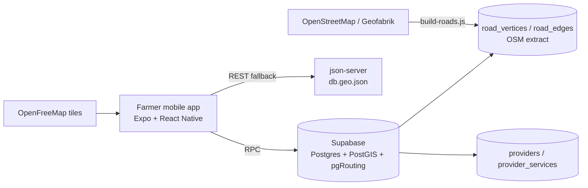

**Target system context (proposed):**

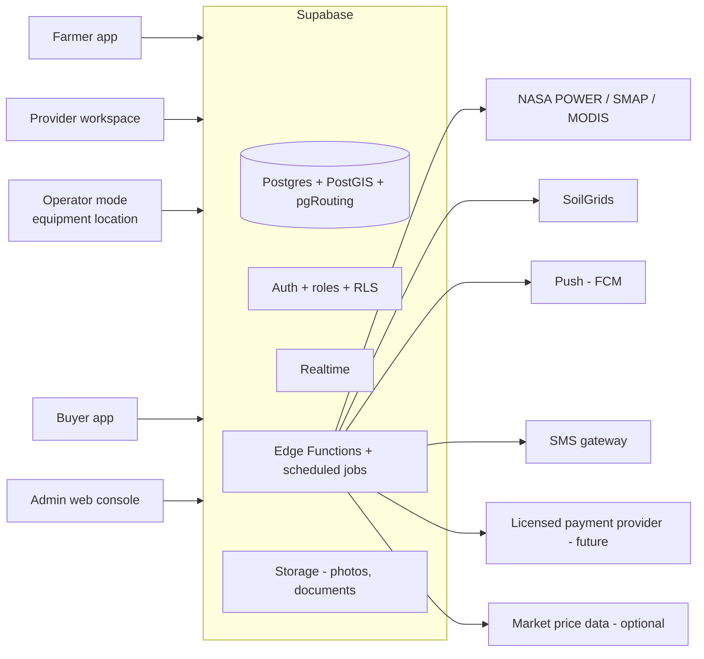

### 2.2 User classes and personas

| User class                 | Description                                                                 | Current support                   |
| -------------------------- | --------------------------------------------------------------------------- | --------------------------------- |
| **Farmer**                 | Saves land, requests a service, compares providers, books, tracks, rates; later sells produce | Partial (map + match)             |
| **Provider (owner)**       | Manages profile, hubs, equipment, offers, availability; accepts and fulfils bookings | Not yet                           |
| **Operator / driver**      | Operates equipment; updates job status; optionally shares location          | Not yet                           |
| **Buyer**                  | Browses produce listings, makes offers (experimental)                       | Not yet                           |
| **Transporter**            | Offers transport for produce/inputs (future)                                | Not yet                           |
| **Field agent / support**  | Assists onboarding, verifies providers, resolves disputes                   | Not yet                           |
| **Administrator**          | Verifies providers, manages data, finance and analytics                     | Not yet                           |
| **Researcher / developer** | Runs scenarios, benchmarks the engine, validates data                       | Partial (simulator + CLI scripts) |

**Primary persona:** a smallholder farmer in Rangpur with a mid-range Android phone and intermittent 4G. They know the service they need and have a rough budget, but not who is nearby or what a fair price is.

**Additional personas (illustrative — replace with interview findings):** a provider who owns two tractors and employs two drivers; an operator who needs a simple "next job" screen and fair, transparent location sharing; a local trader who wants to find produce by crop and distance; a field agent who onboards providers in one upazila.

### 2.3 Operating environment

| Aspect                 | Current choice                                                                         |
| ---------------------- | -------------------------------------------------------------------------------------- |
| Mobile framework       | Expo SDK ~54, React Native 0.81, React 19                                              |
| Routing                | Expo Router ~6 (file-based)                                                            |
| Map renderer           | `@maplibre/maplibre-react-native` 11.5 (requires a development build; **not** Expo Go) |
| Primary OS             | Android (package `com.sadikuzzamantarek.FarmerHelper`)                                 |
| Secondary              | iOS, web (Expo web output: static)                                                     |
| Backend                | Supabase (Postgres + PostGIS + pgRouting)                                              |
| Local fallback backend | `json-server` on a LAN IP, serving `db.geo.json`                                       |
| Map style              | OpenFreeMap Liberty (no API key)                                                       |
| Language/tooling       | TypeScript for app shell, JavaScript for services/engines, Node scripts                |

### 2.4 Design and implementation constraints

| ID   | Constraint                                                                                                      |
| ---- | --------------------------------------------------------------------------------------------------------------- |
| C-01 | MapLibre requires a native development build; features cannot be validated in Expo Go.                          |
| C-02 | Supabase anon key and service-role key must never be committed; only `.env.example` is tracked.                 |
| C-03 | The service-role key may be used only by Node scripts, never bundled into the app.                              |
| C-04 | The road graph currently covers only the Rangpur demo bounding box (~18 km span).                               |
| C-05 | Supabase free tier / network latency and PostgREST statement timeouts constrain RPC size.                       |
| C-06 | OSM data is ODbL-licensed; attribution is required in the app and documentation.                                |
| C-07 | Provider data is currently synthetic (`Provider_0`…`Provider_99`) and must not be presented as real businesses. |
| C-08 | The app must remain usable when Supabase is unreachable (degradation ladder).                                   |
| C-09 | NASA gridded products are coarse (roughly 9 km to tens of km depending on product). Show them as **area context**, never as plot-level measurement.   |
| C-10 | External data APIs (NASA, SoilGrids, price data) have rate limits and may be down: ingest **server-side** into cache tables; clients never call them directly. |
| C-11 | Continuous GPS drains battery and data; Android background location needs a foreground service and Play-policy justification. Use adaptive intervals and opt-in. |
| C-12 | Phone OTP needs a Bangladesh-capable SMS provider; each message costs money and delivery varies.                                                     |
| C-13 | Holding or moving customers' money is regulated; use a licensed PSP/MFS and get legal advice before any payment feature.                              |
| C-14 | Supabase free-tier limits (storage, Realtime connections, Edge Function invocations) constrain chat and location; throttle, compress, or upgrade.     |

### 2.5 Assumptions and dependencies

| ID   | Assumption / dependency                                                                                 |
| ---- | ------------------------------------------------------------------------------------------------------- |
| A-01 | Farmers have a GPS-capable Android phone and intermittent mobile data.                                  |
| A-02 | Coordinates can be represented as WGS84 lat/lng.                                                        |
| A-03 | A meaningful ranking can be built from cost + distance; other factors (rating, reliability) come later. |
| A-04 | The Rangpur demo area is sufficient for evaluation and demonstration.                                   |
| A-05 | Supabase remains the backend of record for the prototype.                                               |
| A-06 | OSM road data is accurate enough for rural routing in the demo area; isolated farms may be unreachable. |
| A-07 | Prices are in Bangladeshi Taka (Tk) and are per acre (tractor/sprayer) or per kg (seed).                |
| A-08 | Some providers have low digital literacy; assisted onboarding by a field agent is acceptable.                                  |
| A-09 | Farmers think in decimal / bigha / acre; the app must convert units and confirm the result.                                    |
| A-10 | NASA POWER, SMAP/MODIS, and SoilGrids data are free to use with attribution (verify terms at implementation).                  |
| A-11 | Buyers (traders, aratdars) are reachable by phone; marketplace cold start is solved by seeding, not by organic growth.         |
| A-12 | The pilot runs in 1–2 upazilas of Rangpur, matching the road-graph coverage.                                                   |

### 2.6 Current implementation snapshot

**Status: working prototype.** The matching and road-routing concepts are implemented and exercised; the product surface (onboarding, booking, provider accounts) is not.

| Area                                  | Current state                                                                                                            | Evidence / files                                      |
| ------------------------------------- | ------------------------------------------------------------------------------------------------------------------------ | ----------------------------------------------------- |
| App shell                             | Expo Router with tabs; Home and Explore are still template screens                                                       | `app/(tabs)/index.tsx`, `app/(tabs)/explore.tsx`      |
| Map screen                            | MapLibre map, provider markers, center crosshair, booking options card, best/candidate results, road polyline            | `app/(tabs)/map.tsx`                                  |
| Simulator                             | Form-based scenario runner with timing output                                                                            | `app/(tabs)/simulate.jsx`                             |
| Tab configuration                     | Home, Explore, Simulate explicitly configured; `map` route exists but is not explicitly styled/ordered in the tab layout | `app/(tabs)/_layout.tsx`                              |
| Matching (server road)                | `nearby_providers_road` RPC via pgr_dijkstra                                                                             | `services/supabase.js`, `supabase/routing-schema.sql` |
| Matching (server Haversine)           | `nearby_providers` RPC via `ST_DistanceSphere`                                                                           | `supabase/schema.sql`                                 |
| Matching (local fallback)             | Haversine + score in JS                                                                                                  | `utils/geoEngine.js`                                  |
| Legacy engine                         | Synthetic-grid Dijkstra retained for reference                                                                           | `utils/farmMatchEngine.js`                            |
| Dataset                               | 100 synthetic providers on a 10×10 Rangpur grid; 210 service offers                                                      | `db.geo.json`, `data/generator.js`                    |
| Road graph                            | 33,220 vertices / 34,159 edges from OSM, loaded to Supabase                                                              | `supabase/road-data.json`, `scripts/build-roads.js`   |
| Seeding                               | Service-role seeding of providers and services                                                                           | `scripts/seed-supabase.js`                            |
| Preview                               | Browser preview and static map preview                                                                                   | `preview/index.html`                                  |
| Auth / booking / provider app / admin | Not implemented                                                                                                          | —                                                     |
| Automated tests / CI                  | Not implemented                                                                                                          | —                                                     |
| Provider profile, equipment, onboarding | Not implemented — providers are seeded rows with no owner or account                                                  | —                                                     |
| Saved lands, NASA/soil data, crop suggestion | Not implemented                                                                                                  | —                                                     |
| Communication, job tracking, ratings  | Not implemented                                                                                                          | —                                                     |
| Marketplace, ledger, transport        | Not implemented                                                                                                          | —                                                     |

**Known technical debt (do not mistake for requirements):**

- `services/api.js` hardcodes a LAN IP (`http://192.168.1.112:3000`) instead of using environment configuration.
- In Supabase mode, `loadGeoContext()` maps providers with `services: {}`, so the client-side `findBestProvider` fallback cannot rank them if both RPCs fail.
- `rankCandidateRows()` does not re-apply the `max_distance_km` filter after road distance is computed; road distance can exceed the straight-line prefilter radius.
- No request persistence, no auth, no input sanitisation beyond numeric coercion.
- No error boundaries, structured logging, or telemetry.
- No versioned DB migrations; SQL files are applied manually.
- Providers are keyed by text id with no owner (`auth.users`); an ownership model is needed before provider accounts.
- Schema is single-role (public read). Roles and per-role RLS must be designed before any write feature.
- No notification, queue, or scheduled-job infrastructure exists (needed for FR-16 and FR-20).

---

## 3. Functional Requirements

### 3.1 Feature map

| ID    | Feature                                          | Priority                  | Status                  | Target release | Request # |
| ----- | ------------------------------------------------ | ------------------------- | ----------------------- | -------------- | --------- |
| FR-01 | Farmer request and service selection             | Must                      | Partial                 | R0.2           | —         |
| FR-02 | Provider discovery and matching                  | Must                      | Implemented (prototype) | R0.1           | —         |
| FR-03 | Map and route visualization                      | Must                      | Implemented (prototype) | R0.1           | —         |
| FR-04 | Provider and service data management             | Must                      | Partial (seed only)     | R0.3           | 1         |
| FR-05 | Simulation and evaluation                        | Should                    | Implemented (prototype) | R0.1           | —         |
| FR-06 | Road-network data pipeline                       | Should                    | Implemented (prototype) | R0.1           | —         |
| FR-07 | Degraded/offline operation                       | Must                      | Implemented (partial)   | R0.2           | —         |
| FR-08 | Authentication, roles and profiles               | Must (target)             | Not started             | R0.2           | 4         |
| FR-09 | Booking and request lifecycle                    | Must (target)             | Not started             | R0.3           | 3         |
| FR-10 | Provider workspace (see FR-14, FR-17)            | Should (target)           | Not started             | R0.3           | 1         |
| FR-11 | Admin and analytics                              | Could                     | Not started             | R1.0           | 10        |
| FR-12 | Notifications, localization, accessibility       | Should                    | Not started             | R0.4           | 3         |
| FR-13 | Farmer marketplace (experimental)                | Could                     | Not started             | R2.0           | 9         |
| FR-14 | Provider profile and equipment management       | Must (target)             | Not started             | R0.3           | 1         |
| FR-15 | Customer–provider relationship management        | Should                    | Not started             | R0.4           | 2         |
| FR-16 | Communication system                             | Must (target)             | Not started             | R0.3           | 3         |
| FR-17 | Onboarding and job tracking ("working track")    | Must (onboarding) / Should (tracking) | Not started | R0.3 / R0.4    | 4         |
| FR-18 | Equipment live location and dispatch (**needs discussion**) | Could          | Not started             | R1.1           | 5         |
| FR-19 | Saved lands and marks                            | Should (foundation)       | Not started             | R0.2           | 7         |
| FR-20 | Environmental and soil data (NASA and others)    | Should                    | Not started             | R0.5           | 6         |
| FR-21 | Crop suggestion                                  | Should (market input: Could) | Not started          | R0.5           | 8         |
| FR-22 | Business model, transactions and logistics       | Should (ledger) / Could (payments, transport) | Not started | R1.0 / R2.0 | 10     |

Priorities use MoSCoW and describe the **target product**, not the prototype.

---

### 3.2 FR-01 — Farmer request and service selection

**Description:** The farmer specifies what they need and the constraints under which a provider is acceptable.

| ID      | Requirement                                                                                                                                            | Priority | Acceptance criteria                                                                                                               |
| ------- | ------------------------------------------------------------------------------------------------------------------------------------------------------ | -------- | --------------------------------------------------------------------------------------------------------------------------------- |
| FR-01.1 | The farmer can choose a service type: tractor, sprayer, or seed.                                                                                       | Must     | Selecting a type updates the form: acres for tractor/sprayer, kg for seed.                                                        |
| FR-01.2 | The farmer's start location comes from phone GPS when permission is granted; otherwise it is the map center. The farmer can always adjust it by panning the map. | Must     | A visible crosshair always shows the chosen point; GPS denial falls back to the map center with no error (AT-14). Default behaviour tracked in D-13. |
| FR-01.3 | The farmer can enter acres (tractor/sprayer) or kg needed (seed).                                                                                      | Must     | Non-numeric/empty input is rejected or coerced safely; value ≥ 0.                                                                 |
| FR-01.4 | The farmer can set a maximum travel distance in km.                                                                                                    | Must     | Value > 0; used as both a filter and a score normaliser.                                                                          |
| FR-01.5 | The farmer can set a maximum total cost in Tk.                                                                                                         | Must     | Value > 0; candidates above budget are excluded.                                                                                  |
| FR-01.6 | The farmer can set a travel cost rate in Tk/km.                                                                                                        | Must     | Default 10; used in the total cost formula. Target: the provider's own travel rate (FR-14.6) replaces this default when present.   |
| FR-01.7 | The form validates input and explains invalid values.                                                                                                  | Should   | Inline messages; no request is sent with invalid values.                                                                          |
| FR-01.8 | The last-used request can be restored between sessions.                                                                                                | Could    | Local persistence; not required for first demo.                                                                                   |
| FR-01.9 | The farmer can reuse their current GPS location.                                                                                                       | Should   | Requests location permission and handles denial gracefully.                                                                       |
| FR-01.10 | Seed requests select a seed variety: potato, bean, rice, maize, mustard, lentil, wheat or jute.                                                       | Must     | The selected variety's `price_per_kg` is used; providers without that variety are excluded; the catalogue page and map picker stay in sync. |

**Current:** `map.tsx` and `simulate.jsx` implement FR-01.1–FR-01.6 with text inputs. FR-01.7–FR-01.9 are not implemented. FR-01.10 is implemented in `app/seeds.tsx` + `features/map/map-screen.tsx` (2026-11-16).

---

### 3.3 FR-02 — Provider discovery and matching

**Description:** Given a request, find all eligible providers, rank them, and return the best option plus the full ranked list.

| ID       | Requirement                                                                                                            | Priority | Acceptance criteria                                                                                        |
| -------- | ---------------------------------------------------------------------------------------------------------------------- | -------- | ---------------------------------------------------------------------------------------------------------- |
| FR-02.1  | Only providers that offer the requested service are considered.                                                        | Must     | A provider without the service never appears.                                                              |
| FR-02.2  | Only offers marked available are considered.                                                                           | Must     | `available = false` is excluded.                                                                           |
| FR-02.3  | Candidates must be within the requested maximum distance.                                                              | Must     | Distance filter applied using the active distance source.                                                  |
| FR-02.4  | Candidates must be within the requested maximum total cost.                                                            | Must     | `serviceCost + travelCost ≤ max_total_cost_tk`.                                                            |
| FR-02.5  | Candidates are ranked by a weighted normalised score (lower is better).                                                | Must     | `score = 0.7 × cost/maxCost + 0.3 × distance/maxDistance`.                                                 |
| FR-02.6  | The best provider and the full ranked list are returned.                                                               | Must     | Result contains `best_provider`, `best_distance_km`, `best_total_cost_tk`, `ranked_candidates`, `success`. |
| FR-02.7  | The result reports which distance source was used.                                                                     | Should   | `distance_kind` ∈ `road`, `haversine`, `local-cache`, `json-server`. Full detail is shown in dev/simulator builds; production builds show only a simple accuracy label and hide scores/weights. |
| FR-02.8  | The solver is deterministic for identical inputs.                                                                      | Must     | Same request + same dataset → same ranking.                                                                |
| FR-02.9  | Rejected candidates can be explained (out of radius, over budget, unavailable).                                        | Could    | Useful for debugging and farmer trust.                                                                     |
| FR-02.10 | Ranking weights are configurable.                                                                                      | Could    | Defaults 0.7/0.3; admin or experiment override.                                                            |
| FR-02.11 | Additional ranking factors (rating, reliability, response time) are supported.                                         | Could    | Extend score without breaking result contract.                                                             |

**Current:** FR-02.1–FR-02.7 are implemented across `utils/geoEngine.js`, Supabase RPCs, and `services/geoClient.js`. FR-02.8 is effectively true. FR-02.9–FR-02.11 are not implemented.

**Open rule:** confirm whether `max_distance_km` must be re-checked after road distance (recommended: yes). See D-07.

---

### 3.4 FR-03 — Map and route visualization

**Description:** A map-first interface showing the farmer's chosen location, available providers, and the route to the selected provider.

| ID       | Requirement                                                                                                                                     | Priority | Acceptance criteria                                              |
| -------- | ----------------------------------------------------------------------------------------------------------------------------------------------- | -------- | ---------------------------------------------------------------- |
| FR-03.1  | Show an interactive map centered on the demo area.                                                                                              | Must     | Map renders without an API key using OpenFreeMap Liberty.        |
| FR-03.2  | Show all known providers as markers.                                                                                                            | Must     | Marker count matches the provider dataset.                       |
| FR-03.3  | Show a fixed crosshair identifying the farmer's chosen location. | Must     | Crosshair stays at screen center while the map pans. With GPS, the map first centers on the GPS fix; the crosshair remains the manual adjuster and fallback. |
| FR-03.4  | Show the best provider and route after a successful match.                                                                                      | Must     | Polyline drawn from farmer to best provider.                     |
| FR-03.5  | Use the real road polyline when available; otherwise draw a dashed straight line(fallback).                                                     | Should   | Solid route when `road_path` returns geometry; dashed otherwise. |
| FR-03.6  | Distinguish markers by service availability.                                                                                                    | Should   | Legend and marker styling make availability clear.               |
| FR-03.7  | Tap a marker to see provider details.                                                                                                           | Should   | Name, services, prices, availability, distance.                  |
| FR-03.8  | Show the current backend/distance mode.                                                                                                         | Should   | Status badge reflects road/Haversine/json-server.                |
| FR-03.9  | Attribute OpenStreetMap data.                                                                                                                   | Must     | Visible OSM/ODbL attribution in the app.                         |
| FR-03.10 | Support offline map tiles for the demo area.                                                                                                    | Could    | Not required for first evaluation.                               |

**Current:** FR-03.1–FR-03.6 and FR-03.8 are implemented; FR-03.7 and FR-03.9 are not fully implemented.

---

### 3.5 FR-04 — Provider and service data management

**Description:** Maintain accurate provider records and service offers.

| ID      | Requirement                                                              | Priority        | Acceptance criteria                                            |
| ------- | ------------------------------------------------------------------------ | --------------- | -------------------------------------------------------------- |
| FR-04.1 | Store providers with id, name, lat, lng, and a spatial geography column. A provider's location is its **hub**, captured by GPS or map pin at onboarding. | Must            | `providers` table populated; GiST index exists.                |
| FR-04.2 | Store one row per provider/service with price and availability.          | Must            | `provider_services` primary key `(provider_id, service_type)`. |
| FR-04.3 | Seed the database from a versioned dataset.                              | Must            | `npm run seed-supabase` is idempotent (upsert).                |
| FR-04.4 | Validate coordinates and prices on write.                                | Should          | lat ∈ [-90, 90], lng ∈ [-180, 180], inside Bangladesh (DQ-02), price > 0. Coordinate checks still apply to GPS-captured points (GPS can be inaccurate or spoofed). |
| FR-04.5 | Providers can register and edit their own offers.                        | Should (target) | Detailed in FR-14 (profile, hubs, offers, equipment).          |
| FR-04.6 | Administrators can verify, suspend, or remove providers.                 | Should (target) | Admin action audit trail.                                      |
| FR-04.7 | Price history is retained.                                               | Could           | Time-series table; supports fair-price insights.               |
| FR-04.8 | Duplicate providers can be detected/merged.                              | Could           | Proximity + name similarity check.                             |
| FR-04.9 | _Superseded_: multiple vehicles per provider and per-vehicle availability. | —               | See FR-14.5 (equipment register) and FR-14.3/FR-18.8 (availability). Kept for traceability. |
| FR-04.10 | _Superseded_: tractor live location differs from provider area; drivers' GPS sub-profiles; parked/running status. | —  | See FR-18 (equipment live location and dispatch) — **needs discussion**. |

**Current:** FR-04.1–FR-04.3 are implemented; the rest is planned.

---

### 3.6 FR-05 — Simulation and evaluation

**Description:** A non-production screen and CLI that run scenarios and expose timings for evaluation and debugging.

| ID      | Requirement                                           | Priority | Acceptance criteria                                                |
| ------- | ----------------------------------------------------- | -------- | ------------------------------------------------------------------ |
| FR-05.1 | Run a match from a form with all request fields.      | Should   | Simulator screen returns best + ranked list.                       |
| FR-05.2 | Show per-stage timings.                               | Should   | Matching time displayed in ms.                                     |
| FR-05.3 | Provide repeatable CLI scenarios.                     | Should   | `npm run preview-match` prints ranked results for fixed scenarios. |
| FR-05.4 | Allow synthetic dataset regeneration.                 | Could    | `data/generator.js` produces `db.json`.                            |
| FR-05.5 | Support batch evaluation over many generated farmers. | Could    | CSV/JSON summary of success rate, average cost, latency.           |
| FR-05.6 | Compare road vs Haversine results side by side.       | Could    | Report distance delta and ranking changes.                         |

**Current:** FR-05.1–FR-05.4 exist; FR-05.5–FR-05.6 do not.

---

### 3.7 FR-06 — Road-network data pipeline

**Description:** Build a routable graph from OpenStreetMap for the demo area and load it into Supabase.

| ID       | Requirement                                                              | Priority | Acceptance criteria                                        |
| -------- | ------------------------------------------------------------------------ | -------- | ---------------------------------------------------------- |
| FR-06.1  | Build the graph from OSM highway ways inside the demo bounding box.      | Should   | `npm run build-roads` writes vertices/edges/SQL/GeoJSON.   |
| FR-06.2  | Use Overpass with mirrors, falling back to the Geofabrik Bangladesh PBF. | Should   | Script completes when Overpass is unavailable.             |
| FR-06.3  | Treat each OSM segment as a directed edge with km cost.                  | Must     | `cost` = haversine length; `reverse_cost` honours one-way. |
| FR-06.4  | Upload the graph to Supabase in batches.                                 | Should   | `npm run upload-roads` seeds `road_vertices`/`road_edges`. |
| FR-06.5  | Snap arbitrary points to the nearest road vertex.                        | Must     | `nearest_vertex_id(lng, lat)` returns a vertex id.         |
| FR-06.6  | Compute shortest road distance and full route geometry.                  | Must     | `road_distance_km` and `road_path` return valid results.   |
| FR-06.7  | Never lose a candidate due to an unreachable road segment.               | Must     | Fallback to Haversine for that provider.                   |
| FR-06.8  | Report graph statistics and sanity checks.                               | Should   | Vertex/edge counts, total km, sample road ≥ straight-line. |
| FR-06.9  | Rebuild and re-upload are idempotent.                                    | Should   | Truncate/upsert; no duplicate edges.                       |
| FR-06.10 | Support incremental updates without rebuilding everything.               | Could    | Future scalability.                                        |

**Current:** implemented as a prototype. Graph build, upload, and routing RPCs work; idempotency and incremental updates need verification.

---

### 3.8 FR-07 — Degraded/offline operation

**Description:** The app must never hang or crash because a backend is slow or unreachable.

| ID      | Requirement                                                         | Priority | Acceptance criteria                                   |
| ------- | ------------------------------------------------------------------- | -------- | ----------------------------------------------------- |
| FR-07.1 | Every network call has a timeout.                                   | Must     | Supabase 8 s wrapper; axios 5 s timeout.              |
| FR-07.2 | If road routing fails or times out, retry with Haversine.           | Must     | Result reports `haversine`; no user-facing crash.     |
| FR-07.3 | If Supabase is unavailable, use the on-device provider store (SQLite or AsyncStorage) with local ranking. | Must     | Result reports `local-cache` (production) or `json-server` (development only). Production must not depend on a LAN json-server. |
| FR-07.4 | If all backends fail, show the map and a clear status message.      | Must     | Status badge: backend unreachable; map still renders. |
| FR-07.5 | Cache provider data on the device for the farmer's radius. Refresh when online and the cache is older than 7 days, or every 10–15 app sessions (tunable), whichever comes first. | Should   | App usable after a cold start with no network; shows cache age. Newly added providers in the radius appear after the next refresh. |
| FR-07.6 | Queue match requests for retry.                                     | Could    | Not required for first evaluation.                    |

**Current:** FR-07.1–FR-07.4 implemented; FR-07.5–FR-07.6 not.

---

### 3.9 FR-08 — Authentication and profiles (Planned)

| ID      | Requirement                                              | Priority | Notes                                                    |
| ------- | -------------------------------------------------------- | -------- | -------------------------------------------------------- |
| FR-08.1 | Users sign in with phone number + OTP (preferred), or a simplified alternative (e.g., PIN after first OTP; email as fallback). | Must (target) | Supabase Auth; phone OTP needs an SMS provider (C-12). Required for booking. |
| FR-08.2 | Providers have accounts linked to provider records.      | Should   | Role-based access.                                       |
| FR-08.3 | Admin accounts are separate and protected.               | Should   | RLS policies.                                            |
| FR-08.4 | Anonymous browsing and matching are allowed; authentication is required to book, save lands, message, or list produce. | Should   | Lower friction (decision D-19).                           |
| FR-08.5 | Profile stores name, language, default location.         | Could    | Privacy controls.                                        |
| FR-08.6 | Roles: `farmer`, `provider_owner`, `operator`, `buyer`, `transporter`, `field_agent`, `support`, `admin`. One account may hold several roles. | Must (target) | Roles stored server-side; RLS enforces access per role.   |
| FR-08.7 | The user can switch active role in the app (e.g., farmer ↔ provider). | Should   | Role switch does not expose the other role's private data. |
| FR-08.8 | Account deletion and personal-data export on request.     | Should   | Completed within a documented period (NFR-32).           |
| FR-08.9 | Consent is captured and logged for location, notifications, and data use. | Must (before pilot) | Consent record with timestamp and version.      |

### 3.10 FR-09 — Booking and request lifecycle (Planned)

| ID      | Requirement                                                | Priority      | Notes                                                 |
| ------- | ---------------------------------------------------------- | ------------- | ----------------------------------------------------- |
| FR-09.1 | Farmer can create a booking request from a match result.   | Must (target) | Persist request + selected provider + price snapshot. |
| FR-09.2 | Provider can accept, decline, or propose a new time/price. | Must (target) | State machine below.                                  |
| FR-09.3 | Farmer can cancel before acceptance.                       | Should        | Cancellation reason.                                  |
| FR-09.4 | Both parties see request status and history.               | Must (target) | Timeline view.                                        |
| FR-09.5 | Availability is reserved/updated on acceptance.            | Should        | Prevent double booking.                               |
| FR-09.6 | Rating/review after completion.                            | Could         | Feeds future ranking.                                 |
| FR-09.7 | Payment is recorded (cash/mobile money), not processed.    | Could         | Out of payment-gateway scope.                         |
| FR-09.8 | A booking request stores a price snapshot and the land reference (FR-19). | Must (target) | Later price changes do not alter existing bookings.   |
| FR-09.9 | Provider can propose a reschedule; farmer accepts or declines. | Should   | State `Countered` → `Accepted`/`Cancelled`.          |
| FR-09.10 | Pending requests expire after a configurable time (default 24 h). | Should   | State `Expired`; both parties notified.              |
| FR-09.11 | No-show / dispute flag on a booking.                       | Could         | Feeds FR-15.9 and ratings.                            |
| FR-09.12 | Accepting a booking creates a Job (FR-17.5).               | Should        | Job id linked to booking.                             |

**Proposed booking state machine (draft):**

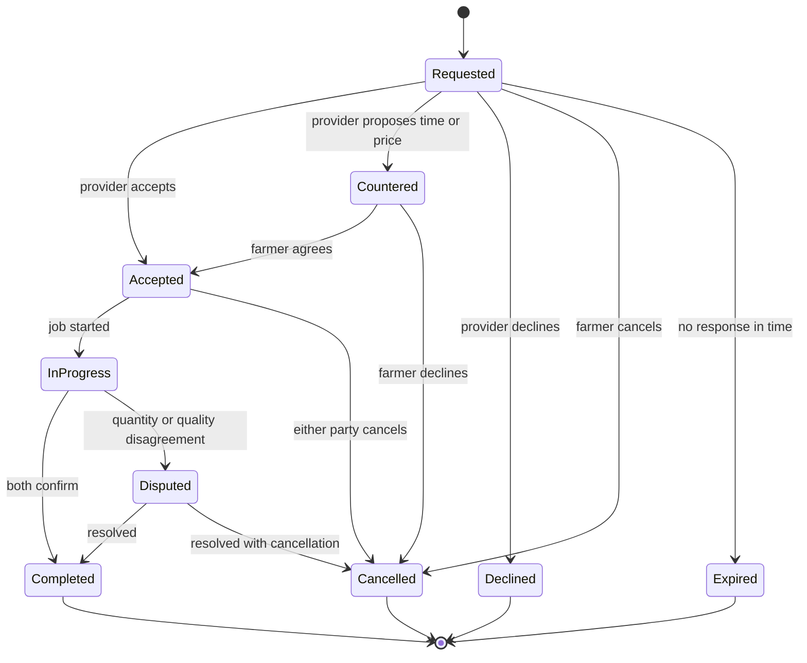

### 3.11 FR-10 — Provider workspace (Planned)

| ID      | Requirement                                                              | Priority |
| ------- | ------------------------------------------------------------------------ | -------- |
| FR-10.1 | Provider creates/updates service offers and prices.                      | Should   |
| FR-10.2 | Provider toggles availability (available/busy/off-season).               | Should   |
| FR-10.3 | Provider sets a service radius.                                          | Should   |
| FR-10.4 | Provider receives and responds to booking requests.                      | Should   |
| FR-10.5 | Provider sees earnings/usage summary.                                    | Could    |
| FR-10.6 | Provider verification documents (NID/licence) are uploaded and reviewed. | Could    |

> FR-10 is detailed by **FR-14** (profile, hubs, equipment, offers) and **FR-17** (onboarding, job tracking). IDs are retained for traceability; implement against FR-14/FR-17.

### 3.12 FR-11 — Admin and analytics (Planned)

| ID      | Requirement                                                                | Priority |
| ------- | -------------------------------------------------------------------------- | -------- |
| FR-11.1 | Admin dashboard lists providers, services, and verification status.        | Could    |
| FR-11.2 | Admin can suspend/verify providers.                                        | Could    |
| FR-11.3 | Analytics: matches, success rate, average distance/cost, popular services. | Could    |
| FR-11.4 | Privacy-safe export for research/evaluation.                               | Could    |
| FR-11.5 | Audit log of admin actions.                                                | Could    |
| FR-11.6 | Price tracking over time per service and area (snapshots on offer change and per completed booking); supports fair-price analytics and internal research (see FR-04.7). | Could    |

### 3.13 FR-12 — Notifications, localization, accessibility (Planned)

| ID      | Requirement                                                          | Priority |
| ------- | -------------------------------------------------------------------- | -------- |
| FR-12.1 | Push/SMS notification on booking status change.                      | Should   |
| FR-12.2 | Bangla and English UI.                                               | Should   |
| FR-12.3 | Screen-reader labels and sufficient contrast.                        | Should   |
| FR-12.4 | Large-touch-target, low-literacy-friendly UI (icons + minimal text). | Should   |
| FR-12.5 | Offline-friendly error copy.                                         | Could    |


---

### 3.14 FR-13 — Farmer marketplace (Experimental)

**Description:** The reverse of the service model: farmers publish produce for sale; buyers browse, offer, and arrange pickup. Reuses auth, chat (FR-16), saved lands (FR-19), and the ledger (FR-22). **Do not start before the service marketplace (pillar A) is pilot-stable.**

| ID       | Requirement                                                                                                     | Priority   | Acceptance criteria                                                          |
| -------- | --------------------------------------------------------------------------------------------------------------- | ---------- | ---------------------------------------------------------------------------- |
| FR-13.1  | Farmer creates a produce listing: crop, variety, quantity + unit (kg/maund/ton), asking price per unit, available date, pickup location (saved land or pin), up to 5 photos, quality notes. | Could (exp.) | Listing appears to buyers within a radius.                                |
| FR-13.2  | Buyer profile: buyer type (trader, aratdar, processor, retailer, group), crops of interest, service area.        | Could (exp.) | Buyer role per FR-08.6.                                                    |
| FR-13.3  | Buyers browse/search listings by crop, distance, price, and date.                                                | Could (exp.) | Results sorted by distance by default; filters work.                       |
| FR-13.4  | Buyer sends an offer (price, quantity, pickup date) or "buy at asking"; farmer accepts, counters, or declines.   | Could (exp.) | Same state pattern as FR-09 (`Offered/Countered/Accepted/Declined/Expired`). |
| FR-13.5  | Reverse request: buyer posts a demand (crop, quantity, target price, deadline); farmers respond.                 | Could      | Farmers in radius are notified.                                            |
| FR-13.6  | Listing lifecycle: `draft → active → reserved → sold`, or `expired / cancelled`.                                | Could (exp.) | Quantity decremented on accepted offers; no overselling.                   |
| FR-13.7  | Show a market-price benchmark when available (FR-21.6).                                                          | Could      | Labelled with source and date.                                             |
| FR-13.8  | Request a transport quote for a trade (FR-22.7).                                                                | Could      | Transport request linked to the trade.                                     |
| FR-13.9  | Ratings after a completed trade.                                                                                 | Could      | Reuses FR-15.6 pattern.                                                    |
| FR-13.10 | Safety: report a listing/user; admin takedown; no phone numbers in public listing text.                          | Should     | Reported items hidden pending review.                                      |

**Experiment rule:** run a 4-week mini-pilot; continue only if listing and offer counts meet thresholds agreed with the supervisor (D-31). Otherwise stop and document the finding.

---

### 3.15 FR-14 — Provider profile and equipment management

**Description:** A provider (owner) manages their business identity, hubs, services, equipment, availability, and trust signals. Supersedes FR-04.5 and the detail of FR-10.

| ID       | Requirement                                                                                                     | Priority | Acceptance criteria                                                              |
| -------- | --------------------------------------------------------------------------------------------------------------- | -------- | -------------------------------------------------------------------------------- |
| FR-14.1  | Provider profile: business name, owner name, photo/logo, OTP-verified phone, languages, description, years of experience. | Must     | Profile saved; phone verified by OTP; visible on public profile.                 |
| FR-14.2  | One or more hubs, each with GPS-captured or map-pinned location and address text.                                | Must     | Hub stored as `geography`; provider can add/edit/remove hubs.                    |
| FR-14.3  | Per-service offers: price, price unit (per acre / per kg / per hour), minimum quantity or minimum charge, status (`available` / `busy` / `off_season`), notes. | Must     | Matches use only `available` offers (FR-02.2).                                   |
| FR-14.4  | Service area per hub: radius and optional maximum distance.                                                       | Should   | Farmers outside the area are not matched to that hub.                            |
| FR-14.5  | Equipment register: type, model, capacity/HP, optional plate number, photo, status, linked hub, optional assigned operator. | Should   | Each machine has its own availability (supports FR-18.8).                        |
| FR-14.6  | Provider-defined travel rate (Tk/km) and minimum charge.                                                          | Should   | Replaces the farmer-entered default (FR-01.6) when present.                      |
| FR-14.7  | Working hours, seasonal calendar, and blackout dates.                                                             | Should   | Unavailable dates are excluded from matching/booking.                            |
| FR-14.8  | Verification level: `unverified`, `phone_verified`, `document_verified`, `field_verified`.                        | Should   | Badge shown; level changes recorded in the audit log.                            |
| FR-14.9  | Profile completeness meter; incomplete profiles are hidden or ranked lower (configurable).                        | Should   | Rule documented; provider sees what is missing.                                  |
| FR-14.10 | Public profile for farmers: services, prices, photos, rating, jobs completed, response time, verification badge.  | Should   | Reachable from marker tap and result list.                                       |
| FR-14.11 | Staff and operator sub-accounts with limited permissions.                                                         | Could    | Operator sees only assigned equipment/jobs.                                      |
| FR-14.12 | Price-change history (feeds FR-04.7, FR-11.6).                                                                    | Could    | Time-stamped rows; no deletion by provider.                                      |

---

### 3.16 FR-15 — Customer–provider relationship management

**Description:** Give both sides memory and trust: favourites, history, ratings, private notes, rebooking, and dispute handling.

| ID       | Requirement                                                                                                  | Priority | Acceptance criteria                                                          |
| -------- | ------------------------------------------------------------------------------------------------------------ | -------- | ---------------------------------------------------------------------------- |
| FR-15.1  | Farmer can favourite/save providers; "My providers" lists them.                                              | Should   | Favourites sync across devices after login.                                  |
| FR-15.2  | Per-provider booking history for the farmer: past jobs, prices, ratings.                                     | Should   | History opens from the provider profile and booking list.                    |
| FR-15.3  | One-tap **rebook**: reuse the previous land, service, and provider.                                          | Should   | New request prefilled; provider and farmer can still edit.                   |
| FR-15.4  | Provider customer list: farmers served, job count, last job, private notes and tags.                          | Should   | Notes visible only to that provider.                                         |
| FR-15.5  | Provider can set a negotiated repeat price for a specific farmer.                                            | Could    | Price applied in matching for that farmer only; shown as "special price".    |
| FR-15.6  | Ratings and reviews after completion: farmer rates provider (1–5 + tags). Provider rates farmer reliability privately. | Should   | One rating per completed booking per direction; edit window documented (D-32). |
| FR-15.7  | Trust signals: repeat-customer count, on-time rate, cancellation rate.                                        | Could    | Computed from jobs; shown on public profile.                                 |
| FR-15.8  | Block and report a user; admin reviews reports.                                                               | Should   | Blocked users cannot message or book each other.                             |
| FR-15.9  | Dispute workflow: raise, attach evidence (photos, chat), admin resolution, logged outcome.                    | Could    | Disputes linked to booking/job; resolution status visible to both.           |
| FR-15.10 | Seasonal re-engagement suggestions based on past jobs ("time to prepare land again").                         | Could    | Opt-in; controlled by notification preferences (FR-16.11).                   |

---

### 3.17 FR-16 — Communication system

**Description:** Low-literacy-friendly communication tied to a booking. Channel order: push notification → in-app thread → one-tap call → SMS fallback for critical events.

| ID       | Requirement                                                                                                  | Priority | Acceptance criteria                                                          |
| -------- | ------------------------------------------------------------------------------------------------------------ | -------- | ---------------------------------------------------------------------------- |
| FR-16.1  | Every booking has a thread containing system events (status changes) and messages.                            | Must     | Thread created with the booking; both parties see the same history.         |
| FR-16.2  | Quick replies and structured messages with icons (e.g., "On my way", "Need one more day", "Please share location"), in Bangla and English. | Should   | Quick reply sends in ≤ 1 tap.                                                |
| FR-16.3  | Free-text messages; optional voice notes (≤ 30 s).                                                            | Should (text) / Could (voice) | Voice stored in private storage with signed URLs.               |
| FR-16.4  | One-tap call button (`tel:`); the other party's number is revealed only after acceptance (D-21).              | Must     | Number hidden before acceptance.                                             |
| FR-16.5  | Push notifications for new requests, status changes, and messages (FCM).                                      | Must     | Delivered within NFR-27 target when the device is online.                    |
| FR-16.6  | SMS fallback for critical events (request received, accepted, declined, reminder).                            | Should   | Sent if push is not acknowledged within a configured time.                   |
| FR-16.7  | Realtime delivery (Supabase Realtime) with offline queue and retry.                                           | Should   | Messages composed offline send once connectivity returns; no duplicates.     |
| FR-16.8  | Delivered/read indicators.                                                                                    | Could    | Indicator updates within NFR-25.                                             |
| FR-16.9  | Share a location pin or the linked land in the thread.                                                        | Should   | Pin opens in the map; land shared only with the booked provider (FR-19.7).   |
| FR-16.10 | Moderation: report a message, abuse flags, retention policy (default 12 months — D-34).                       | Should   | Reported messages visible to admin; retention job documented.                |
| FR-16.11 | Notification preferences: language, channels, quiet hours.                                                    | Could    | Preferences respected by all senders.                                        |
| FR-16.12 | Reminders before scheduled work (e.g., 24 h and 2 h before).                                                  | Should   | Scheduled job sends once per booking per interval.                           |

---

### 3.18 FR-17 — Onboarding and job tracking ("working track")

**Description:** Part A guides new users to value quickly. Part B records that accepted work actually happened. **Interpretation of "working track" as job tracking — confirm (D-22).**

_Part A — Onboarding_

| ID       | Requirement                                                                                                  | Priority | Acceptance criteria                                                          |
| -------- | ------------------------------------------------------------------------------------------------------------ | -------- | ---------------------------------------------------------------------------- |
| FR-17.1  | Farmer first-run: language, role, phone OTP, location permission, optional first land — in ≤ 4 screens.       | Must     | First-time farmer reaches the map and can request a match in ≤ 3 further taps. |
| FR-17.2  | Provider onboarding wizard: OTP → business → hub → services and prices → equipment (optional) → availability → review. Resumable. | Must     | Progress saved after each step; completed in ≤ 10 min in usability test.     |
| FR-17.3  | Assisted onboarding: a field agent/admin creates or edits a provider on their behalf with the provider's OTP consent. | Should   | Audit log records agent, provider, and consent.                              |
| FR-17.4  | Guided tips, empty states with a "next best action", and a progress checklist.                                | Should   | Each empty screen offers exactly one primary action.                         |

_Part B — Job tracking_

| ID       | Requirement                                                                                                  | Priority | Acceptance criteria                                                          |
| -------- | ------------------------------------------------------------------------------------------------------------ | -------- | ---------------------------------------------------------------------------- |
| FR-17.5  | Accepting a booking creates a **Job** record.                                                                 | Must     | One job per accepted booking.                                                |
| FR-17.6  | Job statuses with timestamps: `scheduled → en_route → arrived → working → paused → completed`.               | Should   | Provider/operator can advance status; invalid transitions rejected.          |
| FR-17.7  | Provider records actual quantity (acres/hours/kg), start/end time, and optional photos.                      | Should   | Values validated and stored; photos compressed (NFR-33).                     |
| FR-17.8  | Farmer confirms completion; a mismatch beyond tolerance raises a dispute flag (FR-09.11).                    | Should   | Booking becomes `Completed` only after confirmation or auto-confirm timeout (configurable). |
| FR-17.9  | Completed jobs feed history (FR-15), ratings, price tracking (FR-11.6), and the ledger (FR-22.2).            | Should   | Job summary available to all four consumers.                                 |
| FR-17.10 | Farmer sees a job timeline and, if FR-18 is available, an ETA.                                                | Could    | ETA shown with freshness label.                                              |

---

### 3.19 FR-18 — Equipment live location and dispatch (**Needs discussion**)

**Problem:** A provider's hub may be far from where a machine currently is. Ranking by hub distance can mislead the farmer.

**Hypothesis H-1:** using the machine's _current_ position improves distance accuracy and ETA and reduces mismatches.

**Model:** `Hub` (fixed) · `Equipment` (movable) · `Operator` (account). Candidates are **equipment**, shown to the farmer as the provider's best equipment. The origin used for distance is the **effective origin** (Section 6.9).

**Options for discussion**

| Option | Description                                              | Effort    | Accuracy | Privacy / battery        | Recommendation              |
| ------ | -------------------------------------------------------- | --------- | -------- | ------------------------ | --------------------------- |
| A      | Hub only (current)                                       | None      | Low      | Best                     | Baseline                    |
| B      | Provider sets "currently at" manually (village or pin) with a freshness timer | Low       | Medium   | Best                     | **First step**              |
| C      | Operator phone shares location while "on duty"           | High      | High     | Consent + battery cost   | Only if B shows value       |
| D      | Dedicated GPS hardware                                   | Very high | High     | Cost, maintenance        | Not now                     |

| ID       | Requirement                                                                                                  | Priority | Acceptance criteria                                                          |
| -------- | ------------------------------------------------------------------------------------------------------------ | -------- | ---------------------------------------------------------------------------- |
| FR-18.1  | Equipment status: `parked`, `en_route`, `working`, `offline`.                                                 | Should   | Status changes timestamped.                                                  |
| FR-18.2  | Operator mode: share location only while "on duty"; manual on/off.                                           | Should (option C) | Sharing stops immediately when off duty.                           |
| FR-18.3  | Adaptive update interval (initial: 60–120 s moving, 10 min stationary, none off duty; tunable).              | Should (option C) | Battery impact measured (NFR-26).                                  |
| FR-18.4  | Store only the **latest** location per equipment; optional sampled history for active jobs.                   | Should   | History purged per retention rule (D-34).                                    |
| FR-18.5  | Staleness rule: a location older than the TTL (default 15 min) is ignored and the next origin in the chain is used. | Must (if FR-18 is built) | Verified by AT-22.                                          |
| FR-18.6  | Matching uses the effective origin per equipment; the result labels origin as `live`, `manual`, or `hub`.     | Should   | Ranking contract unchanged (NFR-16) plus `origin_kind`.                      |
| FR-18.7  | Farmer sees the equipment position on the map, **rounded** (e.g., 100–200 m), only for relevant matches or active jobs. | Could    | No exact positions exposed to unrelated users.                               |
| FR-18.8  | Per-equipment availability; a booking reserves that equipment.                                               | Should   | No double booking of the same machine (FR-09.5).                             |
| FR-18.9  | Equipment with an active job is excluded, or ETA-adjusted using the estimated finish time.                    | Could    | Behaviour configurable.                                                      |
| FR-18.10 | Operator consent and transparency: operator sees when sharing is on; the provider cannot track off-duty.      | Must (if option C)  | Consent logged (FR-08.9).                                         |
| FR-18.11 | Manual "currently at" (option B): provider picks a hub or drops a pin; expires after the TTL.                 | Should   | Expired manual location reverts to hub.                                      |

**Success criterion (to decide continuing to option C):** option B changes the top match in ≥ 10% of pilot requests, or farmers report the provider was not where the app said in ≥ 10% of cases (D-23).

---

### 3.20 FR-19 — Saved lands and marks

**Description:** Farmers save plots with names, boundaries, and marks, and reuse them in requests and insights.

| ID       | Requirement                                                                                                  | Priority | Acceptance criteria                                                          |
| -------- | ------------------------------------------------------------------------------------------------------------ | -------- | ---------------------------------------------------------------------------- |
| FR-19.1  | Create a Land: name, location, boundary polygon (draw on map) **or** point + typed area; area computed from the polygon with manual override. Units: decimal (শতাংশ), bigha, acre, hectare. | Should   | Area shown in the user's preferred unit; conversion configurable (D-20).     |
| FR-19.2  | Multiple lands per farmer; edit, archive, delete.                                                            | Should   | Archived lands hidden by default; deletion confirmed.                        |
| FR-19.3  | Marks on a land: water source, gate/entry, boundary corner, soil sample spot, problem area, note — each with name, type, note, optional photo. | Should   | Marks render on the land map and can be edited.                              |
| FR-19.4  | Land attributes: ownership (owned/leased/shared), self-declared soil type, irrigation availability, current crop and sowing date, crop history (season, crop, optional yield). | Could    | Used as inputs to FR-21.                                                     |
| FR-19.5  | Select a saved land in the request form; location and area auto-fill (FR-01).                                | Should   | Selecting a land fills acres/location in ≤ 2 taps.                           |
| FR-19.6  | Land detail screen: map, area, marks, linked insights (FR-20), and booking/job history.                      | Should   | All sections load from cache when offline.                                   |
| FR-19.7  | Providers see a land's location, area, and marks **only** for accepted bookings, and only the fields the farmer shares. | Must     | RLS test: unrelated provider cannot read the land (AT-27).                   |
| FR-19.8  | Offline create/edit with later sync (last-write-wins per field; conflicts logged).                           | Could    | Edits made offline appear after sync.                                        |
| FR-19.9  | Validation: valid simple polygon, area > 0 and ≤ configurable maximum, inside Bangladesh.                    | Should   | Invalid polygons rejected with a plain-language message.                     |
| FR-19.10 | Import/export GeoJSON or KML.                                                                                | Could    | Round-trip preserves geometry.                                               |

**Unit note:** 1 acre = 100 decimal. Bigha differs by region (commonly about 33 decimal) — conversion must be configurable and confirmed with the farmer.

---

### 3.21 FR-20 — Environmental and soil data (NASA and others)

**Description:** Show farmers what weather, soil moisture, vegetation, and soil properties look like for their land, with honest provenance and resolution.

**Important clarification:** NASA products provide weather, soil **wetness/moisture**, and vegetation indices. Detailed soil composition (texture, pH, organic carbon) is **not** a NASA product; use SoilGrids (ISRIC) or local soil surveys and label it separately.

**Candidate data sources** (verify parameters, terms, and resolution at implementation — D-25):

| Data                                      | Candidate source                          | Typical resolution / refresh               | Notes                                            |
| ----------------------------------------- | ----------------------------------------- | ------------------------------------------ | ------------------------------------------------ |
| Rainfall, temperature, humidity, wind, solar radiation | NASA POWER API                | Gridded, tens of km; daily                 | No-key API; best first source                    |
| Soil wetness (surface / root zone)        | NASA POWER (soil-wetness parameters) and/or SMAP | Coarse; daily to multi-day          | SMAP needs Earthdata login and heavier ingestion |
| Vegetation (NDVI/EVI)                     | NASA MODIS / VIIRS                        | ~250 m–1 km; ~daily to 16-day              | Via Earthdata or map tile services               |
| Soil properties (texture, pH, organic carbon) | ISRIC SoilGrids (non-NASA)            | ~250 m; static                             | Estimate, not a lab result                       |
| Weather forecast                          | Separate provider (NASA is not a forecast service) | —                                 | Decision D-26                                    |

| ID       | Requirement                                                                                                  | Priority | Acceptance criteria                                                          |
| -------- | ------------------------------------------------------------------------------------------------------------ | -------- | ---------------------------------------------------------------------------- |
| FR-20.1  | For a saved land (or point), show a summary: rainfall (7/30 days), temperature, soil-moisture index, vegetation index, each with a plain-language class (dry / adequate / wet, etc.). | Should   | Summary loads from cache in < 2 s.                                           |
| FR-20.2  | Time-series charts (30/90/365 days) with simple Bangla/English labels.                                       | Should   | Charts render offline from cached data.                                      |
| FR-20.3  | Regional map layers (rainfall, soil moisture, NDVI) with legend and date selector.                            | Could    | Layer toggles do not block the main map.                                     |
| FR-20.4  | Static soil profile (texture, pH, organic carbon) shown with an "estimate, ~250 m" caveat.                    | Should   | Source and resolution visible.                                               |
| FR-20.5  | **Server-side ingestion and caching:** a scheduled job fetches per **grid cell** (not per farmer) and stores observations; the client reads only the cache. | Must     | No client call to NASA/SoilGrids (NFR-29).                                   |
| FR-20.6  | Show provenance and freshness: source, observation date, resolution; flag data older than N days (default 3). | Must     | Every value has a source label and date.                                     |
| FR-20.7  | Graceful degradation: if a source is down, show the last good data with its date; never block other features. | Must     | Verified by AT-23.                                                           |
| FR-20.8  | Compare the land's period against last year and a regional average.                                           | Could    | Comparison labelled with period.                                             |
| FR-20.9  | Alerts (heavy rain, heat, long dry spell) via push.                                                           | Could    | Opt-in; thresholds configurable.                                             |
| FR-20.10 | In-app attribution and licence compliance for NASA and ISRIC data.                                            | Must     | Attribution visible in the land insight screen and About.                    |
| FR-20.11 | Farmer-entered soil-test values (pH, N/P/K from a lab report) override the static estimate.                   | Could    | Override flagged as "farmer-provided".                                       |

**Honesty rule:** the UI must describe NASA values as _area conditions near the land_, never as measurements of the plot.

---

### 3.22 FR-21 — Crop suggestion

**Description:** A transparent, rule-based advisory that ranks crops for a land using season, soil, water, rotation, and (optionally) market signals. Advisory only — not agronomic prescription.

| ID       | Requirement                                                                                                  | Priority | Acceptance criteria                                                          |
| -------- | ------------------------------------------------------------------------------------------------------------ | -------- | ---------------------------------------------------------------------------- |
| FR-21.1  | For a saved land, return ranked crop suggestions with reasons.                                               | Should   | Each suggestion lists matched factors.                                       |
| FR-21.2  | Inputs: current season (Rabi / Kharif-1 / Kharif-2, derived from date), land attributes (FR-19.4), soil (FR-20.4), recent weather and soil moisture (FR-20.1), irrigation availability, previous crop. | Should   | Missing inputs reduce confidence, not block the result (FR-21.9).            |
| FR-21.3  | v1 uses a **crop-suitability table** (crop → season window, soil texture, pH range, water need, duration, rotation notes) curated from authoritative sources (e.g., BARC, DAE, BRRI/BARI) and **reviewed by an agriculture expert**. | Must     | Review recorded with reviewer and date (D-30).                               |
| FR-21.4  | Each suggestion shows "why", a confidence level (high/medium/low), caveats, and an "advisory only" notice.     | Must     | Confidence derived by documented rule (6.11).                                |
| FR-21.5  | Show sowing window and expected duration; link to nearby seed providers via FR-02 (`service = seed`).         | Should   | One tap from suggestion to a seed match prefilled with the land.             |
| FR-21.6  | Optional market signal (recent wholesale price trend) as a secondary factor, clearly labelled, off by default. | Could    | Source and date shown; can be disabled.                                      |
| FR-21.7  | Farmer feedback: "I grew this" / "not suitable".                                                              | Could    | Stored for rule review, not auto-applied.                                    |
| FR-21.8  | Rules are versioned; each suggestion records the rule version used.                                           | Should   | Version visible in debug/admin.                                              |
| FR-21.9  | Works with partial data.                                                                                      | Must     | Missing soil → lower confidence and a "add soil info" hint.                  |
| FR-21.10 | Machine-learning prediction.                                                                                  | Won't (v1) | Revisit after pilot data exists.                                           |

---

### 3.23 FR-22 — Business model, transactions and logistics

**Description:** The platform manages the transaction experience between roles and earns from facilitating it. **Phased so the platform does not hold money until legal review:** Phase A ledger-lite (records only) → Phase B licensed payment provider → Phase C logistics.

| ID       | Requirement                                                                                                  | Priority | Acceptance criteria                                                          |
| -------- | ------------------------------------------------------------------------------------------------------------ | -------- | ---------------------------------------------------------------------------- |
| FR-22.1  | Fee rules configurable per service/transaction type (percent or flat), with effective dates.                  | Should   | Fee calculated per 6.10; rule version stored on each transaction.            |
| FR-22.2  | A transaction record for each completed booking/trade: gross, fee, net, payer, payee, status.                 | Should   | Created from a confirmed job (FR-17.9).                                      |
| FR-22.3  | Payment recording (cash / bKash / Nagad, manual), confirmed by both parties; discrepancies flagged.           | Should   | Unconfirmed or mismatched records appear in an admin queue.                  |
| FR-22.4  | Provider fee statement and settlement reminders (commission payable).                                         | Could    | Statement exportable; reminders respect FR-16.11.                            |
| FR-22.5  | Payment through a **licensed PSP/MFS**; release on confirmed completion (subject to legal review).             | Could (blocked by D-03/D-27) | Platform never holds funds outside the PSP.                |
| FR-22.6  | Refunds and adjustments with reason and admin approval.                                                       | Could    | Adjustment creates new ledger entries; originals are never edited.           |
| FR-22.7  | Transport requests for produce or inputs: transporter role, vehicle type, capacity, price per km/ton; quote → accept flow (reuses the booking pattern). | Could    | Linked to a trade or booking.                                                |
| FR-22.8  | Delivery tracking: status, and optional live location (reusing FR-18 patterns).                               | Could    | Visible to the two parties only.                                             |
| FR-22.9  | Operational roles: field agent (onboarding, verification visits) and support agent (disputes) with scoped permissions and audit trail. | Should   | Actions logged with actor, time, before/after (NFR-37).                      |
| FR-22.10 | Admin finance dashboard: GMV, fee revenue, outstanding commission, per-role earnings.                         | Could    | Figures reconcile with the ledger.                                           |
| FR-22.11 | Immutable audit trail for all financial events.                                                               | Must (if FR-22.2 exists) | Append-only table; no update/delete grants.                     |
| FR-22.12 | Policy controls against going off-platform (contact revealed after acceptance, fee on repeat bookings).       | Could    | Policy decision D-28.                                                        |
| FR-22.13 | Provider agreement and terms of use accepted and recorded before publishing or transacting.                   | Must (before pilot) | Acceptance timestamp and version stored.                          |

---

## 4. External Interface Requirements

### 4.1 User interface — screens

| Screen              | Route                     | Purpose                        | Status               |
| ------------------- | ------------------------- | ------------------------------ | -------------------- |
| Home                | `app/(tabs)/index.tsx`    | Landing/dashboard              | Template placeholder |
| Explore             | `app/(tabs)/explore.tsx`  | Expo template documentation    | Template placeholder |
| Map                 | `app/(tabs)/map.tsx`      | Map-first matching and results | Prototype            |
| Simulator           | `app/(tabs)/simulate.jsx` | Scenario testing with timings  | Prototype            |
| Modal               | `app/modal.tsx`           | Template modal                 | Placeholder          |
| Provider onboarding | TBD                       | Registration and offers        | Not started          |
| Booking detail      | TBD                       | Request status/timeline        | Not started          |
| Admin               | TBD (web)                 | Data/admin operations          | Not started          |
| Farmer onboarding          | TBD                       | Language, OTP, permissions, first land | Not started   |
| Land list / detail / draw  | TBD                       | Save lands, marks, area units  | Not started          |
| Land insight               | TBD                       | NASA/soil summary and charts   | Not started          |
| Crop suggestions           | TBD                       | Ranked crops with reasons      | Not started          |
| Provider onboarding wizard | TBD                       | Resumable multi-step setup     | Not started          |
| Provider dashboard         | TBD                       | Requests, jobs, availability   | Not started          |
| Provider public profile    | TBD                       | Services, rating, verification | Not started          |
| Equipment list / detail    | TBD                       | Machines, status, location     | Not started          |
| Booking list / detail      | TBD                       | Status timeline and history    | Not started          |
| Chat thread                | TBD                       | Messages, quick replies, call  | Not started          |
| Job tracker                | TBD                       | Status updates, actual quantity| Not started          |
| My providers               | TBD                       | Favourites, history, rebook    | Not started          |
| Marketplace (listings, offers) | TBD                   | Produce sale (experimental)    | Not started          |
| Transport request          | TBD                       | Quotes and delivery status     | Not started          |
| Fees and ledger            | TBD                       | Transactions, statements       | Not started          |
| Notification settings      | TBD                       | Channels, language, quiet hours| Not started          |

**UI principles (proposed):**

- Map first; controls in a collapsible bottom sheet.
- One primary action per screen (“Find best provider”).
- Every number has a unit and a plain-language label.
- Never show a spinner without a timeout/fallback path.
- Show data provenance (road/Haversine/demo data) so results are interpretable.

### 4.2 API interfaces

**Supabase RPCs (primary):**

| RPC                     | Inputs                                       | Output                                              | Purpose                                |
| ----------------------- | -------------------------------------------- | --------------------------------------------------- | -------------------------------------- |
| `nearby_providers`      | `p_lat`, `p_lng`, `p_radius_km`, `p_service` | `id, name, lat, lng, distance_km, price, available` | Haversine candidates via PostGIS       |
| `nearby_providers_road` | same as above                                | same as above, `distance_km` = road km              | Road-distance candidates via pgRouting |
| `road_distance_km`      | `f_lng`, `f_lat`, `t_lng`, `t_lat`           | `double precision` (km, `-1` unreachable)           | Shortest road distance                 |
| `road_path`             | `f_lng`, `f_lat`, `t_lng`, `t_lat`           | GeoJSON `LineString` text or `null`                 | Route polyline for the map             |
| `nearest_vertex_id`     | `p_lng`, `p_lat`                             | `integer`                                           | Snap point to road graph               |

**Local fallback REST (json-server):**

| Endpoint         | Returns                                              |
| ---------------- | ---------------------------------------------------- |
| `GET /providers` | Provider map with coordinates and services           |
| `GET /meta`      | Region, center, grid metadata                        |
| `GET /graph`     | Legacy synthetic graph (not used by the current map) |

**Client service contracts:**

- `loadGeoContext()` → `{ region, center, providers, source }`
- `runGeoMatch(req, providers)` → `{ best_provider, best_distance_km, best_total_cost_tk, ranked_candidates, dijkstra_time_ms, ranking_time_ms, success, distance_kind }`
- `fetchRoadPath(from, to)` → GeoJSON `LineString` or `null`

**Proposed APIs (not implemented) — Supabase RPCs / Edge Functions:**

| Name                              | Type          | Inputs (summary)                              | Output (summary)                           | Feature |
| --------------------------------- | ------------- | --------------------------------------------- | ------------------------------------------ | ------- |
| `create_booking`                  | RPC           | request id, provider id, equipment id, price snapshot, land id | booking id, status        | FR-09   |
| `respond_booking`                 | RPC           | booking id, action (accept/decline/counter), payload | updated booking                    | FR-09   |
| `post_message`                    | RPC           | booking id, type, body/quick-reply code       | message id                                 | FR-16   |
| `advance_job`                     | RPC           | job id, new status, actual quantity           | updated job                                | FR-17   |
| `nearby_equipment`                | RPC           | lat, lng, radius, service                     | candidates with `origin_kind`              | FR-18   |
| `set_equipment_location`          | RPC           | equipment id, lat, lng, source (manual/live)  | ok                                         | FR-18   |
| `save_land` / `list_lands`        | RPC           | land fields, polygon GeoJSON                  | land id / lands                            | FR-19   |
| `get_land_insights`               | RPC           | land id, period                               | summary, series, provenance                | FR-20   |
| `suggest_crops`                   | RPC           | land id, date                                 | ranked crops, reasons, confidence, rule version | FR-21 |
| `ingest_env_data`                 | Scheduled Edge Function | grid cell list, date range          | rows in `env_observations`                 | FR-20   |
| `send_notification`               | Edge Function | user id, event, payload                       | push/SMS result                            | FR-16   |
| `list_listings` / `make_offer`    | RPC           | filters / listing id, offer                   | listings / offer id                        | FR-13   |
| `record_payment`                  | RPC           | transaction id, method, amount, actor         | ledger entries                             | FR-22   |

**External APIs (server-side only):** NASA POWER · NASA Earthdata (SMAP/MODIS, optional) · SoilGrids · FCM · SMS gateway · licensed PSP/MFS (future) · market price source (optional).

### 4.3 Data interfaces

| Format                    | Use                                                              |
| ------------------------- | ---------------------------------------------------------------- |
| `db.geo.json`             | Real-coordinate synthetic dataset (`meta`, `nodes`, `providers`) |
| `db.json`                 | Legacy synthetic graph/providers/farmers                         |
| `supabase/road-data.json` | Generated road graph (`vertices`, `edges`)                       |
| `supabase/road-data.sql`  | SQL-editor alternative for loading the graph                     |
| `preview/roads.geojson`   | Visual verification of road edges                                |
| GeoJSON `LineString`      | Route returned by `road_path`                                    |
| WKT `LINESTRING`          | Internal edge geometry storage                                   |
| SQL                       | Schema and routing functions applied manually                    |

### 4.4 Configuration

| Variable                        | Where                 | Purpose                                         |
| ------------------------------- | --------------------- | ----------------------------------------------- |
| `EXPO_PUBLIC_SUPABASE_URL`      | `.env` / EAS          | Supabase project URL                            |
| `EXPO_PUBLIC_SUPABASE_ANON_KEY` | `.env` / EAS          | Public client key (RLS-protected)               |
| `SUPABASE_SERVICE_ROLE_KEY`     | `.env` only (scripts) | Seed/upload scripts; never in app bundle        |
| `MAP_STYLE_URL` (proposed)      | TBD                   | Map style override instead of hardcoding        |
| `API_BASE_URL` (proposed)       | TBD                   | json-server URL instead of the hardcoded LAN IP |
| `FCM_SERVER_CREDENTIALS`        | Server only           | Push notifications                              |
| `SMS_PROVIDER_API_KEY`          | Server only           | OTP and SMS fallback                            |
| `EARTHDATA_TOKEN` (optional)    | Server only           | NASA SMAP/MODIS access                          |
| `PSP_API_KEY` (future)          | Server only           | Payment provider                                |
| `LOCATION_TTL_MIN`              | Server config / DB    | Equipment location freshness (default 15)       |
| `CROP_RULES_VERSION`            | DB / config           | Active crop-suitability rule set                |

`.env` is git-ignored; `.env.example` is committed. This must remain true.

### 4.5 Third-party services and licences

| Service       | Use                    | Licence/terms                   |
| ------------- | ---------------------- | ------------------------------- |
| OpenFreeMap   | Map style/tiles        | Free, attribution per provider  |
| OpenStreetMap | Road data              | ODbL — attribution required     |
| Geofabrik     | Bangladesh PBF extract | OSM ODbL                        |
| Overpass API  | OSM query              | Fair-use; use mirrors and cache |
| Supabase      | Database, RPC, auth    | Free tier limits apply          |
| Expo / EAS    | Build and distribution | Expo terms                      |
| NASA POWER / Earthdata | Weather, soil wetness, vegetation | Free; attribution required (verify terms) |
| ISRIC SoilGrids       | Soil properties        | Open licence; attribution required (verify) |
| Firebase Cloud Messaging | Push notifications  | Google terms; free tier                 |
| SMS gateway (Bangladesh) | OTP and fallback SMS | Commercial; per-message cost            |
| Licensed PSP / MFS (future) | Payments         | Commercial; regulatory review required  |

---

## 5. Data Requirements

### 5.1 Conceptual entities

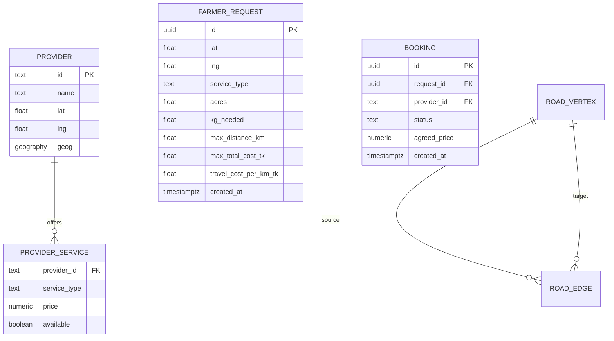

`FARMER_REQUEST` and `BOOKING` are **proposed** and not yet in `schema.sql`.

### 5.1b Extended conceptual model (proposed — v0.2)

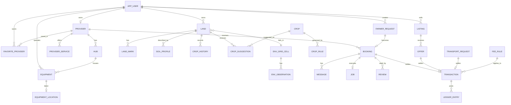

All tables in 5.1b except those in 5.2 are **proposed**.

### 5.2 Physical schema (current)

| Table               | Columns                                                                                                                  | Notes                           |
| ------------------- | ------------------------------------------------------------------------------------------------------------------------ | ------------------------------- |
| `providers`         | `id text PK`, `name text`, `lat float8`, `lng float8`, `geog geography(point,4326) generated`                            | GiST index `providers_geog_idx` |
| `provider_services` | `provider_id text FK`, `service_type text check`, `price numeric`, `available boolean`, `seed_varieties jsonb`, PK `(provider_id, service_type)` | Cascade delete; seed offers carry per-variety prices |
| `road_vertices`     | `id int PK`, `lon float8`, `lat float8`, `geom geometry(point,4326) generated`                                           | GiST index                      |
| `road_edges`        | `id int PK`, `source int FK`, `target int FK`, `cost float8`, `reverse_cost float8`, `geom geometry(linestring,4326)`    | Source/target indexes           |

**RLS:** public read policies exist for `providers` and `provider_services`; `anon` can execute the read-only RPCs. Write access requires the service role (scripts) or a future authenticated provider policy.

### 5.2b Proposed physical schema (v0.2)

| Table                  | Key columns                                                                                                              | Notes                                              |
| ---------------------- | ------------------------------------------------------------------------------------------------------------------------ | -------------------------------------------------- |
| `user_profiles`        | `id uuid PK = auth.users.id`, `name`, `language`, `roles text[]`, `phone`                                                | Roles checked by RLS                               |
| `providers`            | existing + `owner_id uuid`, `verification_level`, `profile jsonb`                                                         | `owner_id` required for writes                     |
| `hubs`                 | `id`, `provider_id`, `name`, `geog geography(point)`, `address`, `radius_km`                                             | Replaces single lat/lng long-term                  |
| `provider_services`    | existing + `price_unit`, `min_charge`, `status` (`available/busy/off_season`), `notes`                                    | Keep PK `(provider_id, service_type)` or add hub   |
| `equipment`            | `id uuid`, `provider_id`, `hub_id`, `type`, `model`, `capacity`, `status`, `operator_id`                                  | FR-14.5                                            |
| `equipment_location`   | `equipment_id PK`, `geog`, `source` (`live/manual`), `updated_at`                                                         | One row per equipment (latest)                     |
| `lands`                | `id uuid`, `owner_id`, `name`, `geom geometry(polygon)` / `centroid`, `area_acres`, `attributes jsonb`, `archived`        | GiST index; validity check                         |
| `land_marks`           | `id`, `land_id`, `type`, `name`, `geom`, `note`, `photo_path`                                                             | FR-19.3                                            |
| `farmer_requests`      | per 5.1 + `land_id`                                                                                                       | Proposed in v0.1                                   |
| `bookings`             | `id`, `request_id`, `provider_id`, `equipment_id`, `status`, `price_snapshot jsonb`, `created_at`, `expires_at`           | State machine per FR-09                            |
| `messages`             | `id`, `booking_id`, `sender_id`, `type`, `body`, `created_at`                                                             | Append-only                                        |
| `jobs`                 | `id`, `booking_id`, `status`, `actual_quantity`, `started_at`, `ended_at`, `confirmed_at`                                 | FR-17                                              |
| `reviews`              | `id`, `booking_id`, `rater_id`, `ratee_id`, `rating`, `tags`, `visibility`                                                | Unique per booking and direction                   |
| `favorites`            | `user_id`, `provider_id`, `created_at`                                                                                    | FR-15.1                                            |
| `env_grid_cells`       | `id`, `geom`, `source`, `resolution_km`                                                                                   | Lands map to a cell                                |
| `env_observations`     | `cell_id`, `date`, `variable`, `value`, `source`, `fetched_at`; PK `(cell_id, date, variable, source)`                    | Written by scheduled job only                      |
| `soil_profiles`        | `land_id`, `texture`, `ph`, `organic_carbon`, `source`, `resolution_m`, `is_farmer_provided`                              | FR-20.4 / 20.11                                    |
| `crops`, `crop_rules`  | crop, season window, soil texture, pH range, water need, duration, `rule_version`, `reviewed_by`, `reviewed_at`           | Admin-managed                                      |
| `crop_suggestions`     | `land_id`, `crop_id`, `score`, `confidence`, `reasons jsonb`, `rule_version`, `created_at`                                | FR-21.8                                            |
| `listings`, `offers`   | listing: owner, crop, quantity, unit, price, status, geog; offer: listing, buyer, price, quantity, status                 | FR-13 (experimental)                               |
| `fee_rules`            | `id`, `scope`, `type`, `value`, `effective_from`, `effective_to`                                                          | FR-22.1                                            |
| `transactions`         | `id`, `booking_id/offer_id`, `gross`, `fee`, `net`, `status`, `fee_rule_id`                                               | Money as integer paisa or `numeric`                |
| `ledger_entries`       | `id`, `transaction_id`, `account`, `amount`, `direction`, `created_at`                                                    | Append-only; no UPDATE/DELETE grants               |
| `audit_log`            | `id`, `actor_id`, `action`, `object`, `before`, `after`, `created_at`                                                     | FR-11.5, FR-22.11                                  |
| `consents`             | `user_id`, `type`, `version`, `granted_at`, `revoked_at`                                                                  | FR-08.9                                            |

**Proposed access matrix (RLS):**

| Data                         | Farmer           | Provider owner       | Operator         | Buyer          | Admin / support    |
| ---------------------------- | ---------------- | -------------------- | ---------------- | -------------- | ------------------ |
| Providers, offers (public)   | Read             | Read/write own       | Read             | Read           | Read/write         |
| Lands, marks                 | Own only         | Only for accepted bookings (shared fields) | Only assigned jobs | None | Read (audited) |
| Bookings, messages, jobs     | Own              | Own provider's       | Assigned jobs    | None           | Read (audited)     |
| Equipment location           | Rounded, active match/job only | Own equipment | Own (while on duty) | None     | Read (audited)     |
| Env observations             | Read             | Read                 | Read             | Read           | Read/write         |
| Listings, offers             | Own / read       | Read                 | None             | Read, own offers | Read/write       |
| Transactions, ledger         | Own              | Own                  | None             | Own            | Read (audited)     |
| Documents (NID, licence)     | Own upload       | Own upload           | None             | None           | Read (audited)     |

### 5.3 Data volumes (current baseline)

| Dataset        | Volume                                               |
| -------------- | ---------------------------------------------------- |
| Providers      | 100 synthetic                                        |
| Service offers | 210 (seed 66, sprayer 73, tractor 71)                |
| Road vertices  | 33,220                                               |
| Road edges     | 34,159                                               |
| Demo area      | ~18 km × 18 km around Rangpur (25.7439 N, 89.2752 E) |
| Road data file | ~6.2 MB JSON / ~5.1 MB SQL                           |

### 5.4 Data quality rules

| ID    | Rule                                                                                                 |
| ----- | ---------------------------------------------------------------------------------------------------- |
| DQ-01 | Every provider has a unique id and non-null name.                                                    |
| DQ-02 | Coordinates are WGS84 and inside Bangladesh for this project.                                        |
| DQ-03 | Every service has a positive price and a boolean availability.                                       |
| DQ-04 | Seed prices are per kg; tractor/sprayer prices are per acre.                                         |
| DQ-05 | A road edge's `source` and `target` exist in `road_vertices`.                                        |
| DQ-06 | `reverse_cost` is `-1` for one-way against direction, otherwise equal to `cost`.                     |
| DQ-07 | Road distance must be ≥ straight-line distance for the same pair (sanity check).                     |
| DQ-08 | No provider is silently dropped when its nearest road vertex is unreachable; fall back to Haversine. |
| DQ-09 | Synthetic data is clearly labelled as demo data in the UI/docs.                                      |
| DQ-10 | A land polygon is valid and simple (`ST_IsValid`); area matches the polygon within tolerance unless manually overridden and flagged. |
| DQ-11 | Equipment location carries a UTC timestamp and source; locations older than the TTL are never used for ranking.                       |
| DQ-12 | Every environmental value has source, observation date, grid cell, and resolution; no value without provenance is displayed.          |
| DQ-13 | Money amounts are stored as integers (paisa) or `numeric`, never floating point; fee ≥ 0; ledger entries per transaction balance.     |
| DQ-14 | Messages and ledger entries are append-only; corrections are new rows.                                                                |
| DQ-15 | Listing quantity > 0 and never oversold; price > 0.                                                                                    |
| DQ-16 | Each crop rule has a version, reviewer, and review date; suggestions record the rule version used.                                    |

### 5.5 Privacy and data classification

| Data                            | Sensitivity | Handling                                               |
| ------------------------------- | ----------- | ------------------------------------------------------ |
| Farmer location / request       | Personal    | Don't publish raw coordinates; aggregate for analytics |
| Provider phone/contact (future) | Personal    | Authenticated access only                              |
| Provider price/availability     | Business    | Public by design                                       |
| Auth credentials                | Secret      | Supabase Auth; never log                               |
| API keys                        | Secret      | `.env`; service role only in Node scripts              |
| Live equipment/operator location| Personal    | Opt-in, on-duty only, TTL, latest-only storage, rounded for farmers   |
| Land boundaries and marks        | Personal    | Owner only; shared with the booked provider for accepted jobs only    |
| Chat messages, voice notes       | Personal    | Participants + audited admin; retention policy; private storage       |
| Payment and ledger records       | Financial   | Own records only; admin access audited; no card data stored           |
| NID / licence documents          | Sensitive   | Private bucket, signed URLs, admin review only, delete on rejection   |
| Crop and yield history           | Personal/business | Owner only; aggregated before research export                   |

---

## 6. Business Rules and Algorithms

### 6.1 Eligibility filters (must all pass)

For each provider offer of the requested service:

1. The provider offers `service_type`.
2. `available = true`.
3. `distance_km ≤ max_distance_km`.
4. `total_cost_tk ≤ max_total_cost_tk`.

### 6.2 Distance calculation ladder

| Level | Method                                   | When used                                     | Reported as       |
| ----- | ---------------------------------------- | --------------------------------------------- | ----------------- |
| 1     | pgRouting Dijkstra on OSM road graph     | Road graph and RPC available                  | `road`            |
| 2     | PostGIS `ST_DistanceSphere` (Haversine)  | Road RPC fails/times out, or graph not loaded | `haversine`       |
| 3     | Client-side Haversine over the on-device store (SQLite/AsyncStorage) in production; json-server in development only | Supabase not configured or both RPCs fail | `local-cache` / `json-server` |
| 4     | Show map with the last cached data and a status badge                                            | All backends unreachable and no usable cache  | status badge only |

The chosen mode is cached after the first probe (`_distanceKind`) to avoid repeating a slow failing query. A timeout during a later match degrades that match and updates the cached mode.

### 6.3 Cost model

```
service_cost =
  seed              → price_per_kg  × kg_needed
  tractor/sprayer   → price_per_acre × acres

travel_cost = distance_km × travel_cost_per_km_tk

total_cost  = service_cost + travel_cost
```

### 6.4 Ranking score

```
cost_norm   = total_cost / max_total_cost_tk
distance_norm = distance_km / max_distance_km
score       = 0.7 × cost_norm + 0.3 × distance_norm
```

Lower score is better. Both normalisers are bounded by the farmer's own constraints, so scores are comparable within a single request, not across requests.

### 6.5 Tie-breaking and edge cases

| Case                            | Rule                                                                                                                            |
| ------------------------------- | ------------------------------------------------------------------------------------------------------------------------------- |
| Equal scores                    | Current implementation relies on array/sort order; **TBD** deterministic tie-breaker (e.g., shorter distance, then provider id) |
| No candidates                   | Return `success: false` with an empty list and a helpful message                                                                |
| Zero acres/kg                   | Cost is travel-only; validate whether this should be allowed                                                                    |
| Max cost/distance = 0           | Division by zero risk; validation must reject                                                                                   |
| Provider not connected to roads | Use Haversine for that provider (never drop silently)                                                                           |
| Road distance > straight line   | Expected; ensure the distance filter still applies                                                                              |
| One-way road                    | `reverse_cost = -1`, honoured by `pgr_dijkstra(..., directed := false)` with reverse-cost semantics                             |

### 6.6 Worked example

Request: tractor, 5 acres, at Rangpur center (25.7439, 89.2752), max 12 km, max 2,000 Tk, travel rate 10 Tk/km.

For Provider_6 (tractor at 254 Tk/acre, ~3.2 km straight):

```
service_cost = 254 × 5            = 1,270 Tk
travel_cost  = 3.2 × 10           =    32 Tk
total_cost                        = 1,302 Tk
score = 0.7 × (1302/2000) + 0.3 × (3.2/12)
      = 0.4557 + 0.0800 = 0.5357
```

### 6.7 Matching pseudocode

```
function match(request, dataset):
    candidates = []

    for provider in dataset:
        offer = provider.services[request.service_type]
        if offer is missing or not offer.available: continue

        d = distance(provider, request.location)      # road or Haversine
        if d uncomputable: d = haversine(provider, request.location)
        if d > request.max_distance_km: continue       # recommended post-road check

        service_cost = price(offer) * quantity(request)
        total = service_cost + d * request.travel_cost_per_km_tk
        if total > request.max_total_cost_tk: continue

        score = 0.7 * (total / request.max_total_cost_tk)
              + 0.3 * (d / request.max_distance_km)
        candidates.append({ score, provider, d, total })

    sort candidates by score ascending
    return best + ranked list
```

### 6.8 Road graph construction rules

- Bounding box: the `db.geo.json` grid origin/corner expanded by 0.005°.
- Drivable highways: motorway, trunk, primary, secondary, tertiary, unclassified, residential, service, track, living_street, road. More road criteria should be filled. Database exceeding free limit is the current limitation. Will take decisions about it
- Each consecutive OSM node pair becomes an edge.
- Cost: rounded Haversine km (`1e-5` precision).
- One-way handling: `oneway=yes/true/1` → `reverse_cost = -1`; `oneway=-1` reverses direction; otherwise bidirectional.
- Degenerate edges (< 1e-6 km, self-loops) are skipped.
- Data source order: Overpass mirrors (6) → cached/Downloaded Geofabrik PBF.

### 6.9 Effective origin for equipment (FR-18)

Candidates are equipment. For each equipment `e` offering the service:

```
if e has an active job:            exclude (or ETA-adjust, if configured)
else if live location fresh (now - updated_at <= TTL) and source == live:
                                   origin = live location,   origin_kind = "live"
else if manual location fresh (<= TTL):
                                   origin = manual location, origin_kind = "manual"
else:
                                   origin = hub of e,        origin_kind = "hub"
```

The provider appears once in the farmer's list, using the best-ranked equipment. Distance and cost use the same formulas as 6.3/6.4, computed from the effective origin. Result contract adds `origin_kind` (NFR-16 stays satisfied).

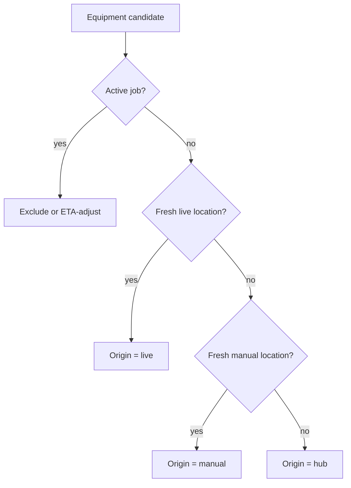

### 6.10 Booking price and platform fee (FR-09, FR-22)

```
price_snapshot = service_cost + travel_cost      (at request time, per 6.3)
final_amount   = rate x actual_quantity + travel_cost   (after the job, if quantity differs)
fee            = fee_rule(service_type) applied to fee_base
net_to_provider = final_amount - fee
```

- If `final_amount` differs from `price_snapshot` by more than a configurable tolerance (initial: 10%), the farmer must confirm before the booking completes.
- **Fee base (service only vs. service + travel) is undecided — D-29.** Fee rate and who pays are undecided — D-28.
- Fee rule version is stored on every transaction.

### 6.11 Crop suitability scoring (FR-21)

1. **Hard filters:** the crop's sowing window must include today's season window; water need must be feasible (irrigation available or moisture adequate); previous-crop rotation conflicts exclude the crop.
2. **Soft score (higher is better), initial weights — tune with expert and pilot data:**

```
score = 0.40 x soil_fit + 0.30 x water_fit + 0.20 x rotation_fit + 0.10 x market_fit
```

   If market input is disabled (default), redistribute: `0.45 / 0.33 / 0.22`.
3. **Confidence:** `high` if soil, moisture, and season data are all present and fresh; `medium` if one is missing or stale; `low` if two or more are missing.
4. **Output:** top N crops, each with matched factors, caveats, sowing window, duration, and rule version.
5. Rules are authored from authoritative sources and **reviewed by an agriculture expert** before use. The weights above are starting values, not agronomic truth.

### 6.12 Environmental classes (FR-20)

Plain-language classes make charts understandable. **Thresholds below are placeholders and must be calibrated with local data and an expert:**

| Indicator                | Classes (placeholder thresholds)                                          |
| ------------------------ | ------------------------------------------------------------------------- |
| Soil wetness (0–1 index) | dry < 0.35 · adequate 0.35–0.70 · wet > 0.70                              |
| Rainfall (7 days)        | compared with the grid cell's climatology: below / near / above normal    |
| Temperature              | compared with the seasonal normal: cooler / normal / hotter               |
| Vegetation (NDVI)        | low / moderate / high relative to the same period last year              |

### 6.13 Availability model (D-14)

Recommended hybrid: **manual status** (available/busy/off-season) + **calendar** (FR-14.7) + **booking-derived busy** (accepted booking or active job marks the equipment busy for its duration). Matching uses the combined result.

### 6.14 Rating aggregation (FR-02.11, FR-15.6)

To avoid small-sample bias, display a smoothed average: `rating = (C x m + sum of ratings) / (C + n)`, with `m` the platform mean and `C` a small constant (e.g., 5). Ranking use of ratings is optional (FR-02.11) and off by default until enough data exists.

### 6.15 Marketplace matching (experimental, FR-13)

v1 has **no algorithmic ranking**: listings are sorted by distance, then available date. Price benchmarks are informational only. Offers follow the same accept/counter/decline pattern as bookings.

---

## 7. Non-Functional Requirements

| ID     | Category        | Requirement                                                       | Target / acceptance                                     |
| ------ | --------------- | ----------------------------------------------------------------- | ------------------------------------------------------- |
| NFR-01 | Performance     | Match latency on demo dataset                                     | p95 < 2 s over 4G; road RPC < 1.5 s                     |
| NFR-02 | Performance     | App cold start to interactive map                                 | < 5 s on a mid-range Android device                     |
| NFR-03 | Capacity        | Providers per demo area                                           | ≥ 1,000 providers with GiST index; current 100          |
| NFR-04 | Capacity        | Road graph in demo area                                           | ≥ 30k edges loaded and routable                         |
| NFR-05 | Availability    | Backend failure does not block the UI                             | 100% of tested failure modes show a fallback or message |
| NFR-06 | Reliability     | No unhandled promise rejection during matching                    | Verified in manual fault-injection tests                |
| NFR-07 | Reliability     | Results deterministic for identical inputs                        | 10 repeated runs → identical ranking                    |
| NFR-08 | Usability       | First-time user completes a match                                 | ≤ 3 taps + form defaults; think-aloud test              |
| NFR-09 | Usability       | All numeric fields have labels and units                          | UI review checklist                                     |
| NFR-10 | Compatibility   | Android 8+ (API 26+)                                              | Test on at least two physical devices                   |
| NFR-11 | Compatibility   | Expo SDK 54 APIs only; no Expo Go assumption for MapLibre         | Dev build documented                                    |
| NFR-12 | Security        | Service-role key never shipped in the app bundle                  | Bundle inspection + `.env` policy                       |
| NFR-13 | Security        | RLS enabled on all public tables; writes authenticated/authorised | Schema review                                           |
| NFR-14 | Security        | Inputs validated before RPC                                       | Client and server-side checks                           |
| NFR-15 | Privacy         | No raw farmer coordinates in analytics exports                    | Aggregation/anonymisation rule                          |
| NFR-16 | Maintainability | One distance/ranking contract across modes                        | Same result shape from all backends                     |
| NFR-17 | Maintainability | Config via environment, not hardcoded IPs                         | No LAN IP in source                                     |
| NFR-18 | Testability     | Core formulas unit-tested                                         | Haversine + score tests with known values               |
| NFR-19 | Testability     | Acceptance scenarios automated where possible                     | RPC integration tests + manual UI matrix                |
| NFR-20 | Scalability     | Add a new district without code changes                           | Data + bbox driven; configuration documented            |
| NFR-21 | Legal           | OSM/ODbL attribution visible                                      | In-app attribution + README/docs                        |
| NFR-22 | Accessibility   | Contrast and touch targets                                        | WCAG AA contrast; ≥ 44 px targets                       |
| NFR-23 | Localization    | Bangla + English ready                                            | All strings externalised (proposed)                     |
| NFR-24 | Observability   | Structured logs for failures                                      | Client + script logs; no secrets                        |
| NFR-25 | Realtime       | Message delivery and equipment-location refresh latency            | Messages < 3 s online; location view < 10 s (p95)       |
| NFR-26 | Battery        | Operator location sharing cost                                      | ≤ 5% battery per hour on a mid-range device (measure; tunable) |
| NFR-27 | Notifications  | Push and SMS-fallback delivery                                      | Push < 30 s p95 when online; SMS fallback < 2 min for critical events |
| NFR-28 | Data freshness | Environmental data refresh and display                              | Refreshed daily; stale after 3 days and flagged         |
| NFR-29 | Resilience     | External APIs called only from the server with caching, retry/backoff, circuit breaker | No client-side dependency on NASA/SoilGrids |
| NFR-30 | Financial integrity | Ledger is append-only and balanced; money never stored as float | Daily reconciliation job passes; zero float columns for money |
| NFR-31 | Security       | Role-based RLS on all new tables; private storage buckets with signed URLs | Schema review + automated RLS tests (AT-27) |
| NFR-32 | Privacy        | Consent log, data export and deletion, retention schedule (chat ~12 months, location history ~30 days — tunable) | Documented; legal review for applicable Bangladeshi rules |
| NFR-33 | Media          | Photos compressed on device; voice notes ≤ 30 s                     | Photo ≤ 300 KB typical                                  |
| NFR-34 | Offline        | Lands, bookings, and last results readable offline; writes queued   | Verified on a physical device in airplane mode          |
| NFR-35 | Localization   | Bangla numerals and local units (decimal, bigha) supported          | Unit conversion tests; Bangla font check               |
| NFR-36 | Scalability    | Concurrent tracked equipment                                        | ≥ 200 in pilot without degradation; design for 1,000    |
| NFR-37 | Auditability   | Admin, agent, and financial actions logged with actor/time/before/after | Audit rows for 100% of such actions                 |
| NFR-38 | Maintainability | All schema changes via versioned migrations (`supabase/migrations`) | Database reproducible from scratch in staging           |

---

## 8. System Architecture and Working Process

### 8.1 Component view

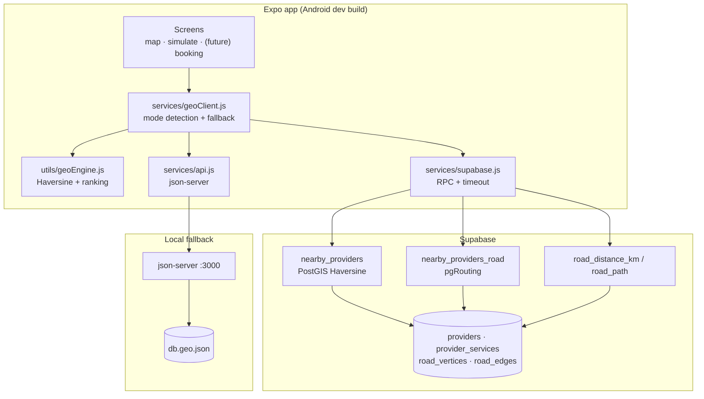

### 8.2 Request lifecycle

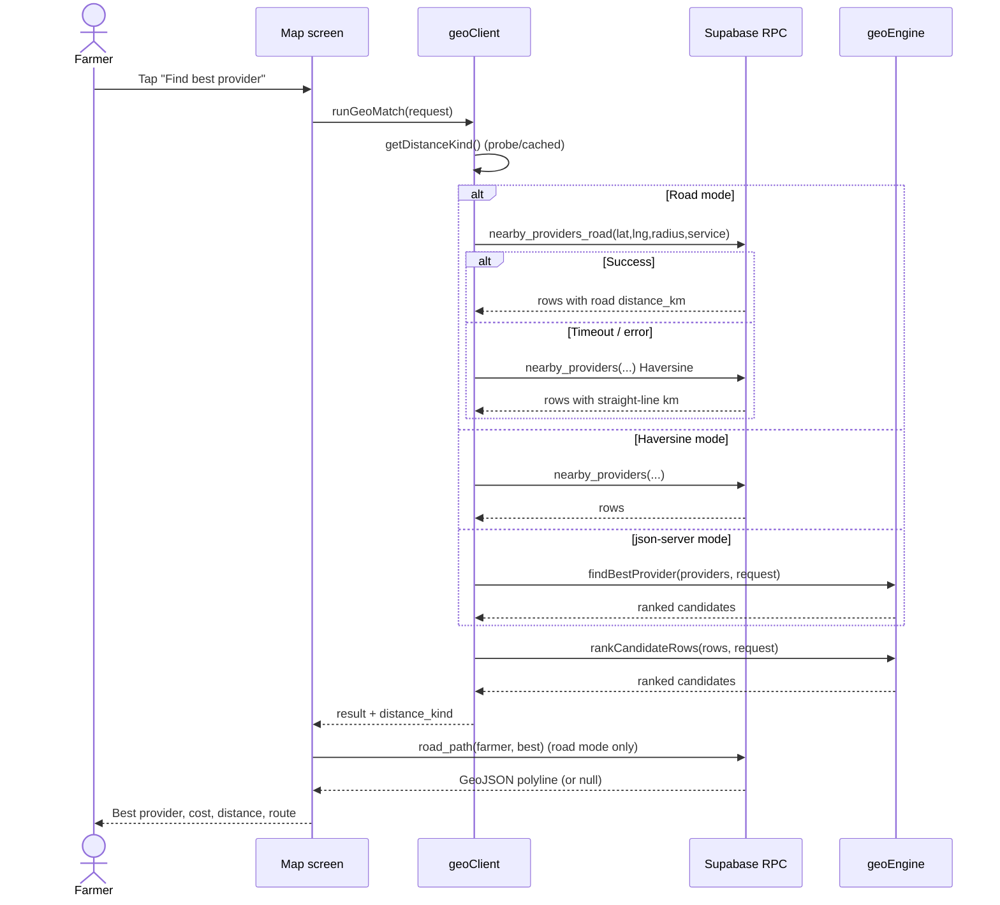

### 8.3 Data pipeline

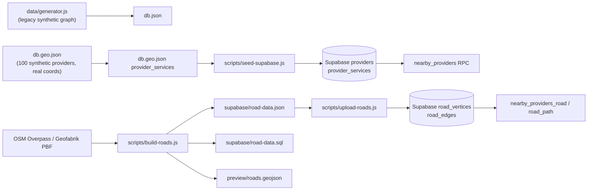

### 8.4 Repository structure

```
FarmerHelper/
├── app/                        # Expo Router routes
│   ├── (tabs)/
│   │   ├── _layout.tsx         # tab bar
│   │   ├── index.tsx           # template Home
│   │   ├── explore.tsx         # template Explore
│   │   ├── map.tsx             # MapLibre matching screen
│   │   └── simulate.jsx        # scenario simulator
│   ├── _layout.tsx             # root stack
│   └── modal.tsx
├── components/                 # UI primitives (template)
├── constants/                  # theme
├── hooks/                      # color scheme/theme hooks
├── services/
│   ├── api.js                  # json-server client (hardcoded LAN IP)
│   ├── geoClient.js            # backend selection + fallback
│   └── supabase.js             # RPC client + 8s timeout
├── utils/
│   ├── geoEngine.js            # Haversine + ranking
│   └── farmMatchEngine.js      # legacy grid Dijkstra
├── supabase/
│   ├── schema.sql              # providers + Haversine RPC
│   ├── routing-schema.sql      # pgRouting tables/functions
│   ├── road-data.json          # generated graph (git-ignored)
│   └── road-data.sql           # generated SQL (git-ignored)
├── scripts/
│   ├── generate-geo-data.js
│   ├── build-roads.js
│   ├── upload-roads.js
│   ├── check-roads.js
│   ├── seed-supabase.js
│   ├── preview-match.js
│   └── .cache/                 # OSM PBF cache (git-ignored)
├── preview/                    # Leaflet preview + roads.geojson
├── db.geo.json                 # real-coordinate synthetic dataset
├── db.json                     # legacy dataset
└── docs/
    ├── brainstorm.md
    └── doc.md                  # this document
```

### 8.5 Environments

| Environment      | App backend                    | Data                          | Use                         |
| ---------------- | ------------------------------ | ----------------------------- | --------------------------- |
| Local offline    | json-server (`db.geo.json`)    | Synthetic                     | UI work without internet    |
| Supabase dev     | Supabase project               | Seeded synthetic + road graph | Integration/routing testing |
| Supabase staging | Separate project (recommended) | Real/verified pilot data      | Pre-pilot                   |
| Production       | Production project             | Real provider data            | Pilot/release (future)      |

**Current reality:** one Supabase project is used; there is no staging/prod split yet. Introduce this before real data.

### 8.6 Build, run, and deploy workflow

```bash
# App
npm install
npx expo start              # Expo Go (no MapLibre)
npm run android             # development build (MapLibre works)
npm run web                 # web preview

# Data and backend
npm run generate-geo        # regenerate real-coordinate dataset
npm run seed-supabase       # providers/services -> Supabase
npm run build-roads         # OSM -> road-data.json/sql + preview
npm run upload-roads        # road graph -> Supabase
npm run check-roads         # verify graph/topology
npm run preview-match       # CLI ranking scenarios
npm run build-preview       # build static Leaflet preview

# Quality
npm run lint
```

**Database setup order (current):**

1. Enable PostGIS and pgRouting in Supabase.
2. Run `supabase/schema.sql`.
3. Run `supabase/routing-schema.sql`.
4. `npm run seed-supabase`.
5. `npm run build-roads`.
6. `npm run upload-roads`.
7. Verify with `nearby_providers`, `nearby_providers_road`, `road_distance_km`, `road_path`.

### 8.7 Degradation matrix

| Failure                      | Detection                 | User experience                         | Recovery                                         |
| ---------------------------- | ------------------------- | --------------------------------------- | ------------------------------------------------ |
| Road RPC missing             | Probe fails once          | Haversine results; badge says Haversine | Rebuild/upload graph; restart app or clear cache |
| Road RPC times out mid-match | Timeout regex             | Retry Haversine for this match          | Next match uses Haversine (cached)               |
| Supabase unreachable         | 8 s timeout / fetch error | json-server results if configured       | Restore network                                  |
| json-server unreachable      | 5 s axios timeout         | Map + “Backend unreachable” badge       | Start json-server / fix IP                       |
| No eligible provider         | Empty ranked list         | “No eligible provider” message          | Adjust criteria                                  |
| Road path unreachable        | `null` from `road_path`   | Dashed straight line                    | None needed                                      |

### 8.8 Observability (proposed)

- Client: a small logger with levels; match mode, latency, candidate count, error class (no coordinates or keys in logs).
- Scripts: clear step logs with counts and sanity assertions.
- Supabase: query performance via dashboard; log slow RPCs.
- Future: Sentry (or equivalent) + a `match_events` analytics table with aggregated, privacy-safe fields.

### 8.9 Target module view (proposed)

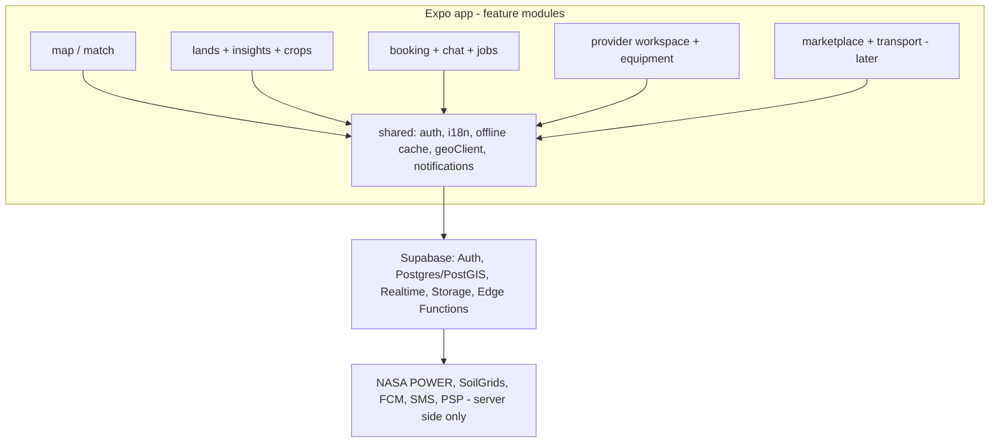

### 8.10 Booking, communication and notification flow

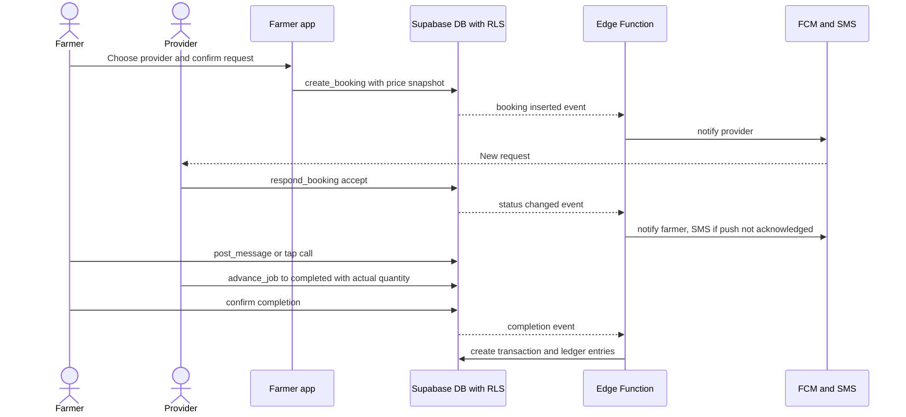

### 8.11 Environmental data pipeline

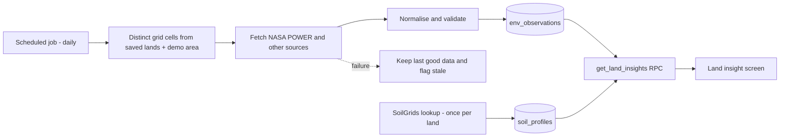

Design rule: fetch **per grid cell**, not per farmer, so many lands in one cell cost one API call.

### 8.12 Equipment location flow (when FR-18 option B/C is built)

- **Option B (manual):** provider picks a hub or drops a pin → `set_equipment_location(source = manual)` → TTL timer starts.
- **Option C (operator phone):** operator toggles "on duty" → app sends location at the adaptive interval → `set_equipment_location(source = live)` overwrites the latest row; stopping duty stops updates and marks `offline`.
- Matching reads the latest row and applies 6.9. Farmers never read raw coordinates; the API returns rounded positions for relevant matches/jobs only.

### 8.13 Target repository additions (proposed)

```
FarmerHelper/
├── app/
│   ├── (auth)/                # onboarding, OTP
│   ├── (tabs)/                # map, lands, bookings, profile
│   ├── provider/              # workspace, equipment, onboarding wizard
│   └── marketplace/           # later
├── features/                  # lands, bookings, chat, jobs, insights, crops
├── i18n/                      # bn.json, en.json
├── supabase/
│   ├── migrations/            # versioned SQL (NFR-38)
│   ├── functions/             # ingest_env_data, send_notification, ...
│   └── seed/
├── data/crop-rules/           # versioned suitability tables + review record
└── docs/
    ├── PRD.md
    └── doc.md                 # this SRS
```

### 8.14 Environments and migrations

Create **staging** before real data (R-06). Move all SQL to `supabase/migrations`, applied in order, so dev/staging/prod are reproducible. Secrets (SMS, FCM, PSP, Earthdata) live only in Supabase function secrets or EAS secrets — never in the app bundle.

---

## 9. Project Plan

### 9.1 Phase plan

| Phase                          | Objective                           | Key deliverables                                              | Exit criteria                                | Status           |
| ------------------------------ | ----------------------------------- | ------------------------------------------------------------- | -------------------------------------------- | ---------------- |
| 0. Discovery & requirements    | Agree on scope and architecture     | This SRS, PRD, interviews, data-model decisions               | Team + supervisor review complete            | In progress      |
| 1. Foundation                  | Expo app + dataset + map            | Tabs, MapLibre map, `db.geo.json`, provider markers           | Map renders with 100 providers               | Done (prototype) |
| 2. Matching engine             | Haversine + ranking                 | `geoEngine`, simulator, CLI preview                           | Correct ranking for fixed scenarios          | Done (prototype) |
| 3. Real road routing           | OSM + pgRouting                     | Road graph, upload, RPCs, polyline                            | Road distance ≥ straight line; route renders | Done (prototype) |
| 4. Farmer core + lands (R0.2)  | Usable farmer experience            | Real Home, GPS, validation, phone OTP, **FR-19 saved lands**, offline cache | Farmer saves a land and runs a match with it | Next             |
| 5. Provider side (R0.3a)       | Providers manage their business     | **FR-14 profile/hubs/offers**, **FR-17 onboarding**, roles/RLS | A provider publishes a service              | Planned          |
| 6. Booking + communication (R0.3b) | Request → accept → talk         | **FR-09 lifecycle, FR-16 push/thread/call**                   | Booking happy path + decline/cancel/expire   | Planned          |
| 7. Trust and records (R0.4)    | Prove work happened                 | **FR-17 job tracking, FR-15 favourites/ratings**, notifications, Bangla/English | Booking reaches confirmed completion + rating | Planned    |
| 8. Land intelligence (R0.5)    | Insight and advice                  | **FR-20 NASA/soil, FR-21 crop v1** (expert-reviewed rules)   | Insight + suggestion for a saved land        | Planned          |
| 9. Hardening and pilot (R1.0)  | Operability and proof               | Admin console, analytics, **FR-22 ledger-lite**, staging, tests, CI | No P0 bugs; pilot metrics visible       | Planned          |
| 10. Fleet-aware matching (R1.1)| Test hypothesis H-1                 | **FR-18 option B**; option C only if criterion met            | H-1 evaluated with pilot data                | Planned          |
| 11. Marketplace and business (R2.0) | Expand if justified            | **FR-13 marketplace, FR-22 payments/transport**               | Gate: pilot results + legal review           | Gated            |

### 9.2 Sizing, dependencies, and re-baselining

The original 16-week table cannot hold ten new features. Re-baseline with the team using the effort sizes below (S ≈ days, M ≈ 1–2 weeks, L ≈ 2–4 weeks, XL ≈ 4+ weeks for one developer; adjust to your team).

| Feature                                  | Size | Depends on                  | Notes                                                       |
| ---------------------------------------- | ---- | --------------------------- | ----------------------------------------------------------- |
| FR-08 auth + roles + RLS                 | M    | —                           | Foundation for everything below                             |
| FR-19 saved lands + marks                | M    | FR-08                       | Polygon drawing and unit conversion take the time           |
| FR-14 provider profile/hubs/offers       | L    | FR-08                       | Equipment register can follow                               |
| FR-09 booking lifecycle                  | L    | FR-14, FR-08                | State machine + RLS + tests                                 |
| FR-16 communication                      | L    | FR-09                       | Push first; SMS fallback and voice later                    |
| FR-17 onboarding + job tracking          | M    | FR-14, FR-09                |                                                             |
| FR-15 relationships and ratings          | M    | FR-17                       | Favourites + ratings first                                  |
| FR-20 NASA/soil data                     | L    | FR-19                       | Ingestion job + charts; start with POWER                    |
| FR-21 crop suggestion                    | L    | FR-20, expert review        | Content-heavy: crop table authoring and review              |
| FR-18 equipment location                 | M (B) / XL (C) | FR-14             | Build B first; C only if criterion met                      |
| FR-22 ledger-lite                        | M    | FR-17                       | Records only                                                |
| FR-22 payments + transport               | XL   | FR-22 ledger, legal review  | Gated                                                       |
| FR-13 marketplace                        | XL   | FR-08, FR-16, FR-22 ledger  | Experimental; gated                                         |
| FR-11 admin and analytics                | L    | Most of the above           | Web console                                                 |

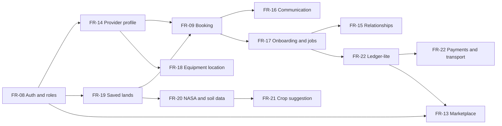

> The current codebase already covers most of FR-01 to FR-07 technically. Mark completed items rather than repeating them.

### 9.3 Workstreams and ownership (fill in)

| Workstream             | Owner | Responsibilities                                  |
| ---------------------- | ----- | ------------------------------------------------- |
| Mobile UI/UX           | TBD   | Screens, accessibility, localization, navigation  |
| Matching/routing       | TBD   | Ranking rules, RPCs, road graph, benchmarks       |
| Data/backend           | TBD   | Schema, seeding, Supabase environments, privacy   |
| Product/field research | TBD   | Personas, provider recruitment, pilot, evaluation |
| Documentation/QA       | TBD   | SRS upkeep, test matrix, release notes            |

### 9.4 Definition of Done (per feature)

- Requirements and acceptance criteria in this document are updated.
- Works on a physical Android dev build, not only in a browser.
- Handles loading, empty, error, timeout, and permission-denied states.
- Inputs validated; no unhandled promise rejections.
- Data-provenance label is accurate (road/Haversine/demo).
- Unit tests for formulas; integration test for RPC changes.
- No secrets or LAN IPs in source.
- Screenshots or a short clip attached to the PR/demo notes.

### 9.5 Testing strategy

| Level        | Scope                                                           | Tools / approach                           |
| ------------ | --------------------------------------------------------------- | ------------------------------------------ |
| Unit         | Haversine, cost, score, tie-breaking, input coercion            | Node test runner (proposed: `node --test`) |
| Integration  | RPC contracts, fallback ladder, RLS                             | Supabase dev project + scripted calls      |
| Data quality | Counts, coordinate bounds, edge integrity, road ≥ straight line | `check-roads.js` + SQL assertions          |
| UI/manual    | All screens, permissions, offline/timeout states                | Device matrix + checklist                  |
| Performance  | Match latency, cold start, graph query time                     | Timing logs + repeated runs                |
| Security     | Key exposure, RLS, input handling                               | Bundle scan + policy review                |
| Acceptance   | Appendix D scenarios                                            | Manual + scripted where possible           |

**Test data:** fixed scenarios in `scripts/preview-match.js`; add edge cases (no candidates, zero budget, unreachable provider, slow network).

### 9.6 Release plan

| Release        | Contents                                                                 | Channel                        |
| -------------- | ------------------------------------------------------------------------ | ------------------------------ |
| R0.1 (current) | Map + matching + road routing prototype                                  | Internal dev build             |
| R0.2           | Farmer flow polish, GPS, validation, phone OTP, **saved lands (FR-19)**, offline cache | Internal APK         |
| R0.3           | **Provider profile + onboarding (FR-14, FR-17A), booking + communication (FR-09, FR-16)** | Internal APK + staging backend |
| R0.4           | **Job tracking (FR-17B), relationships/ratings (FR-15)**, notifications, Bangla/English | Internal APK + staging   |
| R0.5           | **NASA/soil data (FR-20), crop suggestion v1 (FR-21)**                   | Internal APK + staging         |
| R1.0 (pilot)   | Admin console, analytics, **ledger-lite (FR-22 A)**, hardening           | Pilot APK                      |
| R1.1           | **Equipment + manual current location (FR-18 B)**                        | Pilot APK                      |
| R2.0           | **Marketplace (FR-13), payments and transport (FR-22 B/C)** — gated      | Pilot / Play Store             |
| Future         | Store release, multi-district                                            | Play Store                     |

### 9.7 Documentation and handover

- Keep this SRS current (change log at the end).
- Maintain a short “run the project from zero” guide (setup order in 8.6).
- Record architecture decisions in Section 12.
- Document data provenance and licences for the thesis appendix.
- Add screenshots/benchmarks to the final report.

### 9.8 Recommended scope for the final-year evaluation (decision D-33)

| Tier                                    | Items                                                                                                       |
| --------------------------------------- | ----------------------------------------------------------------------------------------------------------- |
| **Core — build and demo fully**         | FR-19 saved lands · FR-14 provider profile (basic) · FR-09 booking (request-and-accept) · FR-16 (push, call, simple thread) · FR-17 onboarding + basic job completion · FR-20 NASA summary for a saved land · FR-21 rule-based suggestions (5–8 crops) |
| **Prototype-level**                     | FR-15 favourites + ratings · FR-18 option B (manual current location) · FR-22 ledger-lite                    |
| **Design-only (documented, not built)** | FR-13 marketplace · FR-22 payments and transport · FR-18 option C (live phone tracking)                      |

**Why:** the core tier tells one end-to-end story (_save land → insight → crop suggestion → find provider → book → job → rate_), keeps external dependencies small (no payments, no two-sided market), and each item can be shown on a physical Android device. This is a recommendation for the team and supervisor to confirm or change.

---

## 10. Risks and Mitigations

| ID   | Risk                                              | Likelihood  | Impact   | Mitigation                                                         |
| ---- | ------------------------------------------------- | ----------- | -------- | ------------------------------------------------------------------ |
| R-01 | MapLibre unavailable in Expo Go confuses testers  | High        | Medium   | Document dev-build requirement; provide a web/preview fallback     |
| R-02 | Synthetic provider data is mistaken for real data | Medium      | High     | Label demo data in UI/docs; plan real onboarding                   |
| R-03 | Road graph covers only Rangpur                    | High        | Medium   | State coverage; detect outside-bbox and fall back to Haversine     |
| R-04 | Supabase free-tier timeouts on routing            | Medium      | High     | Single many-to-one Dijkstra, timeouts, Haversine fallback, indexes |
| R-05 | OSM rural coverage is incomplete                  | Medium      | Medium   | Haversine fallback; data-quality checks; field validation          |
| R-06 | No staging/prod separation causes data accidents  | Medium      | High     | Create separate Supabase projects before pilot                     |
| R-07 | Service-role key leaks                            | Low         | Critical | `.env` ignored; scripts only; rotate keys; bundle scan             |
| R-08 | Hardcoded LAN IP breaks other developers          | High        | Low      | Move to environment config                                         |
| R-09 | Farmer location privacy concerns                  | Medium      | High     | Consent, minimal retention, aggregate analytics                    |
| R-10 | Ranking weights are arbitrary                     | Medium      | Medium   | Sensitivity analysis; document assumptions                         |
| R-11 | Scope creep (payments, multi-district)            | High        | High     | MoSCoW; defer “Could” items                                        |
| R-12 | No automated tests → regressions                  | High        | Medium   | Add unit/integration tests before booking work                     |
| R-13 | Provider phone/contact reliability                | Medium      | Medium   | Verification + fallback contact methods                            |
| R-14 | Bangla font/typography issues                     | Low         | Medium   | Early localization spike                                           |
| R-15 | Play Store/legal requirements                     | Low (pilot) | Medium   | Plan permissions/privacy policy before release                     |
| R-16 | Scope explosion: ten large features for a small team | High        | High     | Tiering (9.8), feature flags, stage gates, MoSCoW discipline        |
| R-17 | Two-sided cold start (providers, buyers)          | High        | High     | Supply first; assisted onboarding by field agent; one upazila       |
| R-18 | Live-location privacy, consent, and battery       | Medium      | High     | Manual location first; opt-in on-duty; TTL; rounding; adaptive interval |
| R-19 | NASA data too coarse and read as plot-level truth | High        | Medium   | Show resolution/source/date; "area conditions" wording; local soil data |
| R-20 | Wrong crop advice harms farmers                   | Medium      | High     | Expert-reviewed rules, confidence + caveats, advisory notice, no yield promises |
| R-21 | External API outage or rate limits                | Medium      | Medium   | Server-side ingestion + cache; graceful degradation (FR-20.7)       |
| R-22 | Payment and regulatory exposure                   | Medium      | High     | Ledger-only until legal review; licensed PSP; no custody of funds   |
| R-23 | Users bypass the platform after first contact     | High        | Medium   | Real value (trust, history, payments); contact revealed after acceptance |
| R-24 | Low digital literacy limits adoption              | High        | High     | Bangla, icons, quick replies, voice later, field-agent assistance   |
| R-25 | OTP/SMS cost and deliverability                   | Medium      | Medium   | Rate limits; PIN after first OTP; budget; provider comparison       |
| R-26 | Fake providers, listings, or reviews              | Medium      | High     | Verification levels, reporting, admin takedown, rate limits         |
| R-27 | Free-tier infrastructure limits (Realtime, storage) | Medium    | Medium   | Throttle, compress media, monitor, budget for upgrade               |
| R-28 | Marketplace sensitivities with existing intermediaries | Medium | Medium   | Keep experimental; pilot with willing buyers; clear exit criteria   |

---

## 11. Out of Scope and Future Backlog

**Explicitly out of scope for the current project:**

- Payment **gateway** integration, custody of funds, and gateway refunds (ledger-only recording is in scope; see D-03, D-27).
- Continuous background tracking of farmers.
- Crop-disease detection (image/AI), fertiliser prescriptions, yield guarantees, insurance.
- Government subsidy workflows.
- Full offline vector map downloads.
- Multi-country deployment.
- IoT sensor / drone integration.

**Changed from v0.1 (now in scope, in limited form):** operator-side equipment location (FR-18, opt-in) and rule-based crop suggestions (FR-21, advisory only).

**Future backlog (prioritised later):**

1. Real provider onboarding with verification at scale.
2. Ratings/reviews feeding the ranking.
3. Price transparency analytics (fair-price range by area/service).
4. Multi-district graph builds and incremental OSM updates.
5. Voice input and voice notes at scale.
6. Weather alerts and forecast integration.
7. Provider route optimisation for multiple bookings.
8. Web admin and research dashboard.
9. A/B testing of ranking weights.
10. Farmer-feedback-driven crop-rule improvement; later ML.
11. Payment gateway, escrow-like release, and logistics fleet management.

---

## 12. Open Questions and Decision Log

| ID   | Question / decision                                               | Options                                                     | Owner | Status |
| ---- | ----------------------------------------------------------------- | ----------------------------------------------------------- | ----- | ------ |
| D-01 | Is the final demo evaluated with synthetic or real provider data? | Synthetic (safe) / small real pilot / mixed                 | TBD   | Open   |
| D-02 | Which booking model?                                              | Instant booking / request-and-accept / phone callback       | TBD   | Open   |
| D-03 | Is payment in scope?                                              | Ledger-only (FR-22 phase A) / mobile-money API via licensed PSP / none | TBD   | Open — blocks FR-22.5 |
| D-04 | How are providers verified?                                       | Self-declared / NID check / community vouching              | TBD   | Open   |
| D-05 | What is the service area model?                                   | Radius / union of unions / administrative boundary          | TBD   | Open   |
| D-06 | Should multi-language launch with Bangla first?                   | Bangla first / English first / both                         | TBD   | Open   |
| D-07 | Re-apply max distance after road distance?                        | Yes (recommended) / no / treat as soft limit                | TBD   | Open   |
| D-08 | What tie-breaker for equal scores?                                | Shorter distance / lower total cost / provider id           | TBD   | Open   |
| D-09 | Do we support provider ratings in v1?                             | Yes / no / admin-only                                       | TBD   | Open   |
| D-10 | What is the pilot size and duration?                              | TBD                                                         | TBD   | Open   |
| D-11 | Which metrics prove success for the thesis?                       | Latency / ranking agreement / usability / provider adoption | TBD   | Open   |
| D-12 | Do we keep json-server as an official offline mode?               | Yes / dev-only / remove                                     | TBD   | Open   |
| D-13 | Should the app request GPS automatically or use map center?       | GPS default / map center default / both                     | TBD   | Open   |
| D-14 | What is the availability update mechanism?                        | Manual toggle / schedule / booking-derived                  | TBD   | Open   |
| D-15 | Which map style is the long-term default?                         | OpenFreeMap Liberty / self-hosted / other                   | TBD   | Open   |
| D-16 | What are the ranking weights?                                     | 0.7/0.3 / tune via study / configurable                     | TBD   | Open   |
| D-17 | Do we need iOS support for evaluation?                            | Yes / Android only                                          | TBD   | Open   |
| D-18 | How do we handle providers outside the road bbox?                 | Haversine / reject / expand graph                           | TBD   | Open   |
| D-19 | Anonymous browsing vs login gate (FR-08.4)?                       | Anonymous browse, login to act (recommended) / login always | TBD   | Open   |
| D-20 | How is bigha converted?                                           | Fixed 33 decimal / per-district setting / ask the farmer    | TBD   | Open   |
| D-21 | When are phone numbers revealed?                                  | Always / after acceptance (recommended) / masked calls      | TBD   | Open   |
| D-22 | What does "working track" mean?                                   | Job tracking (assumed) / onboarding progress / both         | TBD   | Open   |
| D-23 | Equipment location approach (FR-18)?                              | Hub only / manual current location (recommended first) / operator phone / GPS device | TBD | Open |
| D-24 | Location TTL and update interval?                                 | 15 min TTL, 60–120 s moving (initial) / tune in pilot       | TBD   | Open   |
| D-25 | Which NASA products to ingest first?                              | POWER + SoilGrids (recommended) / + SMAP / + MODIS NDVI     | TBD   | Open   |
| D-26 | Weather forecast source?                                          | None in v1 / third-party forecast API / national met service | TBD  | Open   |
| D-27 | Payment approach beyond ledger?                                   | Manual mobile-money recording / licensed PSP integration / none | TBD | Open |
| D-28 | Commission model and who pays?                                    | % of service / flat fee / subscription; provider / farmer / split | TBD | Open |
| D-29 | Is travel cost part of the fee base?                              | Service only / service + travel                             | TBD   | Open   |
| D-30 | Who authors and reviews crop rules?                               | Agriculture expert / supervisor / extension office          | TBD   | Open   |
| D-31 | Marketplace pilot thresholds and buyer types?                     | Set N listings / M offers with supervisor                   | TBD   | Open   |
| D-32 | Rating model and visibility?                                      | Farmer→provider only / two-way with private provider→farmer | TBD   | Open   |
| D-33 | Final-year scope cut?                                             | Core / prototype / design-only tiers per 9.8                | TBD   | Open   |
| D-34 | Retention for chat and location history?                          | Chat 12 mo, location 30 d (initial) / shorter / longer       | TBD   | Open   |

**Decision log template:** date · decision · rationale · alternatives considered · affected requirements.

| Date       | Decision                                | Rationale                              | Affected |
| ---------- | --------------------------------------- | -------------------------------------- | -------- |
| 2026-11-12 | Document initialised from the prototype | Provide a shared baseline for the team | All      |
| 2026-11-14 | Scope expanded with FR-14 to FR-22; FR-04.9/04.10 superseded; FR-13 priority set to Could (experimental); FR-07.5 raised to Should; FR-08 raised to Must (target) | Ten new feature requests; booking requires auth; offline requires a stable on-device store | FR-04, FR-07, FR-08, FR-13–FR-22, 1.4, 11 |

---

## 13. Appendices

### Appendix A — RPC contract examples

```sql
-- Haversine candidates
select * from nearby_providers(25.7439, 89.2752, 12, 'tractor');

-- Road-distance candidates
select * from nearby_providers_road(25.7439, 89.2752, 12, 'tractor');

-- Shortest road distance (km)
select road_distance_km(89.2752, 25.7439, 89.246135, 25.755885);

-- Route polyline (GeoJSON text)
select road_path(89.2752, 25.7439, 89.246135, 25.755885);
```

**Proposed (not implemented) call examples:**

```sql
-- Equipment-level candidates with effective origin
select * from nearby_equipment(25.7439, 89.2752, 12, 'tractor');

-- Land insight and crop suggestions
select * from get_land_insights('<land_uuid>', 30);
select * from suggest_crops('<land_uuid>', current_date);

-- Booking
select create_booking('<request_uuid>', '<provider_id>', '<equipment_uuid>');
select respond_booking('<booking_uuid>', 'accept', '{}'::jsonb);
```

### Appendix B — Environment variables

```dotenv
EXPO_PUBLIC_SUPABASE_URL=https://YOUR-PROJECT.supabase.co
EXPO_PUBLIC_SUPABASE_ANON_KEY=your-anon-key
SUPABASE_SERVICE_ROLE_KEY=your-service-role-key   # scripts only
FCM_SERVER_CREDENTIALS=...            # Edge Function secret
SMS_PROVIDER_API_KEY=...              # Edge Function secret
EARTHDATA_TOKEN=...                   # optional, Edge Function secret
PSP_API_KEY=...                       # future, Edge Function secret
```

> Never commit `.env`. Rotate the service-role key if it is ever exposed. The anon key is public but must still be protected by RLS.

### Appendix C — Command reference

| Command                 | Purpose                                |
| ----------------------- | -------------------------------------- |
| `npx expo start`        | Start Metro (Expo Go — no MapLibre)    |
| `npm run android`       | Build/run the Android dev build        |
| `npm run web`           | Web preview                            |
| `npm run lint`          | ESLint                                 |
| `npm run generate-geo`  | Regenerate the real-coordinate dataset |
| `npm run seed-supabase` | Upload providers/services to Supabase  |
| `npm run build-roads`   | Build OSM road graph                   |
| `npm run upload-roads`  | Upload graph to Supabase               |
| `npm run check-roads`   | Check graph/routing sanity             |
| `npm run preview-match` | CLI ranking preview                    |
| `npm run build-preview` | Static Leaflet preview                 |

### Appendix D — Acceptance test matrix

| ID    | Scenario             | Steps                                          | Expected                                              |
| ----- | -------------------- | ---------------------------------------------- | ----------------------------------------------------- |
| AT-01 | Basic tractor match  | Center, tractor, 5 acres, 12 km, 2,000 Tk      | Best provider returned; route drawn; badge shows mode |
| AT-02 | Seed request         | Center, seed, 20 kg                            | Uses `price_per_kg`; acres field hidden               |
| AT-03 | Sprayer request      | Center, sprayer, 8 acres, 15 km, 4,000 Tk      | Ranked list; best highlighted                         |
| AT-04 | No candidates        | max cost = 1 Tk                                | “No eligible provider”; no crash                      |
| AT-05 | Invalid input        | Empty/negative acres, zero max distance        | Validation message; no RPC call                       |
| AT-06 | Supabase down        | Disable network / wrong URL                    | Falls back to json-server or shows map-only badge     |
| AT-07 | Road RPC unavailable | Drop `nearby_providers_road`                   | Haversine results; badge says Haversine               |
| AT-08 | Unreachable provider | Provider on isolated OSM way                   | Haversine distance used; provider still shown         |
| AT-09 | Road sanity          | Compare road vs straight-line for sample pairs | road ≥ straight-line (except fallback cases)          |
| AT-10 | Timeout              | Introduce a 10 s delay                         | App responds within timeout; fallback message         |
| AT-11 | Repeatability        | Run same request 10 times                      | Identical ranking                                     |
| AT-12 | Outside bbox         | Move map outside Rangpur                       | Clear fallback/coverage message; no wrong road result |
| AT-13 | Attribution          | Inspect map/app info                           | OSM/ODbL attribution visible                          |
| AT-14 | Permission denied    | Deny location permission                       | Manual map-center selection still works               |
| AT-15 | Offline cold start   | No network + cached data (future)              | App opens to map with cached providers                |
| AT-16 | Saved land reuse      | Save a land (polygon), then create a tractor request from it | Location and acres auto-filled in ≤ 2 taps; request succeeds |
| AT-17 | Provider onboarding   | New provider completes the wizard, kills the app midway, resumes | Progress preserved; offer published; appears in matches |
| AT-18 | Booking happy path    | Farmer requests; provider accepts; job started; both confirm | States follow FR-09; push received; booking `Completed`  |
| AT-19 | Decline and expiry    | Provider declines one request; another is ignored past the timeout | `Declined` and `Expired` shown; farmer notified          |
| AT-20 | Chat offline          | Send a quick reply in airplane mode, then reconnect          | Message delivered once, in order                          |
| AT-21 | Job quantity mismatch | Provider records 6 acres vs 5 requested                      | Farmer must confirm the changed amount; dispute flag if rejected |
| AT-22 | Location staleness    | Set equipment location, wait past TTL, run a match           | Origin falls back to hub; `origin_kind` = `hub`           |
| AT-23 | NASA source outage    | Block the data source; open land insight                     | Last good data shown with date and stale flag; app works  |
| AT-24 | Crop suggestion, missing soil | Land without soil data                              | Suggestions returned with low/medium confidence and a hint |
| AT-25 | Marketplace offer     | Farmer lists produce; buyer offers; farmer accepts           | Quantity reserved; no overselling (experimental)          |
| AT-26 | Ledger reconciliation | Complete 10 bookings with mixed payment records              | Ledger balances; mismatches flagged in the admin queue    |
| AT-27 | RLS isolation         | Provider B tries to read Provider A's customers and a farmer's land without a booking | Access denied                      |
| AT-28 | Consent revoked       | Operator turns off sharing / revokes consent                 | Updates stop immediately; location marked offline         |

### Appendix E — Change log

| Version | Date       | Author             | Change                                                   |
| ------- | ---------- | ------------------ | -------------------------------------------------------- |
| 0.1     | 2026-11-12 | AI draft for Sadik | Initial SRS + working plan based on the current codebase |
| 0.2     | 2026-11-14 | AI draft for Sadik | Added FR-14–FR-22 and sections 3.14–3.23; cleaned v0.1 inline notes (FR-01.2/01.6, 02.7, 03.3, 04.1/04.4/04.9/04.10, 07.2/07.3/07.5, 08.1/08.4, 11.6); added roles, extended state machine, proposed schema/RLS, NFR-25–38, architecture 8.9–8.14, risks R-16–R-28, decisions D-19–D-34, tests AT-16–AT-28; reconciled scope (Section 11) and release plan; added PRD companion |
| 0.3     | 2026-11-16 | AI draft for Sadik | Added FR-01.10 seed varieties; added `provider_services.seed_varieties`; documented the seed catalogue + variety-aware pricing in the context/progress docs |


### Appendix F — Traceability: your 10 feature requests

| #  | Request                                              | Requirements                         | Release   | Tier (9.8)       |
| -- | ---------------------------------------------------- | ------------------------------------ | --------- | ---------------- |
| 1  | Provider profile management                          | FR-14, FR-04.5, FR-10                | R0.3      | Core             |
| 2  | Customer–provider relationship management            | FR-15                                | R0.4      | Prototype        |
| 3  | Communication system / booking                       | FR-16, FR-09                         | R0.3      | Core             |
| 4  | Onboarding and working track                         | FR-17, FR-08                         | R0.3/R0.4 | Core             |
| 5  | Tractor vs provider physical location (discuss)      | FR-18, 6.9, D-23/D-24                | R1.1      | Prototype (B)    |
| 6  | NASA land / soil data and visualisation              | FR-20, 6.12, 8.11                    | R0.5      | Core             |
| 7  | Saved land names and marks                           | FR-19                                | R0.2      | Core             |
| 8  | Crop suggestion (land, weather, market optional)     | FR-21, 6.11                          | R0.5      | Core             |
| 9  | Farmer marketplace (reverse model, experimental)     | FR-13, 6.15                          | R2.0      | Design-only      |
| 10 | Business model, transactions, transport, roles       | FR-22, FR-11, 6.10                   | R1.0/R2.0 | Prototype (A) / Design-only |

### Appendix G — Local units

| Unit            | Conversion                                                            |
| --------------- | --------------------------------------------------------------------- |
| 1 acre          | 100 decimal (শতাংশ) ≈ 4,047 m²                                         |
| 1 hectare       | ≈ 2.471 acres                                                         |
| 1 bigha         | Varies by region (commonly ≈ 33 decimal) — configurable, confirm with the farmer (D-20) |
| 1 maund (mon)   | ≈ 40 kg (confirm locally before use in listings)                      |

---

_End of document. Edit freely — keep requirement IDs stable so issues and PRs can reference them._
